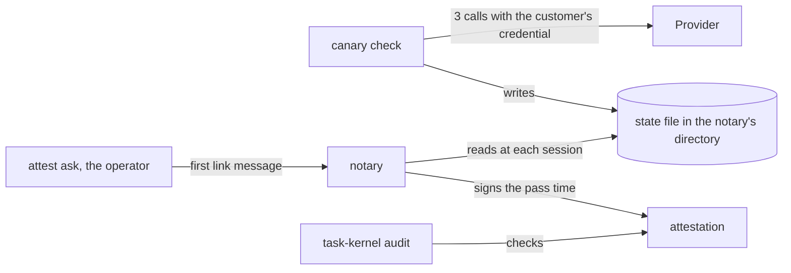
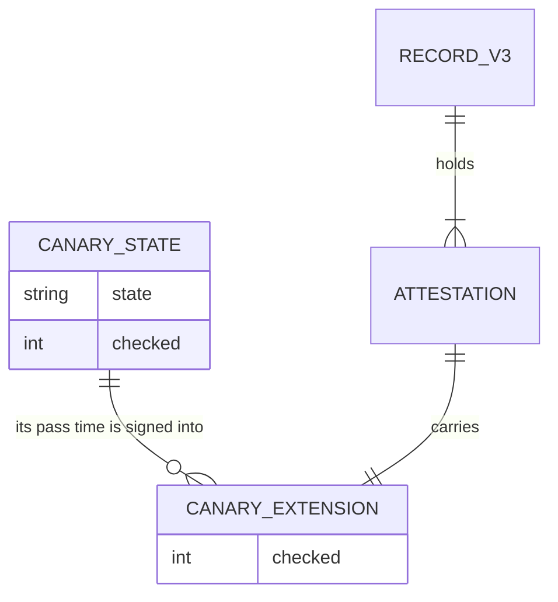
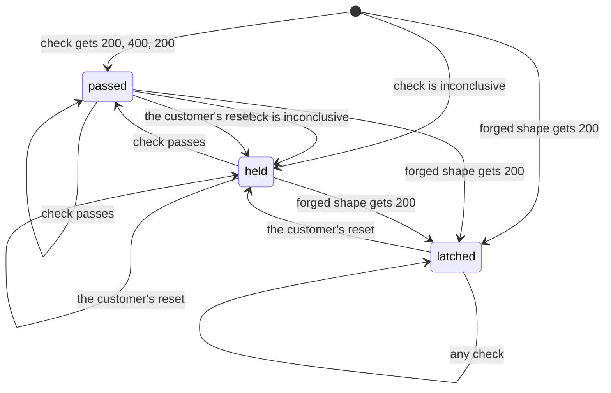
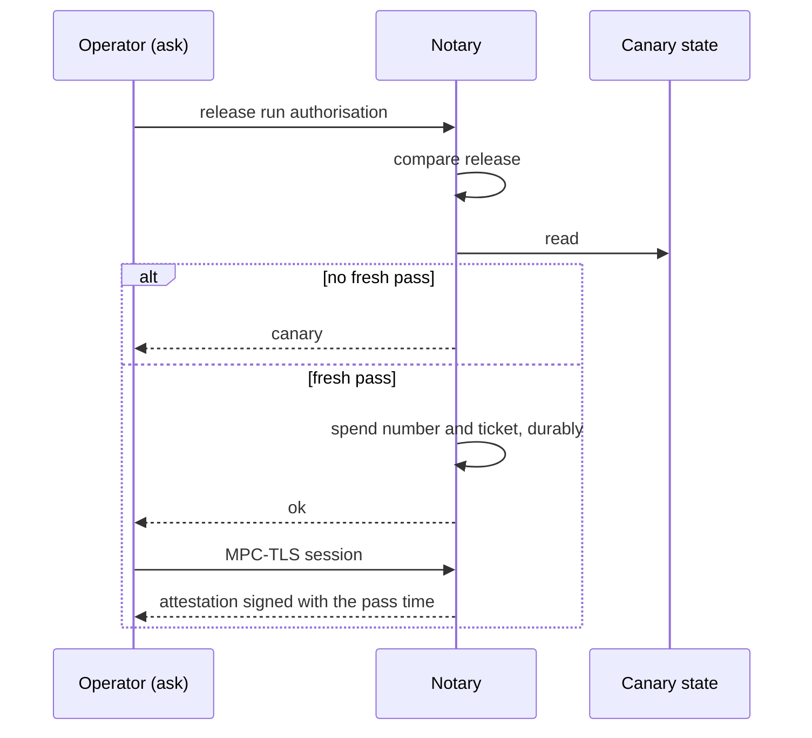

# Design

## 1. Architecture

Three parties touch the canary, and only the customer's side holds the credential.

- **`canary`** is a new binary in `attest`. It reads the credential, makes the three calls, and writes the state under a lock (ADR-002).
- **`notary`** reads the state at each session, before it spends anything, and signs the pass time. It never opens a credential.
- **`attest verify`** reads the signed extension strictly and reports it.
- **`task-kernel audit`** decides freshness from signed values alone, with no credential. Deciding it needs no network, though the audit's existing log check does.

## 2. Contracts

| Name | Inputs | Outputs | Errors | Invariants |
|---|---|---|---|---|
| `canary check --dir <d> --credential <file>` | A private credential file of the pinned shape | Case names, status codes, one verdict. Exit 0 pass, 1 accepted or latched, 2 inconclusive or refused to start | Fixed messages only | At most 3 calls, in order, each on its own connection: 3 normally, and 1 when the first control is not 200, because the check stops there. Never prints a credential or a reply body. The credential is read with `read_private` (limit 1024 bytes), and parsed by the same line rules as `credential` in `attest/src/main.rs` (first non-empty line, an optional `NAME=` prefix, surrounding quotes). That function takes no path, so this is new code. A missing file is refused. With no `HYALOS_TRUST_*` setting it must start `sk-ant-` and not `sk-ant-api`. With any such setting it must start `test-`, as the Python probe requires. A check whose existing state is unreadable or malformed is refused with exit 2 and leaves the file unchanged, because it could hide a latch. A pass's `checked` is the verdict's time, and a staged `held` or `latched` result carries the time the check started. A pass is written through `<d>/canary.new`. Refusals run in this order, all before any call: the lock, the state read (with the `read_private` rules), then the credential. Before its first call, a check durably writes `<d>/canary.init.new` and the two non-pass results it might need, `<d>/canary.held.new` and `<d>/canary.latched.new`. It refuses to start with exit 2 if it cannot. When a state file exists and the marker does not, the check renames `canary.init.new` to the marker `<d>/canary.init` durably before its first call, and refuses with exit 2 if it cannot. On a first-ever check, with neither, recording a non-pass verdict first renames it to the marker, and recording a pass does so just after the state is written, so neither a crash before the verdict nor a failed pass write leaves a marker with no state. If a first-ever check can record neither its marker nor its verdict, there is no state to remove and no pass to serve, and it exits 2 and prints that the state was not updated. A latched state is kept by every check, whatever its result, and that check exits 1. When the marker exists and the state file does not, the state was lost, so a check is refused with exit 2 and no call until the customer's reset. A non-pass verdict is then a rename over the state, which needs no new disk space. If that rename fails, the check removes the state file so no pass remains. If that fails too, it exits 2 and prints that the state was not updated and the notary must be stopped (ADR-007). The staged files are removed on exit |
| `canary status --dir <d>` | A state file | Prints `fresh` and exits 0 when the state is `passed` and `0 <= now - checked <= 86400`. Otherwise prints `not fresh` and exits 1 | None: absent, held, latched and malformed are all `not fresh` | Reads only the state file, takes no lock, and never reads a credential |
| `canary reset --dir <d>` | A state file | Writes `held`, from any state including `passed` | Refused when neither a state file nor the marker exists | The only way out of `latched`, and of a damaged or lost state file, since it is the customer's decision |
| State file `<d>/canary`, mode 600. Its strict reader is in `attest/src/lib.rs`, shared by `canary` and `notary`, and holds no credential code. The notary reads it without the lock, because the writer's rename is atomic. The write pattern is re-implemented in `attest/src/lib.rs`, because `Sequences::save` is private to the notary binary | | Lines: `hyalos.canary/1`, `state <passed, held or latched>`, `checked <unix seconds>`, `end` | Anything else reads as no pass | Replaced by write, sync, rename and directory sync. `checked` is the verdict's time for `passed` and the check's start time for a staged `held` or `latched`. Only a pass's time is ever read for freshness |
| Lock `<d>/canary.lock` | | An exclusive, non-blocking `flock`, held for a whole check or reset | A second check exits 2 with a fixed message | A check reads the latch under this lock |
| Link word `canary` | | One-word reply to the first message | | Sent before any number or ticket is spent. `release` is still compared first |
| Extension `hyalos.canary/1` | | Exactly 8 bytes: the pass's unix seconds, big-endian | More than one, or another length, is a refusal in `verify` | Signed by the notary under the same signature as the ticket |
| `verify` JSON field `canary` | | `{ "checked": <unix seconds> }` or null | | Reports what was signed and decides nothing about freshness |
| `Reason::CanaryHeld` | Ask's word `canary` | Result link `refused:CanaryHeld` | | The reason text comes from the closed set |
| Freshness | Pass time, session time | Fresh when `pass <= session` and `session - pass <= 86400`, with no tolerance | Otherwise refused | `CANARY_WINDOW_SECONDS` in `attest/src/lib.rs`, with the monitor's copy pinned by a test (ADR-005). The notary judges it twice: at open on its own clock, before spending, and at signing against the signed session time, using the pass it read at open. A session that crosses the boundary between the two gets no attestation, is logged `refused canary`, and keeps its spent number (as in the notary pack's ADR-014). So the notary never signs what the audit would refuse |
| Record version 3 | As version 2 | `version: 3`, links `v: 3` | Missing, doubled, malformed or stale canary is refused | Task identity, operator field and provider-proof slot as in version 2 |
| Report line, version 3 | Oldest pass | `provider canary: forged body refused at <YYYY-MM-DD HH:MM:SS> UTC, the oldest pass in this record, checked by the customer on this notary` | | Printed after the attempt line |
| Report limit, version 3 | | `not proven: the canary tested one forged shape, with the customer's credential, at the time stated` | | The hidden-bytes limit stays |
| Report limit, version 2 | | `not proven: this record has no provider canary` | | Version 1 output is unchanged |

## 3. Domain model

## 4. State machines

### Canary state

A forged-shape 200 latches even when the control after it fails, because the provider did accept it.

Illegal transitions:

- latched → passed: only a reset leaves a latch (ADR-004).
- Any state → passed without both controls at 200 and the forged shape at 400.

## 5. Flows

## 6. Test strategy

| Level | Proves | How | Fixtures and test data |
|---|---|---|---|
| Integration, `attest/tests/canary.rs` | The check's verdicts, latch, reset, refusals and silence | Runs `canary` against `standin` with a status sequence | A made-up credential at the pinned length |
| Integration, `attest/tests/notary.rs` or `authorise.rs` | Holding sessions, no spend, signing | Runs `notary` with written state files | The stand-in provider |
| Unit, `attest/src/lib.rs` | Strict canary extension reader | Built extensions | |
| Monitor, `kernel/src/forgery_tests.rs` | Audit refusal and report | Real attestations, with `forging-notary` for forged canaries | The existing `World` rig |
| Structural | Notary holds no credential, version 2 evidence audits, docs | `grep`, and the audit command in Verify | `out/two-machines-record` |
| Dry run | The real two-machine probe stops without a pass | Operator only, never by an executor | |

Example levels: S-01.* integration. S-02.1, S-02.2 integration. S-02.3.e1 integration, S-02.3.e2 structural. S-03.* monitor, and S-03.3.e1 runs on the committed record. S-04.1 structural. S-04.2 by a test of the script with stubbed `ssh`, never a real run.

## 7. Risks

| # | Risk or assumption | Mitigation |
|---|---|---|
| R1 | The Rust request differs from the shape measured on 2026-11-21 | The forged request copies the probe's `SMALLEST` and `APPROVED` literals verbatim, the latter holding the binding. A test compares the bytes with the literals in `hidden_header.py` |
| R2 | A provider rate limit reads as a failed check and stops runs | It holds by design (ADR-003). The check makes 3 small calls, and the customer can re-run it |
| R3 | The customer forgets the daily check | The refusal is explicit, and `RECORD.md` shows a cron line |
| R4 | The operator and customer are the same person | The notary-independence limit stays in every report |
| R5 | A 400 could come from something other than the forged shape | Both controls bracket it, as in notary ADR-011. The reply's reason is deliberately not read |
| R6 | Version 3 breaks existing test rigs that write no canary state | The shared test helper writes a pass, in the slice that makes the notary require it |
| R7 | A non-pass verdict cannot be recorded, so an earlier pass could stay on disk | Non-pass results are staged before the first call, so recording one is a rename. If the rename fails the state is removed. If the directory refuses both, the check exits 2 and tells the customer to stop the notary, and the earlier pass may be served until its 24 hours end. This is the accepted limit of ADR-007. A removed state cannot be passed over: a check that found a state makes the `canary.init` marker real before its first call, so every later check refuses until the customer's reset and a lost latch is not cleared by a pass. A first-ever check in a directory that refuses both its marker and its verdict leaves no state and no pass, and its exit 2 and message are the only record of that verdict |

## 8. Pre-mortem

| # | Failure story | Maps to |
|---|---|---|
| P1 | The notary spent a ticket before refusing, so an outage burned the customer's budget | Stop condition in the slice that holds the notary |
| P2 | An operator relabelled a version 3 record as version 2 to skip the check | Refusal of any canary below version 3, in the audit slice. ADR-011 of the `hyalos-kernel-record` pack already stops a record changing version |
| P3 | The credential leaked through an error message | S-01.3.e1, and a stop condition in the check's slice |
| P4 | A later pass silently cleared a real forgery acceptance | ADR-004, S-01.4.e1 |
| P5 | The test-only forging build's hook reached the real notary | Stop condition in the slice that adds the forged canary: the hook stays behind `forge-ticket` |
| P6 | The check passed on a stand-in setting in production | The check honours the test trust settings only as the probe does, and refuses a real-shaped credential under them (§2, the `canary check` row) |

## Modifier: security

- **Assets:** the customer's credential, the truth of the signed pass time, and the audit's verdict.
- **Entry points:** the credential file, the state file, the first link message, and the attestation's extensions.
- **Threats and mitigations:**
  - The operator fakes a pass. On a customer's machine the operator has no write access to the notary's directory and cannot sign, and the audit accepts only signed passes. This rests on the notary machine being the customer's, which is the first limit in every report. `two_machines.sh` reaches that machine over ssh because one person holds both roles in this spike, so its gate guards the run and proves no independence.
  - The operator replays an old attestation. Its pass time is checked against its own session time, and the run and sequence checks are unchanged.
  - The operator drops the canary by using an older record version. Any canary below version 3 is refused, and a version 3 record without one is refused.
  - A credential leaks. It is read through `read_private`, and errors are fixed strings. Replies are read only to their status line.
- **Not closed:** other forged shapes, the hidden API-key case, a dishonest notary machine, and a provider that treats the customer's account differently from the operator's.

## Modifier: integration

- **External contract:** `POST /v1/messages` on `api.anthropic.com`, with the same head the attest tool writes. Only the HTTP status line is read.
- **Failure modes:** connection failure, cut connection, unparseable status, or any status other than those expected. Each is inconclusive and holds.
- **Transport:** a `tokio-rustls` client using `Trust::read`'s roots, TLS 1.2 or later.
- **Timeouts and retries:** 60 seconds per call, as the probe uses, and no retries. The customer re-runs the check.
- **How tests fake it:** `standin` gains `--statuses <code,code,…>`, one status per request in connection order, then 500 after the list ends. The check reads the status from `HTTP/1.1 <code>` itself, because `answer` accepts only a 200 line. `HYALOS_TRUST_*` selects it, and a credential starting `sk-ant-` is refused under those settings. No test contacts the real provider.

## Modifier: public-api

- **Consumers:** auditors reading `RECORD.md`, the `verify` JSON, the report's text and the link's one-word replies.
- **Versioning:** record version 3, a new `hyalos.canary/1` extension, and a new attest release, because an older tool cannot read the `canary` word. The release check refuses the mismatch.
- **Deprecation:** none. Versions 1 and 2 stay readable, and new runs write only version 3.
- **Compatibility tests:** the committed version 1 and version 2 records keep replaying and auditing, with the version 2 report's one added line.
