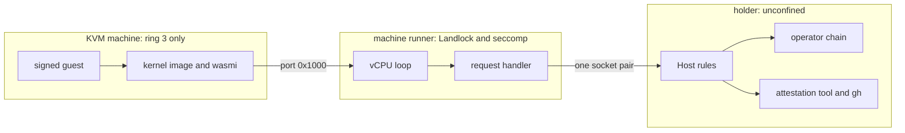
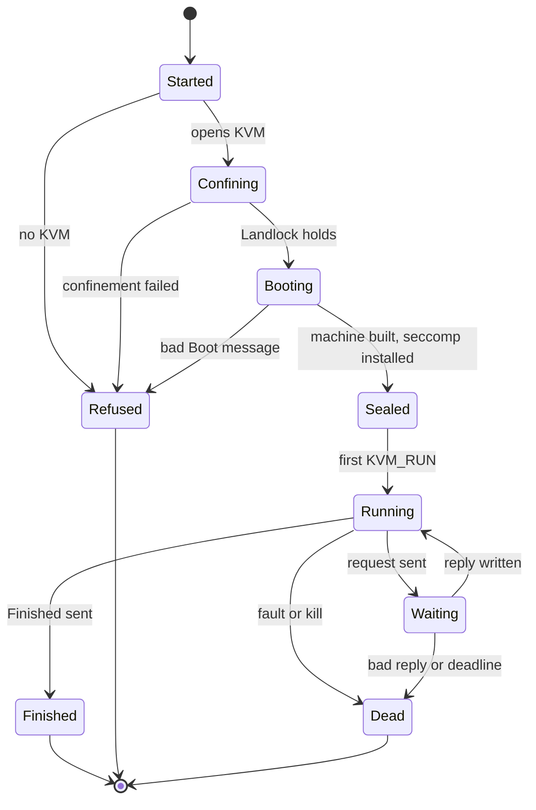
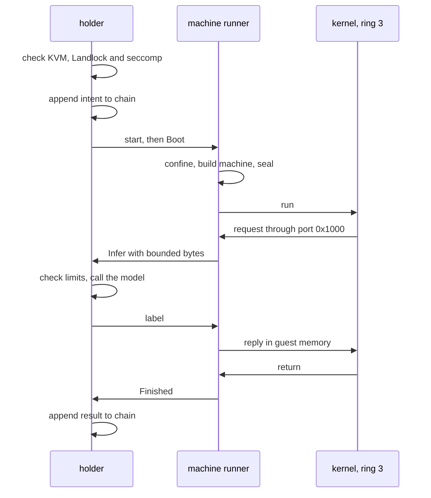

# Design

## 1. Architecture

Today one monitor process parses a hostile kernel's requests and also holds the chain and the tools that reach the model and GitHub. This pack splits it in two and takes the kernel's CPU privilege away.

| Component | Owns | Must never |
|---|---|---|
| Kernel image | The interpreter and the guest | Hold CPU privilege, or see host-identifying CPUID |
| Machine runner | KVM handles, guest memory, the first parse of each request | Open a file, use a network, start a program, or hold a credential |
| Holder | `Host`, the deadline, model calls, the effect, the chain | Trust a channel message, or run guest code on a `live` run |
| Host probe | One report on what a machine can reach | Change a run's outcome (ADR-002) |
| Review package | Scope, threats, limits, commands | Claim a review has happened (ADR-006) |

**Starting the runner.** The holder creates a Unix socket pair and re-executes its own binary with a hidden `machine-runner` command. The runner's end is its standard input, its environment is empty, and its standard output and error are null. Using the standard library's process API avoids a `fork` in a multi-threaded program and adds no `unsafe`. In unit tests, where the current program is the test harness, the path is the `task-kernel` binary beside it, as `hyalos-os/monitor/src/live_tests.rs:430` finds it. No environment variable selects it.

**Order inside the runner.** Open `/dev/kvm`, apply Landlock, read the `Boot` message, build the machine, install seccomp, then start the virtual CPU. No guest instruction runs before both confinements hold.

## 2. Contracts

### Machine start state (ADR-001)

| Item | Value | Why |
|---|---|---|
| Code segment | selector 11, DPL 3, 64-bit | Ring 3 |
| Data and stack segments | selector 19, DPL 3 | Ring 3 |
| `CR4` | `PAE` and `TSD` | Faults the time counter in ring 3 |
| `RFLAGS` | `IOPL` 3, interrupts off | Lets the existing `out` reach the monitor |
| Page entries | User bit set on every PML4, PDPT and PD entry on the path to a page the kernel may reach, and on those leaf entries. Writable, executable and NX rights unchanged | Keeps the memory protection the probes test |
| Page tables | Stay in unmapped physical pages | A ring 3 kernel cannot read or change them |
| IDT, TSS handlers | None | Any fault becomes a shutdown, reported as `KernelFault` |

### CPUID allow-list (S-03.1)

| Leaf | Exposed | Everything else |
|---|---|---|
| `0` | Highest basic leaf `1`, vendor string zeroed | Reads as zero |
| `1` | `PAE`, plus any bit KVM proves it needs for the start state (Slice 3's stop condition) | Zero, including `RDRAND` |
| `0x80000000` | Highest extended leaf `0x80000001` | Reads as zero |
| `0x80000001` | Only long mode and `NX` | Zero, including `RDTSCP` |
| `7`, brand leaves, topology, cache, hypervisor | Not exposed | Read as zero, or as the highest basic leaf's filtered data, so `RDSEED` and `RDPID` stay clear |

Tests assert the feature bits and that brand leaves hold no host data. They do not assert whether a leaf is present, since KVM may answer an out-of-range leaf with the highest basic leaf.

### Guest interface `hyalos.abi/1` (ADR-004)

| Call | Signature | Limit | Results |
|---|---|---|---|
| `read` | `(index, ptr, cap) -> len` | Record length | Length, `-1` no record, `-2` buffer too small |
| `infer` | `(schema, ptr, len) -> label` | 4,096 bytes | Schema `0` labels, or a refusal |
| `effect` | `(kind, ptr, len) -> 0` | 65,536 bytes, one per run | `0`, or a refusal |
| `return` | `(ptr, len)` | 4,096 bytes | Ends the run |

A guest exports `run` and `memory`, and imports only these, from module `hyalos`. A refusal is not a return value: it ends the run with a `Reason`. `ABI.md` lists every `Reason` that `answer` (`hyalos-os/monitor/src/kvm.rs:181`) and `Host` can produce for each call, including `BadPointer` from `read`. The profile's settings stay in `hyalos.profile/1` (verifier ADR-007).

### Runner channel `hyalos.runner/1` (ADR-003)

Each frame is a 4-byte little-endian length, a version byte, a type byte and its fields. The length counts every byte after the length field. Type bytes are `1` to `9` in the order `Boot`, Reply, `Input`, `PreInfer`, `PreEffect`, `Infer`, `Effect`, `Finished`, `Failed`. A reason is its index in a closed table in `runner.rs`, independent of the `Reason` enum's order. A frame over its direction's limit, of an unknown type, or out of turn ends the run.

| Direction | Message | Fields | Reply | Limit |
|---|---|---|---|---|
| Holder to runner | `Boot` | kernel bytes, guest bytes | First request | 8 MiB |
| Holder to runner | Reply | record, no record, limit, label, ok, or refusal reason | Next request | 16 MiB, the heap's size |
| Runner to holder | `Input` | index | Record or no record | 64 KiB + 64 bytes |
| Runner to holder | `PreInfer`, `PreEffect` | schema or kind | Limit or refusal | same |
| Runner to holder | `Infer`, `Effect` | schema or kind, bytes | Label, ok or refusal | same |
| Runner to holder | `Finished` | result, fuel | None | same |
| Runner to holder | `Failed` | closed reason value | None | same |

**Invariants.** The holder re-checks every length against `Host`'s limits, keeps the single-effect rule, and holds the deadline. The five request types and the order of their checks stay as `answer` has them, so every `Reason` a run gives today stays the same.

**Deadline.** The holder sets a read timeout to the time left. On expiry it kills the runner and returns `Reason::Timeout`, the value the timer path gives today (`hyalos-os/monitor/src/kvm.rs:282`).

**Failure mapping.** Before the chain's intent link is written, the holder runs `machine-runner --check`, a child that applies both confinements and exits. If it fails, the command is refused with no chain link, so no record changes shape. If a real runner then fails to confine, no guest has run and the run ends in `Reason::KernelFault`. A runner that dies, closes the channel or breaks the protocol after that point is `Reason::KernelFault`, an existing value. This pack adds no value to the `refused:` strings the chain stores (`hyalos-os/monitor/src/main.rs:267`).

### Seccomp allow-list (ADR-003)

| Allowed | Restriction |
|---|---|
| `ioctl` | Only `KVM_RUN` |
| `read`, `write` | Only the channel descriptor, and only as the build needs |
| `mmap`, `mprotect` | Never with execute permission |
| `munmap`, `brk`, `madvise`, `futex`, `rt_sigreturn`, `sigaltstack`, `exit`, `exit_group` | None |

Anything else kills the process with `SIGSYS`, and the holder reports `KernelFault` with no further effect. Landlock makes a file open fail without killing. The deadline moves to the holder, which kills the runner, so the 10 ms signal timer and the teardown thread leave the runner. The first confinement slice must record any further system call it finds and may add one only with a stated reason.

### Host probe (S-03.3)

| Command | Output | Exit |
|---|---|---|
| `task-kernel probe-host` | One line per instruction: `<name> blocked` or `<name> reachable`, for `RDTSC`, `RDTSCP`, `RDRAND`, `RDSEED`, `RDPID` | `0` all blocked, `1` any reachable, `2` could not test |

It uses a fresh machine per instruction with the real start state and CPUID list. Its instructions are fixed byte sequences compiled into the monitor and placed by the probe's own loader, so it accepts no image from outside and still works after Slice 8 refuses raw images. Each sequence runs one instruction and then writes to port `0x1000`. A machine that reaches the port is `reachable`, and one that shuts down first is `blocked`. A control sequence with only a `nop` must reach the port. A failed control is exit 2, never `blocked`.

### Review scope `hyalos-os/review/scope.toml` (ADR-005)

| Field | Required | Meaning |
|---|---|---|
| `name`, `version` | yes | Must equal the lockfile's. For `tlsn`, the tag and the locked commit |
| `upstream_audit` | yes | A citation, or `none found` with the date searched |
| `part` | yes | `use` for how hyalOS uses it, or `internals`. A component ADR-005 splits has one row for each |
| `position` | yes | `covered` or `excluded` |
| `reason` | yes | Non-empty |

### Line and `unsafe` checks (ADR-007)

| Check | Input | Fails when |
|---|---|---|
| `cargo xtask lines` | Rust under `hyalos-os/`, leaving out `tests/` directories, `*_tests.rs` files and everything after `#[cfg(test)]`. The `core/` counter has no file exclusions, so hyalOS gets its own function and the `core/` count stays as it is | Over 12,000 lines |
| `cargo xtask hyalos-unsafe` | Every Rust file under `hyalos-os/`, and a list in `crates/xtask` | The keyword `unsafe` followed by `{`, `fn`, `impl`, `trait`, `extern` or `(` outside a listed file, or with no `SAFETY` comment within the three lines above |
| `cargo xtask review-scope` | The scope and the three `hyalos-os` lockfiles | A listed version differs, `tlsn`'s tag or locked commit differs, a required field is missing, a `part` or `position` value is unknown, or a direct dependency of a hyalOS crate has no row. A utility crate gets an `excluded` row with its reason |
| `cargo xtask review-package` | `hyalos-os/review/README.md` | A required section is missing, the named commit is not an ancestor of `HEAD`, the sentence `not yet been independently reviewed` is missing, or any other line says the code has been reviewed |

The `unsafe` list starts with the seven files that hold a block at `63a75ec`: `guest/src/lib.rs`, `kernel-image/src/main.rs`, `monitor/src/kvm.rs`, `monitor/src/live.rs`, `attest/src/bin/notary.rs`, `attest/src/bin/canary.rs` and `attest/tests/canary.rs`. Slice 7 may add `monitor/src/runner.rs`.

## 4. State machines

### Machine runner

Illegal transitions:

- Booting → Running: a guest instruction would run before seccomp holds.
- Started → Booting: hostile bytes would arrive before Landlock holds.
- Waiting → Finished: a run cannot end with a request unanswered.
- Finished → Running: the machine is never resumed.
- Dead → Running: a failed run is never retried, since an effect may already have happened.
- Sealed → Confining: a filter is never loosened.

## 5. Flows

## 6. Test strategy

| Level | Proves | How | Fixtures and test data |
|---|---|---|---|
| unit | Frame parsing, CPUID filter, scope and budget checks | `cargo test` | Hand-built frames and scopes |
| integration | Both backends, the runner, confinement | `HYALOS_REQUIRE_KVM=1 cargo test` on a KVM host | Committed guest, `fixtures/issues.tsv` |
| hostile | A taken-over kernel or runner is stopped | Self-test kernel probes, and a test-only runner that attempts each action after sealing | `selftest` kernel feature, test-only runner build |
| differential | Dropping privilege changes no result | Transcripts compared with ones generated at the pack's base commit | Seeds `0` and `7` |
| fuzz | The handler and channel survive hostile input | `task-kernel fuzz` and a frame fuzzer, fixed seed, in CI | Fixed seed |
| structural | Rules hold in CI | `cargo xtask` checks, `cargo deny` | The lockfiles |
| dry run | The package works from clean | Follow it in a fresh clone | None |

| Example rows | Level |
|---|---|
| S-01.1.e1–e2, S-01.3.e1–e2 | integration |
| S-01.2.e1–e2 | structural |
| S-02.1.e1–e2 | differential |
| S-02.2.e1–e2, S-02.3.e1–e2, S-02.4.e1–e2 | hostile |
| S-03.1.e1–e2 | unit |
| S-03.2.e1–e2, S-03.4.e1–e2 | hostile |
| S-03.3.e1–e3 | integration, with the host result faked for e1 |
| S-04.1.e1–e2, S-04.3.e1–e2, S-04.5.e1–e2 | integration |
| S-04.2.e1–e3 | hostile |
| S-04.4.e1–e2 | unit and fuzz |
| S-05.1.e1–e2, S-05.2.e1–e2, S-05.3.e1–e2 | structural |
| S-05.4.e1–e2 | integration |
| S-05.5.e1–e2 | fuzz |
| S-06.1.e1–e2, S-06.2.e1–e2, S-06.3.e1–e2 | structural |
| S-06.4.e1–e2 | dry run |
| S-07.1.e1–e2 | structural |
| S-07.2.e1–e2, S-07.3.e1–e2 | dry run |

## 7. Risks

| # | Risk or assumption | Mitigation |
|---|---|---|
| R1 | KVM refuses the start state under the filtered CPUID list | The CPUID slice keeps the minimum bits and stops if any committed transcript changes |
| R2 | Ring 3 hides a difference the fixtures miss | Long-mode ring 3 passed on 2026-11-23 (`context.md` §2). The slice repeats it across the whole hostile list |
| R3 | `RDSEED` stays reachable on real hosts | ADR-002: report it, state it, rely on replay |
| R4 | The seccomp list breaks under another C library or kernel | It fails closed. The runner is built and tested in CI on the pinned toolchain |
| R5 | Splitting the process changes a `Reason` or slows runs | The attack list asserts each reason. The NFR limits cold start to +20% |
| R6 | The verifier pack changes the monitor while this pack is planned | Slices start after #443 and #444, and preflight checks citations by symbol |
| R7 | A taken-over kernel signals through timing it controls, such as how long it takes to answer | Out of scope for this pack, and stated in the review package's limits |
| R8 | An advisory for `tlsn` never reaches RustSec, because it is a git dependency | The scheduled check also reads the GitHub advisories of `tlsnotary/tlsn` and `wasmi-labs/wasmi` |

## 8. Pre-mortem

| # | Failure story | Maps to |
|---|---|---|
| P1 | A guest escaped the interpreter and reached the operator's key, because a `live` run had no kernel configured | S-04.5, a stop condition in the confinement slice |
| P2 | Someone added a system call to make a test pass, and the filter slowly opened up | Each addition needs a stated reason, and the review package lists the filter |
| P3 | The docs claimed "no hardware randomness", and a reviewer disproved it on the first host | ADR-002, and a stop condition in the review package slice on that wording |
| P4 | A `wasmi` update moved silently and the review covered the wrong version | S-06.2 |
| P5 | The team described the package as a completed review | ADR-006, and a required line in the package |
| P6 | A runner failure wrote a new refusal string, and the audit rejected older chains | The failure mapping in §2, and a stop condition in the runner slice |
| P7 | The test-only raw-image path shipped, so a replaced kernel file got writable, executable memory | S-05.4 |

## Modifier: security

**Assets.** The operator's chain and signing path, the model and GitHub credentials the tools reach, the integrity of a recorded result, and the host itself.

**Entry points.** Guest bytes, task inputs, the five kernel requests, channel frames, the kernel image file, and the environment variables that select test behaviour.

| Threat | Mitigation | Criterion |
|---|---|---|
| Guest exploits `wasmi` and takes over the kernel | Ring 3, read-only code, NX data, no clock | S-02 |
| Taken-over kernel rewrites its page tables | Ring 3, tables unmapped | S-02.3 |
| Taken-over kernel gathers host identity or randomness | CPUID allow-list, probe, replay | S-03 |
| Hostile request exploits the handler | Bounds checks, fuzzing, confined runner | S-04.2, S-05.5 |
| Compromised runner lies to the holder | Holder re-checks all limits and rules | S-04.4 |
| Compromised runner attacks the host | Landlock, seccomp, empty environment | S-04.2 |
| `live` run executes a guest unconfined | `live` with a real repository requires KVM | S-04.5 |
| Test switches weaken a release build | Compiled out or refused | S-05.4 |

**Limits to state in the package.** KVM and the host kernel are trusted. Side channels are out of scope. `RDSEED` may be reachable (ADR-002). TLSNotary's protocol and cryptography are excluded (ADR-005), as are the internals of `rustls`, `ring` and `rcgen` (ADR-008). `attest`'s `forge-ticket` and `canary-test-hooks` features are test-only and off by default. No `auditor` findings are linked, since none have been run on this code.

## Modifier: public-api

**Consumers.** Guests, the capsules pack, the Python guest spike (#438) and the verifier's replay.

**Versioning.** `hyalos.abi/1` names the guest interface. Any change to a name, signature, limit or error value needs a new version and an ADR. `hyalos.runner/1` is internal and carries its own version byte.

**Deprecation.** None in this pack. A later interface version must keep running records made under version 1, and must state when version 1 stops being accepted for new runs.

**Compatibility tests.** The conformance suite runs on both backends. The committed guests' transcripts are compared with the base commit. Existing records still audit and replay unchanged.

## Modifier: infra

**Environments.** Local KVM hosts, and CI's `hyalos-os` job on a runner with `/dev/kvm`.

**CI changes.** Install `x86_64-unknown-none` and `wasm32-unknown-unknown` on the pinned toolchain, build the kernel image and guest, and add `fmt`, `clippy`, the `xtask` checks and the fuzzers. A daily scheduled job runs the advisory check.

**Flags.** The monitor's `test-switches` Cargo feature is off by default, added in Slice 7. It enables the hostile runner, and from Slice 8 the `attacks` command's hostile kernels, `HYALOS_SELFTEST_KERNEL`, `HYALOS_TRACE`, `HYALOS_HUGE` and raw kernel images. CI runs the workspace tests with it beside the existing `test-trust` features (`.github/workflows/ci.yml:248`), then runs the `release_switches` test without it. The kernel image's `selftest` feature stays test-only.

**Rollout order.** Interface, then ring 3, then CPUID and probe, then the runner, then confinement, then the reviewability rules, then scope and package.

**Rollback.** Each slice is one revertible pull request. No slice changes a stored format, so a revert leaves every record valid. Reverting the runner split also reverts its confinement, and that revert needs the same review as the change.

## Modifier: integration

| External | Contract | Failure mode | Timeout and retry | How tests fake it |
|---|---|---|---|---|
| KVM | `/dev/kvm` ioctls through `kvm-ioctls` | Absent, or refuses the state: the run is refused | Holder's run deadline, no retry | A required-KVM CI variable. Skips are named |
| Landlock, seccomp | Linux kernel interfaces | Unavailable: refused before the chain is touched | None | An injected unavailable result in the holder's check |
| Advisory matching | An advisory fails the job when it names the repository or crate and its affected range includes the pinned tag or version | A feed that cannot be parsed fails the job | Same as its source | A saved response |
| RustSec | `cargo deny` advisory database | Unreachable: the job fails, never passes | CI default, one daily run | A fixture lockfile with a known advisory |
| GitHub advisories | Published advisories of `tlsnotary/tlsn` and `wasmi-labs/wasmi`, read through the GitHub REST API with the workflow token. A pinned tag is compared as a version after dropping its `v` | Unreadable: the job fails | 30-second limit, one retry | A saved response |
| TLSNotary | Pinned tag `v0.1.0-beta.1` | A move needs ADR-005's evidence | Not applicable | The existing forgery corpus |
