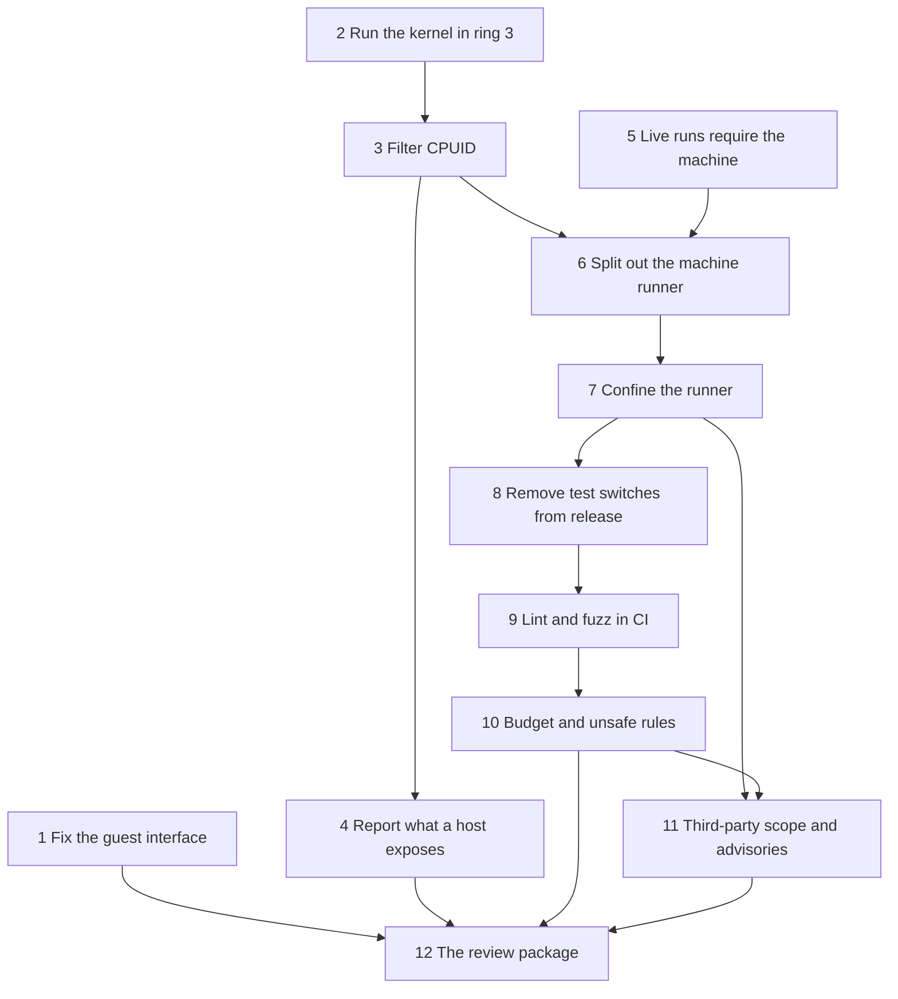

# Plan

## Dependency graph



Slices 9 and 12 also wait for the verifier's last slice (#449). Slice 9 reformats the monitor, and Slice 12 describes the finished verifier. Slices 1 and 2 may run in parallel, and so may Slices 4 and 5. Slices 10 and 11 both edit `crates/xtask/src/main.rs`, so Slice 11 depends on Slice 10.

## Traceability

| Criterion | Slices |
|---|---|
| S-01.1, S-01.2, S-01.3 | 1 |
| S-02.1, S-02.2, S-02.3, S-02.4 | 2 |
| S-03.1, S-03.2 | 3 |
| S-03.3, S-03.4 | 4 |
| S-04.5 | 5 |
| S-04.1, S-04.4 | 6 |
| S-04.2, S-04.3 | 7 |
| S-05.4 | 8 |
| S-05.3, S-05.5 | 9 |
| S-05.1, S-05.2 | 10 |
| S-06.1, S-06.2, S-06.3, S-06.4 | 11 |
| S-07.1, S-07.2, S-07.3 | 12 |

Example rows (S-NN.k.eN) follow their criterion's slices.

## Shared contract

| Rule | Applies to |
|---|---|
| A test proving a criterion is named `core_s_NN_k_...`, or `core_s_NN_k_eM_...` for an example, so the filters below select only this pack's tests | Every slice |
| KVM tests use the gate in `hyalos-os/monitor/src/profile_tests.rs:65`. With `HYALOS_REQUIRE_KVM` set, a missing KVM fails the test | Every KVM test |
| No slice changes a stored record, a `refused:` string (`hyalos-os/monitor/src/main.rs:267`) or `hyalos.profile/1` | Every slice |
| A base transcript is one generated from the commit the slice branch is cut from, with the Slice 2 commands, for `hyalos-os/guest/digest.wasm` (the only committed guest) on seeds `0` and `7`, and kept outside the repository | Slices 2, 3, 6, 7, 9 |

---

## Slice 1 — Fix the guest interface

Issue: #457 · Depends on: none · Stories: S-01 · Map: Fix the interface

### Outcome

The guest interface is named `hyalos.abi/1`, and one suite holds both backends to it, so a silent change fails CI.

### Acceptance

- **S-01.1**
- **S-01.2**
- **S-01.3**
- **1.1** `hyalos-os/ABI.md` names `hyalos.abi/1` and states every call, limit and error value in `design.md` §2.

### Contracts

`design.md` §2, **Guest interface `hyalos.abi/1`**. ADR-004: the record does not carry this name.

### Stop conditions

- Stop if a contract this slice depends on has drifted from `context.md` (preflight).
- Stop if the two backends disagree on any call's result. That is a real defect, and the fix may change the interface.
- Stop if making the suite pass would change a committed guest's transcript.

### Verify

```bash
HYALOS_REQUIRE_KVM=1 cargo test --release --locked --manifest-path hyalos-os/Cargo.toml --workspace --features task-kernel/test-trust,hyalos-audit/test-trust core_s_01
HYALOS_REQUIRE_KVM=1 cargo test --release --locked --manifest-path hyalos-os/Cargo.toml --workspace --features task-kernel/test-trust,hyalos-audit/test-trust
git grep -n 'hyalos.abi/1' -- hyalos-os/ABI.md
```

Expected: both test runs pass with none skipped, and the first runs at least one test per example row of S-01. The `git grep` prints at least one line.

Dry run: temporarily raise the `infer` limit, see `core_s_01_2_e2` fail, and revert (S-01.2).

### Pattern to follow

- Backend comparison: `hyalos-os/monitor/src/profile_tests.rs:65`
- The attack list's expected reasons: `hostile_kernels` at `hyalos-os/monitor/src/main.rs:150`

### Suggested path

Default route. You may deviate if every mandatory item still holds; record why.

1. Add the interface name to `ABI.md`, and a constant in the monitor and in the kernel image, which is a separate workspace. A test asserts both equal the name in `ABI.md`.
2. Write small test guests that exercise each call and each refusal.
3. Run them on both backends and compare transcripts.

### Files

- Create: `hyalos-os/monitor/src/abi_tests.rs`
- Modify: `hyalos-os/ABI.md`, `hyalos-os/monitor/src/main.rs`

---

## Slice 2 — Run the kernel in ring 3

Issue: #458 · Depends on: none · Stories: S-02 · Map: Remove privilege

### Outcome

The kernel runs in 64-bit ring 3, so a taken-over kernel loses the time counter and its privileged instructions, with every transcript unchanged.

### Acceptance

- **S-02.1**
- **S-02.2**
- **S-02.3**
- **S-02.4**
- **2.1** The KVM backend's median cold start is within 20% of the base commit's: boot to first call as `HYALOS_TRACE` reports it, in a release build over 21 runs on one host.

### Contracts

`design.md` §2, **Machine start state**. ADR-001.

### Stop conditions

- Stop if a contract this slice depends on has drifted from `context.md` (preflight).
- Stop if any committed guest's transcript differs from its base transcript.
- Stop if a probe in S-02.2 or S-02.3 does not end in `KernelFault`.
- Stop if the kernel image needs a ring 0 stub or a fault handler. ADR-001 rules them out.

### Verify

```bash
(cd hyalos-os/kernel-image && cargo build --release --locked)
cargo build --release --locked --manifest-path hyalos-os/Cargo.toml -p task-kernel
HYALOS_KERNEL=hyalos-os/kernel-image/target/x86_64-unknown-none/release/hyalos-kernel hyalos-os/target/release/task-kernel run hyalos-os/guest/digest.wasm hyalos-os/evidence/fixtures/issues.tsv /tmp/core-seed-7.json 7
HYALOS_REQUIRE_KVM=1 cargo test --release --locked --manifest-path hyalos-os/Cargo.toml --workspace --features task-kernel/test-trust,hyalos-audit/test-trust core_s_02
HYALOS_REQUIRE_KVM=1 cargo test --release --locked --manifest-path hyalos-os/Cargo.toml --workspace --features task-kernel/test-trust,hyalos-audit/test-trust
```

Expected: the `run` prints `ok: 40 inputs, 40 inferences, 1 effect, fuel 30886`, and its transcript is byte-identical to the base commit's for seeds `0` and `7`. All tests pass with none skipped.

Dry runs: the differential comparison on seeds `0` and `7` (S-02.1), and the `attacks` command with the self-test kernel, with every line `PASS` (S-02.4).

### Pattern to follow

- Start state: `hyalos-os/monitor/src/kvm.rs:268`
- Page tables: `hyalos-os/monitor/src/kvm.rs:144`
- Probes: `hyalos-os/kernel-image/src/main.rs:261`

### Suggested path

Default route. You may deviate if every mandatory item still holds; record why.

1. Record base transcripts and the cold-start median.
2. Set the User bit, ring 3 segments, `CR4.TSD` and `IOPL` 3.
3. Add self-test probes for each instruction in S-02.2 and S-02.3.

### Files

- Modify: `hyalos-os/monitor/src/kvm.rs`, `hyalos-os/monitor/src/main.rs`, `hyalos-os/kernel-image/src/main.rs`

---

## Slice 3 — Filter CPUID

Issue: #459 · Depends on: Slice 2 · Stories: S-03 · Map: Close randomness

### Outcome

The machine sees only an allowed CPUID list, so `RDRAND` and `RDPID` fault and the host's identity is hidden.

### Acceptance

- **S-03.1**
- **S-03.2**

### Contracts

`design.md` §2, **CPUID allow-list**.

### Stop conditions

- Stop if a contract this slice depends on has drifted from `context.md` (preflight).
- Stop if KVM refuses the start state and the bit it needs is not `PAE` in leaf `1`, or long mode or `NX` in leaf `0x80000001`. Record the bit and ask.
- Stop if any committed guest's transcript differs from its base transcript.

### Verify

```bash
HYALOS_REQUIRE_KVM=1 cargo test --release --locked --manifest-path hyalos-os/Cargo.toml --workspace --features task-kernel/test-trust,hyalos-audit/test-trust core_s_03
HYALOS_REQUIRE_KVM=1 cargo test --release --locked --manifest-path hyalos-os/Cargo.toml --workspace --features task-kernel/test-trust,hyalos-audit/test-trust
```

Expected: all pass with none skipped.

Dry run: repeat the Slice 2 differential on seeds `0` and `7`, with byte-identical transcripts.

### Pattern to follow

- Current CPUID setup: `hyalos-os/monitor/src/kvm.rs:263`

### Suggested path

Default route. You may deviate if every mandatory item still holds; record why.

1. Build the list from `design.md` as a pure function with unit tests.
2. Set it on the virtual CPU.
3. Add `RDRAND` and `RDPID` probes.

### Files

- Modify: `hyalos-os/monitor/src/kvm.rs`, `hyalos-os/kernel-image/src/main.rs`

---

## Slice 4 — Report what a host exposes

Issue: #460 · Depends on: Slice 3 · Stories: S-03 · Map: Close randomness

### Outcome

An operator can run one command to see which time and randomness instructions their host leaves reachable, and replay still refuses a result that randomness changed.

### Acceptance

- **S-03.3**
- **S-03.4**
- **4.1** `hyalos-os/RECORD.md` states that `RDSEED` may stay reachable, and never says a taken-over kernel has no hardware randomness on every host.

### Contracts

`design.md` §2, **Host probe**. ADR-002: a reachable `RDSEED` is reported and does not refuse a run.

### Stop conditions

- Stop if a contract this slice depends on has drifted from `context.md` (preflight).
- Stop if the probe's control case fails and the probe would still print `blocked`.
- Stop if a kernel varying a request with `RDSEED` passes replay.

### Verify

```bash
HYALOS_REQUIRE_KVM=1 cargo test --release --locked --manifest-path hyalos-os/Cargo.toml --workspace --features task-kernel/test-trust,hyalos-audit/test-trust core_s_03_3
HYALOS_REQUIRE_KVM=1 cargo test --release --locked --manifest-path hyalos-os/Cargo.toml --workspace --features task-kernel/test-trust,hyalos-audit/test-trust core_s_03_4
cargo run --release --locked --manifest-path hyalos-os/Cargo.toml -p task-kernel -- probe-host
```

Expected: tests pass, building their own self-test kernel as `hyalos-os/monitor/src/profile_tests.rs:51` does. The probe prints five lines and exits `0` when all are blocked or `1` when any is reachable. Exit `2` means it could not test, and fails this Verify on a KVM host. The earlier `RDSEED` result was measured only in 32-bit mode, so if the probe prints `RDSEED blocked` on the development host, record a deviation and keep the probe's result.

Dry run: run the probe without access to `/dev/kvm`, and see exit `2` and the cause (S-03.3.e3).

### Pattern to follow

- One machine per case: `hyalos-os/monitor/src/main.rs:192–197`
- Replay: `hyalos-os/monitor/src/main.rs:105`

### Suggested path

Default route. You may deviate if every mandatory item still holds; record why.

1. Add the command, using the real start state and CPUID list.
2. Add a self-test kernel that uses `RDSEED` to vary a question.
3. Document the limit.

### Files

- Modify: `hyalos-os/monitor/src/main.rs`, `hyalos-os/monitor/src/kvm.rs`, `hyalos-os/kernel-image/src/main.rs`, `hyalos-os/RECORD.md`

---

## Slice 5 — Live runs require the machine

Issue: #461 · Depends on: none · Stories: S-04 · Map: Confine the monitor

### Outcome

A `live` run against a real repository can no longer execute its guest in the monitor's own process.

### Acceptance

- **S-04.5**

### Contracts

A real repository is any repository argument other than `stub` (`hyalos-os/monitor/src/main.rs:362`). The refusal is a command error in the `live` arm, right after `load_backend` (`hyalos-os/monitor/src/main.rs:352`) and before `record_is_fresh` and the ledger opens. It names `HYALOS_KERNEL`, and writes no chain link and no `refused:` string. `declared_run` is unchanged, so the tests that call it directly with the process backend (`hyalos-os/monitor/src/live_tests.rs:152`, `:321`) keep running.

### Stop conditions

- Stop if a contract this slice depends on has drifted from `context.md` (preflight).
- Stop if a committed procedure or test runs the `live` command against a real repository on the process backend.

### Verify

```bash
cargo test --release --locked --manifest-path hyalos-os/Cargo.toml --workspace --features task-kernel/test-trust,hyalos-audit/test-trust core_s_04_5
HYALOS_REQUIRE_KVM=1 cargo test --release --locked --manifest-path hyalos-os/Cargo.toml --workspace --features task-kernel/test-trust,hyalos-audit/test-trust
```

Expected: all pass with none skipped.

Dry run: with `HYALOS_KERNEL` unset, a `live` run on a real repository name exits non-zero and the ledger directory is unchanged (S-04.5.e1).

### Pattern to follow

- Backend selection: `hyalos-os/monitor/src/main.rs:327`
- The `live` command: `hyalos-os/monitor/src/main.rs:351`

### Suggested path

Default route. You may deviate if every mandatory item still holds; record why.

1. Check the backend in the `live` arm, as the contract says, and test both example rows through the built binary.
2. Keep `stub` working on either backend.

### Files

- Modify: `hyalos-os/monitor/src/main.rs`, `hyalos-os/monitor/src/live_tests.rs`

---

## Slice 6 — Split out the machine runner

Issue: #462 · Depends on: Slice 3, Slice 5 · Stories: S-04 · Map: Confine the monitor

### Outcome

Every KVM run executes in a separate runner process that holds no credential and speaks to the holder over one bounded channel, with every result and refusal reason unchanged.

### Acceptance

- **S-04.1**
- **S-04.4**
- **6.1** Every line of the `attacks` command's output is unchanged from the previous commit's.

### Contracts

`design.md` §2, **Runner channel `hyalos.runner/1`**, including its failure mapping. `design.md` §4, **Machine runner**.

### Stop conditions

- Stop if a contract this slice depends on has drifted from `context.md` (preflight).
- Stop if a runner failure would need a new value in the chain's `refused:` strings.
- Stop if any `Reason` an attack produces changes.
- Stop if the median cold start is over 20% above the Slice 2 baseline.

### Verify

```bash
HYALOS_REQUIRE_KVM=1 cargo test --release --locked --manifest-path hyalos-os/Cargo.toml --workspace --features task-kernel/test-trust,hyalos-audit/test-trust core_s_04_1
HYALOS_REQUIRE_KVM=1 cargo test --release --locked --manifest-path hyalos-os/Cargo.toml --workspace --features task-kernel/test-trust,hyalos-audit/test-trust core_s_04_4
HYALOS_REQUIRE_KVM=1 cargo test --release --locked --manifest-path hyalos-os/Cargo.toml --workspace --features task-kernel/test-trust,hyalos-audit/test-trust
```

Expected: all pass with none skipped.

Dry runs: repeat the Slice 2 differential. Kill the runner mid-run and see a refusal with no effect (S-04.1.e2).

### Pattern to follow

- Request handling to keep: `hyalos-os/monitor/src/kvm.rs:181`
- The host rules: `Host` in `hyalos-os/audit/src/replay.rs:94`, used by the monitor

### Suggested path

Default route. You may deviate if every mandatory item still holds; record why.

1. Define frames and parse them, with unit tests.
2. Add the hidden `machine-runner` command.
3. Move the vCPU loop into it and let the holder own `Host` and the deadline.

### Files

- Create: `hyalos-os/monitor/src/runner.rs`, `hyalos-os/monitor/src/runner_tests.rs`
- Modify: `hyalos-os/monitor/src/kvm.rs`, `hyalos-os/monitor/src/main.rs`

---

## Slice 7 — Confine the runner

Issue: #463 · Depends on: Slice 6 · Stories: S-04 · Map: Confine the monitor

### Outcome

Code that takes over the runner cannot open a file, use a socket, start a program or signal another process, and a host that cannot enforce this refuses the run.

### Acceptance

- **S-04.2**
- **S-04.3**
- **7.1** A repository ADR records the confinement, and `docs/adr/README.md` lists it.

### Contracts

`design.md` §2, **Seccomp allow-list** and **Failure mapping**. The order in `design.md` §1, **Order inside the runner**. ADR-003. Dependencies: `landlock` `=0.4.4`, the version `core/hyalos/Cargo.toml:43` uses, and `seccompiler` `=0.5.0` with its JSON feature off. This slice adds the off-by-default `test-switches` feature (`design.md`, **Modifier: infra**) and gates the hostile runner with it.

### Stop conditions

- Stop if a contract this slice depends on has drifted from `context.md` (preflight).
- Stop if a system call is needed that lets the runner reach a file, network, process or executable memory.
- Stop if any guest instruction can run before both confinements hold.
- Stop if a run could fall back to an unconfined runner.

### Verify

```bash
HYALOS_REQUIRE_KVM=1 HYALOS_REQUIRE_LANDLOCK=1 cargo test --release --locked --manifest-path hyalos-os/Cargo.toml --workspace --features task-kernel/test-trust,hyalos-audit/test-trust,task-kernel/test-switches core_s_04_2
HYALOS_REQUIRE_KVM=1 HYALOS_REQUIRE_LANDLOCK=1 cargo test --release --locked --manifest-path hyalos-os/Cargo.toml --workspace --features task-kernel/test-trust,hyalos-audit/test-trust,task-kernel/test-switches core_s_04_3
HYALOS_REQUIRE_KVM=1 cargo test --release --locked --manifest-path hyalos-os/Cargo.toml --workspace --features task-kernel/test-trust,hyalos-audit/test-trust
cargo deny --manifest-path hyalos-os/Cargo.toml check --config hyalos-os/deny.toml
```

Expected: all pass with none skipped, and `deny` accepts `seccompiler` with only `libc` as its dependency. A forbidden system call shows as a runner killed by `SIGSYS` and a holder result of `KernelFault`.

Dry run: repeat the Slice 2 differential under confinement.

### Pattern to follow

- Landlock that fails closed: `core/hyalos/src/confine.rs:67`
- The no-confinement refusal: `docs/adr/0121-no-broker-runs-without-landlock.md`

### Suggested path

Default route. You may deviate if every mandatory item still holds; record why.

1. Apply Landlock, then seccomp, at the points the design names.
2. Add a test-only runner that attempts each forbidden action after sealing.
3. Check availability in the holder before the chain is touched.

### Files

- Create: `docs/adr/0131-the-hyalos-machine-runner-is-confined.md` (use the next free number)
- Modify: `hyalos-os/monitor/src/runner.rs`, `hyalos-os/monitor/src/main.rs`, `hyalos-os/monitor/Cargo.toml`, `hyalos-os/Cargo.lock`, `hyalos-os/deny.toml`, `docs/adr/README.md`, `.github/workflows/ci.yml` (sets `HYALOS_REQUIRE_LANDLOCK` on the `hyalos-os` job)

---

## Slice 8 — Remove test switches from release

Issue: #464 · Depends on: Slice 7 · Stories: S-05 · Map: Make it reviewable

### Outcome

No environment variable or raw kernel image can change how a release build of the monitor behaves.

### Acceptance

- **S-05.4**

### Contracts

| Input | Default build | With `test-switches` |
|---|---|---|
| The `attacks` command | Exits non-zero, naming the `test-switches` feature, and reads no kernel file | Runs the hostile list |
| `HYALOS_SELFTEST_KERNEL` | Not read | Selects the self-test kernel |
| `HYALOS_TRACE`, `HYALOS_HUGE` | Not read | Unchanged |
| Raw, non-ELF kernel image from a file | Refused with `KernelFault` | Accepted, for the hostile-kernel tests |
| The host probe's built-in sequences | Unchanged: they never pass through the image loader | Unchanged |

### Stop conditions

- Stop if a contract this slice depends on has drifted from `context.md` (preflight).
- Stop if a hostile-kernel test can no longer run in CI.

### Verify

```bash
cargo test --release --locked --manifest-path hyalos-os/Cargo.toml -p task-kernel --test release_switches core_s_05_4
HYALOS_REQUIRE_KVM=1 cargo test --release --locked --manifest-path hyalos-os/Cargo.toml --workspace --features task-kernel/test-trust,hyalos-audit/test-trust,task-kernel/test-switches
git grep -n 'HYALOS_SELFTEST_KERNEL\|HYALOS_TRACE\|HYALOS_HUGE' -- hyalos-os/monitor/src
```

Expected: tests pass with none skipped. `release_switches` runs without the feature, against the default binary. Each `git grep` line sits in code compiled only with `test-switches`.

Dry run: build the release binary, set each switch and confirm it has no effect (S-05.4.e1).

### Pattern to follow

- The kernel feature gate: `hyalos-os/kernel-image/Cargo.toml:14`
- Raw image handling: `hyalos-os/monitor/src/kvm.rs:112`

### Suggested path

Default route. You may deviate if every mandatory item still holds; record why.

1. Put the remaining switches, the hostile list and the raw-image path behind `test-switches`.
2. Add `monitor/tests/release_switches.rs`, and change CI's test step to run with the feature and then run it without.

### Files

- Create: `hyalos-os/monitor/tests/release_switches.rs`
- Modify: `hyalos-os/monitor/src/kvm.rs`, `hyalos-os/monitor/src/main.rs`, `hyalos-os/monitor/Cargo.toml`, `.github/workflows/ci.yml`

---

## Slice 9 — Lint and fuzz in CI

Issue: #465 · Depends on: Slice 8 · Stories: S-05 · Map: Make it reviewable

### Outcome

CI holds every hyalOS crate to `fmt` and `clippy`, and fuzzes the request handler and channel on a fixed seed.

### Acceptance

- **S-05.3**
- **S-05.5**
- **9.1** The formatting commit changes no behaviour, and the Slice 2 differential still passes.

### Contracts

CI's `hyalos-os` job gains the checks in `design.md`, **Modifier: infra**.

| Fuzzer | Created by | Seed | Rounds |
|---|---|---|---|
| Request handler: `task-kernel fuzz` | Exists (`hyalos-os/monitor/src/kvm.rs:329`) | The fixed seed in that function | 100,000 |
| Channel frames: test `core_s_05_5_frame_fuzzer` | This slice | A fixed constant in the test | 100,000 frames |

`hyalos-os/Cargo.toml`, `hyalos-os/kernel-image/Cargo.toml` and `hyalos-os/guest/Cargo.toml` each gain `[workspace.lints]` with clippy `all` at warn and `unsafe_code = "deny"`, not `forbid`, because a file-level allow cannot override `forbid`. The last two are separate workspaces, so each needs its own table. Each file on the `unsafe` list (`design.md` §2) carries a file-level allow.

### Stop conditions

- Stop if a contract this slice depends on has drifted from `context.md` (preflight).
- Stop if #449 is still open. Reformatting the monitor would conflict with the verifier's remaining slices.
- Stop if a clippy fix would change a stored format or a refusal reason.

### Verify

```bash
cargo fmt --manifest-path hyalos-os/Cargo.toml --all --check
cargo clippy --manifest-path hyalos-os/Cargo.toml --workspace --all-targets --features task-kernel/test-trust,hyalos-audit/test-trust,task-kernel/test-switches --locked -- -D warnings
cargo clippy --manifest-path hyalos-os/Cargo.toml -p attest --features forge-ticket --bin forging-notary --locked -- -D warnings
(cd hyalos-os/kernel-image && cargo fmt --check && cargo clippy --release --locked -- -D warnings)
(cd hyalos-os/guest && cargo fmt --check && cargo clippy --release --locked --target wasm32-unknown-unknown -- -D warnings)
cargo run --release --locked --manifest-path hyalos-os/Cargo.toml -p task-kernel -- fuzz hyalos-os/evidence/fixtures/issues.tsv 100000
HYALOS_REQUIRE_KVM=1 cargo test --release --locked --manifest-path hyalos-os/Cargo.toml --workspace --features task-kernel/test-trust,hyalos-audit/test-trust,task-kernel/test-switches
```

Expected: every command exits 0, and `fuzz` ends with `no crash`.

Dry runs: repeat the Slice 2 differential on seeds `0` and `7` (9.1). Push one temporary clippy warning and one temporary handler panic to the pull request, see CI fail, and remove them (S-05.3.e2, S-05.5.e2).

### Pattern to follow

- The handler fuzzer: `hyalos-os/monitor/src/kvm.rs:329`
- Lint tables: the root's at `Cargo.toml:14`, using `deny` instead of its `forbid`, because a file-level allow cannot override `forbid`. Leave the existing crate-level `forbid` in `profile`, `audit` and `verify`

### Suggested path

Default route. You may deviate if every mandatory item still holds; record why.

1. Make one format-only commit.
2. Fix lints in separate commits by crate.
3. Write the frame fuzzer, then add the checks and both fuzzers to CI.

### Files

- Modify: every Rust file under `hyalos-os/` that needs it, `hyalos-os/Cargo.toml`, `.github/workflows/ci.yml`

---

## Slice 10 — Budget and unsafe rules

Issue: #466 · Depends on: Slice 9 · Stories: S-05 · Map: Make it reviewable

### Outcome

CI fails when hyalOS's own code passes 12,000 lines, or when `unsafe` appears outside a named file or without a `SAFETY` comment.

### Acceptance

- **S-05.1**
- **S-05.2**
- **10.1** A repository ADR records the budget, and `docs/adr/README.md` lists it.

### Contracts

`design.md` §2, **Line and `unsafe` checks**. ADR-007.

### Stop conditions

- Stop if a contract this slice depends on has drifted from `context.md` (preflight).
- Stop if hyalOS's own code is already over 12,000 lines. Raising the budget takes a new ADR.
- Stop if the root trusted-core count changes.

### Verify

```bash
cargo xtask lines
cargo xtask hyalos-unsafe
cargo test --locked -p xtask core_s_05
```

Expected: `lines` reports the `core/` count unchanged and a hyalOS count at most 12,000. Every command exits 0.

Dry run: add an `unsafe` block in an unlisted file and see the check fail (S-05.2.e2).

### Pattern to follow

- Line counting: `crates/xtask/src/main.rs:349`

### Suggested path

Default route. You may deviate if every mandatory item still holds; record why.

1. Add a hyalOS counter that uses `count_rust`'s line rules and the file exclusions in `design.md` §2.
2. Add the `unsafe` list and check.
3. Add `SAFETY` comments where they are missing.

### Files

- Create: a repository ADR with the next free number
- Modify: `crates/xtask/src/main.rs`, `.github/workflows/ci.yml`, `docs/adr/README.md`, listed files under `hyalos-os/`

---

## Slice 11 — Third-party scope and advisories

Issue: #467 · Depends on: Slice 7, Slice 10 · Stories: S-06 · Map: Scope third parties

### Outcome

Every third-party component the claim depends on has a stated review position tied to the lockfile, and an upstream advisory fails a daily check.

### Acceptance

- **S-06.1**
- **S-06.2**
- **S-06.3**
- **S-06.4**
- **11.1** The written pin policy matches ADR-005.

### Contracts

`design.md` §2, **Review scope**. `design.md`, **Modifier: integration**. ADR-005 and ADR-008.

### Stop conditions

- Stop if a contract this slice depends on has drifted from `context.md` (preflight).
- Stop if a cryptographic crate the verifier relies on cannot be given a position under ADR-005 or ADR-008.
- Stop if an advisory source that cannot be read would let the check pass.
- Stop if the check finds a live advisory against a pinned crate. Report it rather than ignoring it.

### Verify

```bash
cargo xtask review-scope
cargo test --locked -p xtask core_s_06
cargo deny --manifest-path hyalos-os/Cargo.toml check advisories --config hyalos-os/deny.toml
```

Expected: every command exits 0.

Dry runs: change a pinned version in a scratch copy of the lockfile and see `review-scope` fail (S-06.2.e2). Apply the pin policy to a hypothetical release that changes the presentation format (S-06.4.e2).

### Pattern to follow

- Dependency policy: `hyalos-os/deny.toml`
- Workflow check: the `hyalos-os` job in `.github/workflows/ci.yml:218`

### Suggested path

Default route. You may deviate if every mandatory item still holds; record why.

1. Write the scope from the lockfiles, with one row per part for `wasmi`, the KVM crates, `landlock`, `seccompiler`, `tlsn`, and each signature, hash or TLS crate `attest` or the verifier uses directly.
2. Add the check.
3. Add `review-scope` to CI's `hyalos-os` job, and a daily job with manual dispatch and read-only permissions, covering RustSec and both GitHub advisory feeds.
4. Write the pin policy.

### Files

- Create: `hyalos-os/review/scope.toml`, `hyalos-os/review/pin-policy.md`, `.github/workflows/hyalos-advisories.yml`
- Modify: `crates/xtask/src/main.rs`, `.github/workflows/ci.yml`

---

## Slice 12 — The review package

Issue: #468 · Depends on: Slice 1, Slice 4, Slice 10, Slice 11 · Stories: S-07 · Map: Hand off

### Outcome

An independent reviewer can build, test and understand hyalOS from one package, and the separate issue for engaging a reviewer exists.

### Acceptance

- **S-07.1**
- **S-07.2**
- **S-07.3**
- **12.1** The package contains the words `not yet been independently reviewed`, and states every limit in `design.md`, **Modifier: security**.
- **12.2** A separate issue tracks engaging a reviewer and closing findings, and the parent's `coverage.md` row points to it (ADR-006).

### Contracts

| Package section (a `##` heading, verbatim) | Holds |
|---|---|
| Scope | `hyalos-os/review/scope.toml`, explained |
| Threat model | From `design.md`, **Modifier: security** |
| Interface | `hyalos.abi/1`, and the seccomp and CPUID lists |
| Limits | Each stated limit, with the host probe |
| Commit under review | The full hash of the merge-base of the package's pull request, since a file cannot name the commit that adds it. The code under review is that commit, and the package's own pull request adds only the package and its check |
| Commands | Two sets from a clean checkout: one for a KVM host with `HYALOS_REQUIRE_KVM=1`, and one for a host without KVM, where KVM tests name why they skipped |
| Findings | How to report, and that each is fixed with a commit or accepted in an ADR |

### Stop conditions

- Stop if a contract this slice depends on has drifted from `context.md` (preflight).
- Stop if #449 is still open.
- Stop if any text claims the review has happened, or that a taken-over kernel has no hardware randomness on every host.
- Stop if a listed command fails from a clean checkout.

### Verify

```bash
cargo xtask review-scope
cargo xtask review-package
d=$(mktemp -d) && git clone --quiet . "$d/repo" && cd "$d/repo" && HYALOS_REQUIRE_KVM=1 cargo test --release --locked --manifest-path hyalos-os/Cargo.toml --workspace --features task-kernel/test-trust,hyalos-audit/test-trust,task-kernel/test-switches
```

Expected: both checks pass, and the clean-clone tests pass.

Dry runs: a person or agent with no project context follows the package's commands alone, and records what they had to ask (S-07.2.e1). Run the no-KVM command set, which is the clean-clone test command without `HYALOS_REQUIRE_KVM`, on a host without `/dev/kvm`, and see the KVM tests name why they skipped (S-07.2.e2).

### Pattern to follow

- Stated limits: `hyalos-os/audit/src/report.rs:6`, `:79–100`
- Guide structure: `docs/security/`

### Suggested path

Default route. You may deviate if every mandatory item still holds; record why.

1. Assemble the package from the scope, design and limits.
2. Add `cargo xtask review-package`, with tests named `core_s_07_1_...`.
3. Follow it from a clean clone.
4. File the issue `Engage an independent reviewer for hyalOS` first, citing ADR-006 and #412, then write its number into the package and point the row at `docs/plans/hyalos-kernel/coverage.md:45` to it.

### Files

- Create: `hyalos-os/review/README.md`
- Modify: `crates/xtask/src/main.rs`, `docs/plans/hyalos-kernel/coverage.md`
