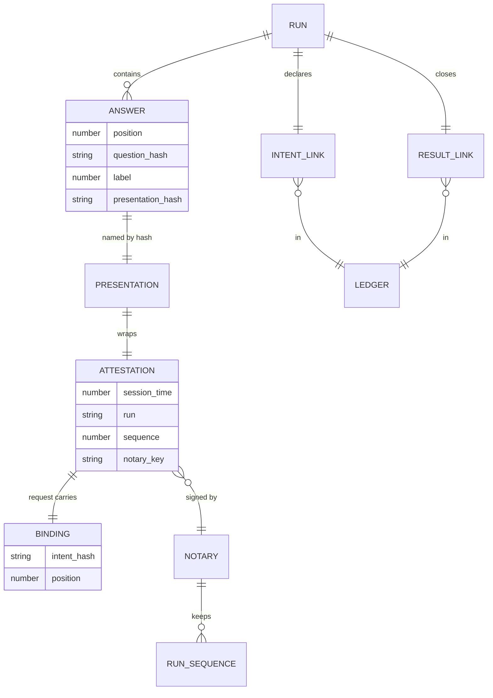
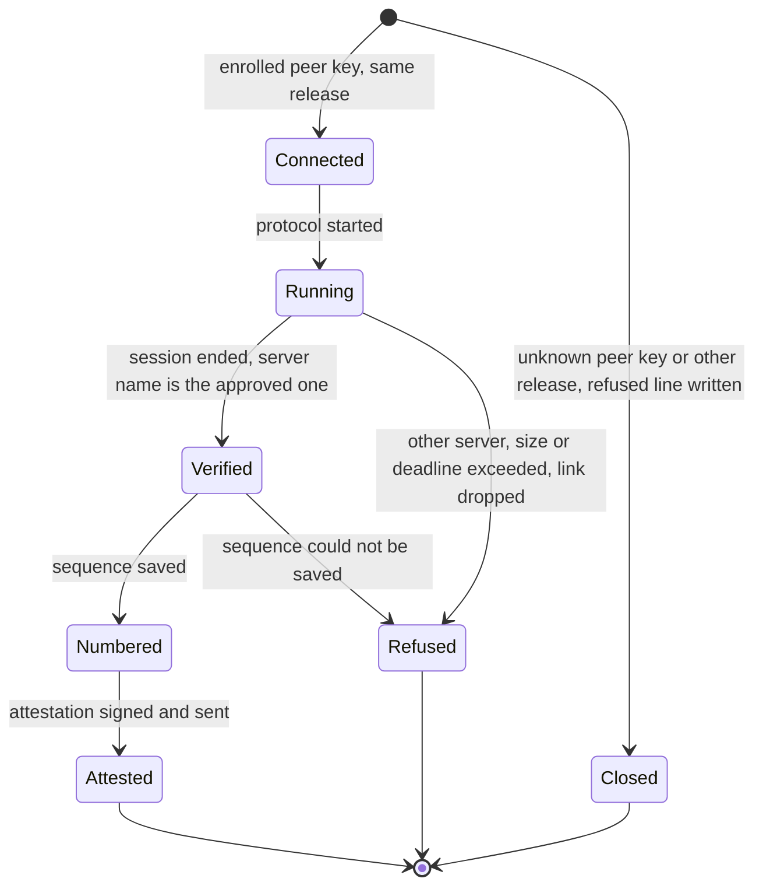
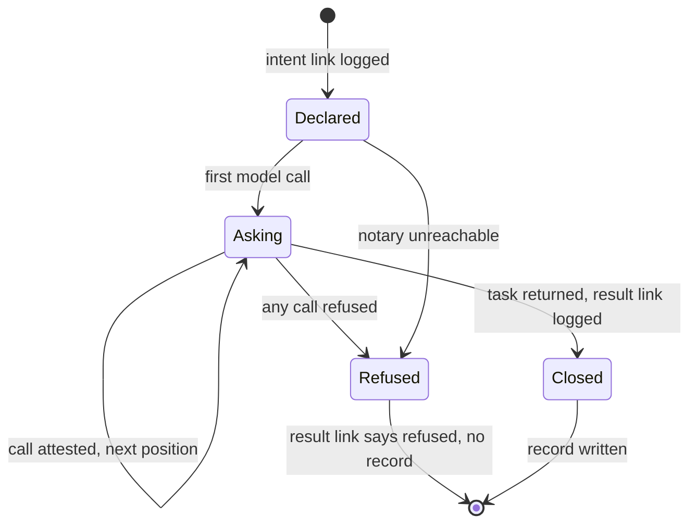
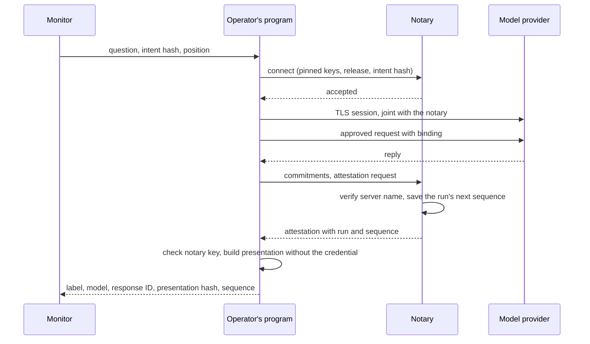
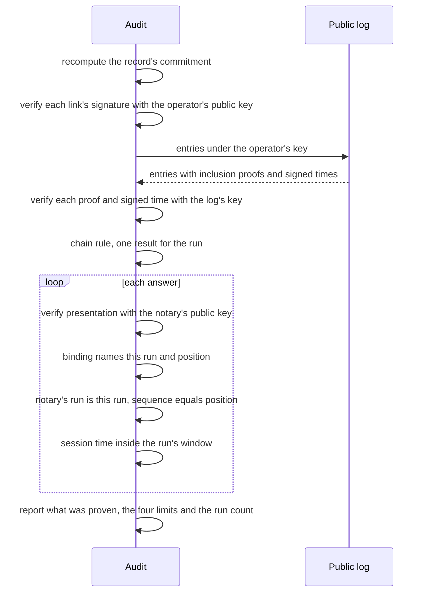

# Design

## 1. Architecture

Three parties, on up to three machines. Nothing here enters `core/` or `crates/`: all of it stays in `spikes/task-kernel`.

```mermaid
flowchart LR
  subgraph Operator machine
    M[Monitor] -->|starts, one per model call| A[Operator's attestation program]
    M --> L[Ledger]
  end
  subgraph Customer machine
    N[Notary program]
    NK[(Notary signing key, transport key, run sequences)]
    N --- NK
  end
  subgraph Auditor, any machine
    AU[Audit]
  end
  A <-->|encrypted link, pinned keys| N
  A -->|TLS session the notary takes part in| P[Model provider]
  L -->|links| LOG[Public log]
  AU -->|proofs| LOG
  AU -. record, links, presentations, two public keys .-> AU
```

- **Monitor** (`task-kernel`). Unchanged in what it trusts. It logs the intent link first, hands the intent hash and each question's position to the operator's attestation program, and refuses the run if any call is refused. Its audit takes public keys only.
- **Operator's attestation program** (`attest`). Makes the one approved request through a session with the notary, checks the returned attestation is signed by the configured notary key, and writes a presentation. It holds the model credential for the length of one call. It contains no code that makes, reads or uses a notary key (ADR-003).
- **Notary program** (new, same crate). Runs on the customer's machine. It accepts a connection only from an enrolled operator key (ADR-004), takes part in the session, refuses any server but the approved one, adds the run it was told and that run's next sequence number to the attestation, signs, and writes one session line. It is the only place the notary's keys and count exist.
- **Audit.** Reads the record, the ledger's links with the public log's stored proofs, and the presentations. It holds the operator's ledger public key, the notary's signing public key and the public log's published key. It opens nothing private.

**What is shared between the two programs:** the approved request template, the size limits, the release identifier, and the trust settings and constants both must agree on, such as the approved server name and the session deadline (ADR-003, ADR-007). No shared file makes, reads or uses a notary key.

**Order inside one run.**

1. The monitor logs the intent link and learns its hash.
2. For each question, in order, the operator's program opens a session, tells the notary the run's intent hash, sends the approved request carrying the intent hash and position, and receives an attestation carrying that run's next sequence number.
3. The monitor logs the result link.
4. The audit later requires every session time to be later than the public log's signed time for step 1 and no later than its signed time for step 3, in whole seconds (`plan.md` Slice 5 Contracts), and every answer's sequence number to equal its position.

## 2. Contracts

### Programs and commands

| Name | Inputs | Outputs | Errors | Invariants |
|---|---|---|---|---|
| Notary: start | A listen address, a directory for its keys and run sequences, the enrolled operator transport public key, and the approved server name and trusted roots when they are not the defaults | Prints its signing public key and its transport public key, then serves | Refuses to start when a key file can be read by anyone but its owner, or when the run sequences cannot be read | Makes its keys once. Never prints or logs a private key |
| Notary: one session | A connection from the enrolled operator key, the release identifier, the run's intent hash | An attestation signed with the notary key, carrying the run it was told and that run's next sequence number | Closes without signing when the peer key is not enrolled, the release differs, the server name is not the approved one, the session exceeds the size limits or its deadline, or the sequence cannot be saved | The sequence is saved before the attestation leaves. One session at a time. One session line per session |
| Operator: ask | The question on standard input, the presentation path, the notary's address and two public keys, the operator's transport key location, the intent hash, the position | One line: label, model name, response ID, presentation hash, sequence number. The presentation file | One word from a closed set (How ask says why it refused, below) and a failing exit status when the notary is unreachable or silent past the deadline, the notary's transport key or signing key is not the configured one, the release differs, the provider does not answer 200 with a typed label, or the presentation would contain the credential | Never opens a notary key. The credential reaches only the provider. Nothing but the presentation is written |
| Operator: verify | A presentation, the trusted notary signing public key | One line: server, session time, notary key, the run the notary was told, sequence number, intent hash, position, question hash, label, model name, response ID | Refuses when the notary key differs, the presentation does not verify, the server is not the approved one, the request is not the approved template with a binding, anything but the credential is hidden in the request, or the reply is not a typed label | Needs no network, no credential and no private key |
| Monitor: live | As today, plus the notary's address and public keys | As today. Each answer in the record names its presentation hash | The run is refused, and its result link says so, when any call is refused | The intent link is logged before the first call, and the first call waits until the monitor's clock is two seconds past the intent's signed time (`plan.md` Slice 5 Contracts). No record is written for a refused run. No call reaches the provider except through the notary: with no notary configured the run is refused |
| Monitor: audit | The record and its salt, the ledger directory, the presentations, the operator's ledger public key, the notary's signing public key. The public log's published key is a pinned constant, not an input. The path of a verify program the auditor built. In tests only, a stand-in log and its key, which marks the report `test trust settings` | A report: what was proven, then the four named limits of S-04.5 and the number of runs of the task | Refuses, naming the first failed check: a link signature, an inclusion proof, the chain rule, an unattested answer, a binding mismatch, a session outside the window, the notary naming another run, or a sequence number that is not the answer's position | Opens no private key and nothing in the operator's home directory |
| Monitor: attested | A record, its presentations, the trusted notary signing public key, the path of a verify program | One line per answer, as the audit's per-answer checks give it | Refuses as the audit does for an answer | The same per-answer checks as the audit, with no ledger. Takes the verify program's path as the audit does |
| Notary: cost report | The session lines, the usage file the serving notary keeps and, when supplied, two files of the operator's measured wall times per call: one for the reported sessions, one from a run against the real provider | CPU seconds and bytes per attestation, the process's peak memory as one figure, the number of sessions and, for each file given, the operator's wall time per call on its own line, marked as the operator's figure and as with or without the real provider | Says the figures are not yet a measurement below 40 sessions. Says the wall time was not supplied when it was not | Reads only what the notary itself recorded and the operator's file. It never measures the operator. The session line keeps its four fields |

### The binding, inside the attested request

| Field | Value | Checked by |
|---|---|---|
| Intent hash | The SHA-256 of the run's intent link, as 64 lowercase hex characters | Verify extracts it. The audit compares it with the record's own intent |
| Position | The question's zero-based index in the run, as a decimal number | Verify extracts it. The audit compares it with the answer's index |

The binding travels in one field of the approved request that the provider accepts and ignores. The first field to try is `metadata.user_id`, the provider's documented field for an opaque identifier, holding the intent hash, a dot and the position. The first slice's probe against the provider settles it (prd Assumptions). The template with the binding stays byte-for-byte rebuildable from the title, intent hash and position, so verify can demand an exact match.

### The notary's addition to an attestation

| Field | Value | Invariant |
|---|---|---|
| Run | The intent hash the operator gave when it opened the session, as 64 lowercase hex characters | Signed by the notary exactly as given. The notary cannot check it against the request, which it never sees: the audit does (ADR-006) |
| Sequence | An unsigned number: how many attestations this notary signed for that run before this one. The first is 0 | Never repeats for a run, across restarts. Saved before the attestation is released. The notary remembers every run it has signed for |

The two fields travel as one extension of the attestation. The library's attestation builder takes extensions and signs them with everything else, so there is one signature and no wrapper, and a verifier that checks the attestation has checked them. The extension's identifier and byte encoding are chosen in Slice 1 and recorded in its progress file under Decisions. Slice 2 reuses them unchanged.

### The link between the two programs

| Part | Value |
|---|---|
| Transport | TLS 1.3 over TCP, with the operator as the client (ADR-009) |
| Identity | Each side presents a self-signed certificate for its own transport key. Each side accepts exactly one peer: the certificate's public key must equal the pinned one. No certificate authority, name or expiry is consulted (ADR-004) |
| First message | After the handshake the operator sends one line: the release identifier, a space, and the run's intent hash. The notary answers `ok`, or answers `release` and closes when the release differs |
| After that | The protocol library's own messages, unframed, on the same stream |
| Deadline | 30 seconds for the whole session, held by each side |
| Second connection | While a session is open, any other connection is closed at once and gets a refused session line with reason `busy` |

The notary learns the session's server name from the protocol library. The operator's side must ask the library to reveal the server's identity when it proves the session, which the spike does not do today (`spikes/task-kernel/attest/src/main.rs:272`). The library then verifies the certificate chain for that name against the notary's trusted roots and returns the name in the verifier's output, which the spike discards today (`spikes/task-kernel/attest/src/main.rs:187`). The notary compares that name with its configured approved name before it saves a sequence. A session whose output carries no verified name is refused.

Reasons a session line may give for `refused`: `unenrolled`, `release`, `server`, `limits`, `deadline`, `sequence`, `dropped`, `busy`.

### How ask says why it refused

On a refusal the operator's ask prints one line holding one word from this set and nothing else, and exits with a failing status. The word never carries text from the exchange, the notary or the provider. The monitor maps it to a reason of its own.

| Ask's word | When | The monitor's reason | The notary's session line, if it wrote one |
|---|---|---|---|
| `unreachable` | No connection to the notary, the notary closes without answering the first message, or the connection breaks | notary unreachable | `busy`, `dropped`, or none |
| `deadline` | The 30-second session deadline passed | notary deadline | `deadline` |
| `notary-key` | The notary's transport key at the handshake, or the signing key on the attestation, is not the configured one | wrong notary key | `unenrolled`, or none |
| `release` | The notary answered `release` to the first message | release mismatch | `release` |
| `provider` | The session with the provider could not be set up, the provider did not answer 200 with a typed label, or the notary refused the session for its server name, limits or sequence | provider refused | `server`, `limits`, `sequence`, or `attested` |
| Anything else: no line, an unknown word, or a process the monitor ended at 35 seconds | | The reason the monitor gives today for a tool that failed, `ModelUnavailable` (`spikes/task-kernel/kernel/src/live.rs:66`) | any |

### The session line

| Field | Value |
|---|---|
| Time | When the session ended |
| Server name | The name the session's certificate was verified for, or none |
| Bytes | Sent and received application bytes, as numbers |
| Outcome | `attested` with the run and sequence number, or `refused` with a reason code |

### The usage file

The cost report is a separate command, so it cannot measure the process that served. The serving notary therefore keeps one more file beside its session lines, rewritten after every session:

| Field | Value |
|---|---|
| Sessions | How many ended `attested`, and how many ended `refused` |
| CPU seconds | The serving process's total so far, user and system |
| Peak memory | The serving process's peak resident memory so far, one figure |
| Link bytes | Bytes sent and received on the link to the operator, totalled |

The report divides CPU seconds and link bytes by the attested sessions, and states the refused count beside them. Peak memory is reported as the one figure it is.

Never in a session line or the usage file: any byte of the exchange, any key, the operator's address beyond what the customer already configured.

### Keys

| Key | Held by | Used for | Who learns the public half |
|---|---|---|---|
| Notary signing key | Customer's machine only | Signing attestations | Operator and every auditor |
| Notary transport key | Customer's machine only | The encrypted link | Operator |
| Operator transport key | Operator's machine only | The encrypted link | Customer |
| Operator ledger key | Operator's machine only, as today | Signing links | Every auditor |
| Model credential | Operator's machine only, as today | The provider | Nobody |

## 3. Domain model



Persisted for the first time by this work: the notary's run sequences, the notary's two keys, the operator's transport key, the session lines, and the public log's proof kept beside each link (already stored, now read).

## 4. State machines

### Session, on the notary



Illegal transitions:

- Running → Attested: nothing is signed before the server name is verified and the sequence is saved.
- Verified → Attested: signing without saving the sequence would let a restart reuse a number.
- Refused → any other state: a refused session is over. The operator opens a new one.
- Numbered → Refused with the sequence rolled back: a number once saved is spent, even if sending fails. That run can then no longer produce a passing record.
- Any state → Connected for a second peer while a session is open: one session at a time.

### Run, on the operator



Illegal transitions:

- [*] → Asking: no model call before the intent link is in the public log.
- Refused → Asking: a refused run is never resumed. A new run has a new intent.
- Asking → Asking for the same position: a position is asked once. A retry would be given the next sequence number, which no longer equals the position.
- Closed → Asking: no answer is added after the result link.

## 5. Flows

### One attested model call



### Audit



## 6. Test strategy

| Level | Proves | How | Fixtures and test data |
|---|---|---|---|
| Unit | Pure checks: the template and binding rebuild, the window, sequence equals position, the session line's fields, key-file access | Tests beside the code in the `attest` crate and the monitor | Hand-built values. No network |
| Integration, local | Two programs over a real socket on one machine against a stand-in provider: refusals, wrong keys, release mismatch, dropped link, sequence across a restart | Tests that start the notary program and a local TLS server with a test certificate the notary is told to trust for the test | A stand-in provider that returns a fixed typed reply. Test keys made for the test and never the operator's |
| Integration, stored | Proof and signature verification against real public-log entries | Tests over the entries already kept in `spikes/task-kernel/ledger`, and altered copies | The stored links and their log replies |
| Structural | The operator's program cannot name a notary key | A search of the operator program's source files, run as a Verify command | None |
| End to end, with the operator | A real run through a notary on a second machine, then an audit from an account with public keys only | Commands the operator runs, output recorded in the progress file | The real provider and the operator's credential, which no executor opens |
| Measurement | Cost per attestation and wall time per call | The cost report after 40 sessions | The stand-in provider for the notary's own cost. The real provider, with the operator, for wall time |

Level each example row is proven at:

| Rows | Level |
|---|---|
| S-01.1.e1 to e3, S-01.5.e1, S-01.5.e2 | Integration, local |
| S-01.2.e1, S-01.3.e1, S-01.3.e2 | Integration, local |
| S-01.4.e1 | Structural |
| S-01.4.e2 | Integration, local |
| S-02.1.e1, S-02.2.e1, S-02.2.e2, S-02.3.e1, S-02.4.e1 | Integration, local |
| S-03.2.e1 to e4, S-03.4.e1, S-03.4.e2 | Integration, local, with unit tests for the comparison itself |
| S-03.3.e1 to e3 | Unit for the window. Integration, stored, for reading the log's signed times |
| S-03.5.e1, S-03.5.e2, S-03.5.e4, S-03.5.e5 | Unit for the rule. Integration, local, for a real second ask |
| S-03.5.e3 | Integration, local |
| S-04.1.e1, S-04.1.e2 | Integration, stored, run with an empty home directory and a stand-in log holding the real stored replies |
| S-04.2.e1 to e3 | Integration, stored |
| S-04.3.e1, S-04.3.e2 | Integration, local |
| S-04.4.e1 to e3 | Integration, local, with the forger given every operator key the test made, and a stand-in log so the forged chain reaches the attestation checks |
| S-04.5.e1, S-04.5.e2 | Unit |
| S-04.5.e3 | Integration, local, with a stand-in log |
| S-05.1.e1, S-05.1.e2 | Measurement |

The stand-in provider exists because a test must not spend the operator's credential or post a public comment. It proves the two programs and the audit. It does not prove the real provider accepts the binding: that is the first slice's probe, with the operator.

## 7. Risks

| # | Risk or assumption | Mitigation |
|---|---|---|
| R1 | The provider rejects or rewrites a request that carries the binding | Probe it first, with the operator, before any other slice builds on it. If it fails, stop for the developer (prd Assumptions) |
| R2 | The protocol library does not let the notary add a signed field | Probe it in the same first slice. If it fails, stop: S-03.5 cannot be met as written |
| R3 | The protocol is too slow or too chatty between two machines | Measure early with the stand-in provider over a real network link. The target is renegotiated with the developer, never quietly relaxed |
| R4 | The stand-in provider hides a difference from the real one, such as chunked replies or TLS settings | The end-to-end run with the operator is a required step of the slice that joins the monitor to the notary |
| R5 | The notary's run sequences are lost or repeat after a crash | The sequence is saved before signing, and the notary refuses to start when it cannot read it. A restart test covers it |
| R6 | A test or an executor reads the operator's real keys or credential | Tests make their own keys in a temporary directory. The slices carry a stop condition for any step that would need the real ones |
| R7 | The public log changes its entry format or key | The log's key and address are constants in one place. A failed proof refuses the audit, never passes it |
| R8 | TLSNotary is a beta pulled from a git tag | One lockfile pins it for both programs. The release identifier refuses a mismatch |
| R10 | The notary's memory of runs grows for ever | One intent hash and one number per run. Accepted by ADR-006, with pruning left to a later decision |
| R9 | A discarded attestation makes an honest run unpassable | Accepted by ADR-002 and ADR-006. The run is refused at once, so no record is produced that later fails |

## 8. Pre-mortem

It is six months later and this failed. Why?

| # | Failure story | Maps to |
|---|---|---|
| P1 | We built the notary and the audit, then found the provider strips or rejects the binding field, and the run binding was quietly reduced to time alone | R1, and a stop condition in the slice that probes the provider |
| P2 | The operator's program still had a way to act as a notary, through a leftover command or a shared helper, and a reviewer showed a forged record passing | The structural check for S-01.4, and the forgery tests for S-04.4 in the slice that adds them |
| P3 | Everything passed against the stand-in provider and failed against the real one on the first customer run | R4 |
| P4 | The audit "verified" the public log by trusting a field the log returned instead of checking a proof | The altered-proof rows S-04.2.e2 and e3, proven on stored entries |
| P5 | A customer's notary crashed, came back with its run sequences lost, and a run in progress could be asked again from zero | R5 |
| P6 | An executor, trying to prove the end-to-end criterion alone, opened the credential file or posted a public comment | R6, and a stop condition in every slice that needs the real provider |
| P7 | The link was fast on one machine and unusable across a real network, and nobody measured until the end | R3, and the measurement in the slice that puts the two sides on a network |
| P8 | Honest runs kept failing their audit because of ordinary provider errors, and the sequence check was switched off to make progress | R9. Switching off a check is a contract change, so it is a stop |

## Modifier: security

**Assets.** The notary's signing key. The model credential. The notary's run sequences. The meaning of a passing audit.

**Entry points.** The notary's listening port. The link between the two programs. The files an auditor is handed: record, links, stored log replies, presentations. The provider's reply. The public log's replies.

**Who is not trusted.** The operator, by the customer and the auditor. Any stranger on the network, by the notary. The public log, beyond what its proofs show. The provider's reply, beyond being a typed label.

| Threat | Mitigation |
|---|---|
| The operator signs an attestation themselves | The notary key exists only on the customer's machine. The operator's program has no code that uses one (S-01.4) |
| The operator runs a notary of their own | The audit trusts one notary key, named by the auditor (S-04.4.e1) |
| An old or foreign attestation is reused | The binding names the run and position (S-03.2) |
| An answer is obtained before the run is declared | The session must lie inside the run's window in the public log (S-03.3) |
| A question is asked again and the first answer discarded | The notary gives the second ask the run's next sequence number, which no longer equals the position (S-03.5) |
| The operator names another run to the notary while asking this run's question | The attestation carries the run the notary was told, and the audit requires it to be the record's own (S-03.5) |
| The operator runs the same task several times and hands over the record they like | Every run is in the public log, and the audit report states how many there were (S-04.5) |
| A stranger uses the notary | The link accepts one enrolled key (ADR-004) |
| A stranger reads the link | The link is encrypted (ADR-004) |
| The notary is made to sign for another server | It verifies the server's certificate for the one approved name before signing (S-01.3) |
| The credential leaks through the notary, a presentation, a log line or an error | The notary never sees plaintext. The presentation hides the credential's bytes and is refused if it contains them. Failures are reported by stage only |
| The public log lies about what it holds | Each entry's inclusion proof and signed time are verified with the log's published key (S-04.2) |
| A forged record is handed over with altered files | Every file the audit reads is checked against a signature, a proof or a hash named by something signed |

**Out of scope, stated:** a notary that colludes with the operator (ADR-001), a compromised provider, a compromised public log key, and a public log that withholds entries. These are the threat model's exclusions. What an audit report must say to its reader is the four limits of S-04.5 in the prd, and that list is the report's wording.

There are no `auditor` findings for this code. It has had no independent review.

## Modifier: integration

| External contract | What we rely on | Failure modes | Timeouts and retries | How tests fake it |
|---|---|---|---|---|
| Model provider | It accepts the protocol's TLS version and key exchange, accepts the approved request with the binding, and answers 200 with a typed label | Refuses the TLS settings, rejects the binding, answers with an error, answers with something that is not a label | One deadline per call. No retry: a retry would spend a sequence number, so a failed call refuses the run | A local TLS server with a test certificate, returning a fixed typed reply, plain and chunked |
| TLSNotary protocol | Both sides on the same pinned release | Release mismatch, session dropped, limits exceeded | The notary and the operator each hold a deadline for the whole session. No retry inside a session | The real library on both sides. Only the provider is faked |
| Public log | It accepts a signed entry and returns an inclusion proof and a signed time, verifiable with its published key | Unreachable, slow, returns an entry that does not verify | Writing a link keeps today's 30-second limit and refuses the run on failure. The audit refuses when a proof cannot be checked | Stored replies from real entries, and altered copies |

The link between the two programs is ours on both ends and is specified in Contracts, not here.

## Modifier: performance

**Baseline.** One attested call with both sides in one process took 1.88 s and 656,676 KB peak memory, measured once on 2026-11-21 on one machine under WSL2, against the real provider. Eight calls in one run took 17.5 s in total. Nothing has been measured across a network, and the notary's share alone is unknown.

The baseline was measured by the operator's account, from `spikes/task-kernel`, with the command `/usr/bin/time -f '%e s, %M KB peak' attest/target/release/attest ask out/q.presentation < out/q.txt`.

**Targets.**

| Measure | Target |
|---|---|
| Wall time for one attested call, notary on another machine, round trip 20 ms or less | 10 s or less |
| Notary peak memory for one session | Reported. No target until measured |
| Notary CPU seconds per attestation | Reported. No target until measured |
| Bytes exchanged between the two programs per attestation | Reported. No target until measured |

**Benchmark.** The notary's cost report after 40 or more sessions gives all four figures (S-05.1, S-05.2). Its exact command is defined by the slice that adds it. The notary's own cost is measured against the stand-in provider, so it can be repeated without the operator. The wall time against the real provider is measured with the operator.
