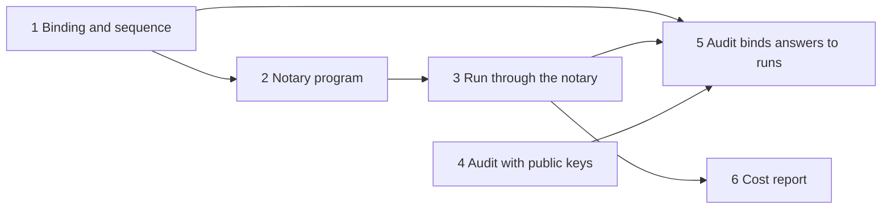

# Plan

## Dependency graph



Slices 1, 3 and 4 all change `spikes/task-kernel/kernel/src/main.rs`, in different functions. When more than one is open, merge them in slice order and rebase each on the one before.

## Traceability

| Criterion | Slices |
|---|---|
| S-01.1, S-01.2, S-01.3, S-01.4, S-01.5 | 2 |
| S-02.1, S-02.2, S-02.3, S-02.4 | 3 |
| S-03.1, S-03.4 | 1 |
| S-03.2, S-03.3 | 5 |
| S-03.5 | 2, 5 |
| S-04.1, S-04.2 | 4 |
| S-04.5 | 4, 5 |
| S-04.3, S-04.4 | 5 |
| S-05.1, S-05.2 | 6 |

Example rows (S-NN.k.eN) follow their criterion's slices.

## Shared contract

### Where the code is

Every slice changes `spikes/task-kernel`. That directory is on `main` since commit `1ccbe47`, so a slice's branch starts from `main` as usual. Preflight for every slice starts by confirming the directory is there.

### Source layout of the `attest` crate

Slice 2 creates this layout. Later slices keep it, because the structural check for S-01.4 names these paths.

| Path | Holds | May name a notary key |
|---|---|---|
| `spikes/task-kernel/attest/src/lib.rs` | What both programs must agree on: the approved request template with its binding, the size limits, the release identifier, the trust settings and shared constants (ADR-007) | No |
| `spikes/task-kernel/attest/src/main.rs` | The operator's program: ask and verify | No |
| `spikes/task-kernel/attest/src/bin/standin.rs` | The stand-in provider, as a program any test can start, the monitor's included | No |
| `spikes/task-kernel/attest/src/bin/notary.rs` | The notary's program: keys, run sequences, sessions, session lines, cost report | Yes, and it is the only file that does |
| `spikes/task-kernel/attest/tests/` | Integration tests | Test keys only, made in a temporary directory |

### Trust settings

| Setting | Default | Non-default use | Invariant |
|---|---|---|---|
| Approved server name | The real provider's name | Tests name the stand-in provider | Verify and the audit print `test trust settings` in every report made with a non-default value, and such a report never states that the real provider answered |
| Trusted root certificates | Mozilla's roots | Tests add the stand-in provider's test root | Same as above |
| Provider address | The approved server name, port 443 | Tests give the stand-in provider's local address | Same as above. Only the operator's ask uses it |
| Public log | The live log at its address, and the pinned key | Tests give a stand-in log: a directory of replies that answers which entries exist under a key, and the key that signed them. That key is a test key for chains a test made, and the pinned key when the directory holds the stored replies of the real log. Either way the log is not the live one, so the report prints `test trust settings` | Same as above. Only the audit reads it. Slice 4 adds it. Tests fill it by writing link files and replies directly with test keys: nothing in a test adds a link through the ledger's own writer, which posts to the real log (`spikes/task-kernel/kernel/src/ledger.rs:71`) |

The operator's ask, the operator's verify and the notary each take these settings, and the defaults are the production values in the library file. The approved request's host line is always the approved server name, so the template stays rebuildable under either setting. No setting is read from the attested exchange itself.

### Constants both programs share

| Constant | Value |
|---|---|
| Release identifier | The TLSNotary tag the crate is pinned to, a slash, and the crate's own version. Both come from the build, never from configuration |
| Session deadline | 30 seconds, on each side |
| Size limits | As today: `spikes/task-kernel/attest/src/main.rs:53` |

The notary takes the approved server name and the trusted roots from the customer's start configuration. Verify and the audit take them from the auditor.

The operator's ask and verify read non-default settings from environment variables, which a child process inherits. So a monitor test sets them once and they reach the tool without the monitor passing them. Slice 1 names the variables and records them in its progress file under Decisions. Slice 1 reads them in the tool's one source file, since the library file does not exist until Slice 2, which moves them there unchanged.

### The stand-in provider

A local TLS server built as its own program, `spikes/task-kernel/attest/src/bin/standin.rs`. Slice 1 starts it with what its own tests need: a test root, a certificate, a fixed typed reply. Slice 2 completes it. Slices 3, 5 and 6 reuse it. The monitor's tests are in another crate, so they start the built stand-in and the built notary as processes from `attest/target/release`, and fail, never skip, when either is missing. It presents a certificate signed by a test root made for the test, accepts the approved request, and returns a fixed typed reply. It can be told to reply plain or chunked, to answer with an error status, to present a certificate for another name, and to go quiet. It never contacts the real provider.

### Steps that need the operator

Some criteria can only be shown against the real provider, which needs the credential file. An executor never opens that file and never runs a command that reads it. For such a step the executor writes the exact command into the progress file, asks the operator to run it, and records the output the operator returns. A run that sends a notification posts a public comment, so each one needs the operator's go-ahead.

### Tests

| Command, from `spikes/task-kernel` | Expected |
|---|---|
| The attestation crate's tests, as each slice's Verify gives it | A line `test result: ok` for every test binary, with `0 failed` |
| The monitor's tests, as each slice's Verify gives it | The same |

Neither crate has a test today. A test binary that reports `0 passed` for a slice that names tests is a failed Verify. Each progress file lists the test's name against every ID it proves.

Every test that proves a criterion or an example row carries that ID in its name, with dots and dashes written as underscores, so `S-03.2.e2` is found by searching for `s_03_2_e2`.

---

## Slice 1 — The request carries the run's binding and the attestation carries the run's sequence number

Issue: #386 · Depends on: none · Stories: S-03 · Map: Tie answers to the run

### Outcome

Every attested request names the run and position it was made for, every attestation carries the run the notary was told and that run's sequence number, and verify reports all of them with the session time. The notary still runs in the operator's process, so this slice changes what is attested and not who attests.

### Acceptance

- **S-03.1**
- **S-03.4**
- **1.1** Given the real provider, when the operator sends one approved request that carries a binding, then the provider answers 200 with a typed label. Shown by the operator (Shared contract, Steps that need the operator).
- **1.2** Given an attestation whose notary added a run and a sequence number, when its presentation is verified, then the report gives both, and a presentation in which either was altered does not verify.
- **1.3** Given a presentation, when it is verified, then the report gives the session time the notary recorded.
- **1.4** Records written before this slice still replay identically.

### Contracts

The intent hash and position reach the operator's ask as command-line arguments. The notary's run and sequence number are added as one attestation extension (`design.md` §2, The notary's addition), and this slice records the extension's identifier and byte encoding under Decisions for Slice 2 to reuse. Changes `Operator: ask`, `Operator: verify`, `The binding, inside the attested request` and `The notary's addition to an attestation` in `design.md` §2, with one limit: the sequences in this slice are kept in memory by the in-process notary, so every run starts at 0 in each process. Slice 2 makes them durable. The audit does not check them until Slice 5.

The field that carries the binding is `metadata.user_id` (`design.md` §2, The binding). No other field is tried. If the provider refuses the binding there, the slice stops, as the prd's Assumptions say.

### Stop conditions

- Stop if a contract this slice depends on has drifted from `context.md` (preflight).
- Stop if the provider rejects or alters a request that carries the binding in `metadata.user_id`. Do not fall back to time alone: that is the developer's decision (prd Assumptions, design P1).
- Stop if the protocol library gives the notary no way to add a signed field that verify can read back. S-03.5 cannot then be met as written (prd Assumptions).
- Stop if showing 1.1 would need the executor to open the credential file or to run a command that reads it.
- Stop if making old records replay would need a change to the record's existing fields.

### Verify

From `spikes/task-kernel`:

```bash
cargo build --release
cargo build --release --manifest-path attest/Cargo.toml
cargo test --release --manifest-path attest/Cargo.toml
target/release/task-kernel replay guest/digest.wasm out/live3.json
```

Expected: both builds end with `Finished`. Every test binary prints `test result: ok` with `0 failed`. The replay prints `replay identical`.

Dry-run scenarios:

- **S-03.1, 1.1:** the operator runs one attested call with a binding against the real provider and returns the output line. It shows a label, and verifying the presentation reports the same intent hash and position that were sent.
- **S-03.4.e1, S-03.4.e2:** a test builds the approved request for a title and a binding and shows verify's comparison accepts it, then changes the model name and the instructions in turn and shows each is refused.
- **1.2, 1.3:** a test reads the run, sequence number and session time back from a presentation made in-process against a local server, then alters the sequence number's bytes and shows verification fails.

### Pattern to follow

- The approved template and its exact-match check: `spikes/task-kernel/attest/src/main.rs:58`, `spikes/task-kernel/attest/src/main.rs:339`.
- Where the notary builds an attestation: `spikes/task-kernel/attest/src/main.rs:175`.
- How the monitor starts the tool and reads its one line: `spikes/task-kernel/kernel/src/live.rs:49`.
- How an optional field was added to an answer without breaking old records: `spikes/task-kernel/kernel/src/main.rs:61`.

### Suggested path

Default route. You may deviate if every mandatory item still holds; record why.

1. Add the binding to the approved template so it is rebuilt from the title, intent hash and position.
2. With the operator, try the binding against the real provider in the candidate field. Record which field was accepted.
3. Have the in-process notary add the run and its sequence number to the attestation, and verify read them back with the session time.
4. Extend verify's output line with intent hash, position, the notary's run, sequence number and session time.
5. Have the monitor pass the intent hash and position to the tool, without yet checking them in the audit.
6. Add the tests, named by ID.

### Files

- Modify: `spikes/task-kernel/attest/src/main.rs`
- Modify: `spikes/task-kernel/kernel/src/live.rs`
- Modify: `spikes/task-kernel/kernel/src/main.rs`
- Create: `spikes/task-kernel/attest/src/bin/standin.rs` (the first part of the stand-in provider)
- Create: `spikes/task-kernel/attest/tests/` (first tests). Until Slice 2 creates the library file, a test there can only run the built programs. A test that calls a function directly sits beside the code in the source file

---

## Slice 2 — The notary is its own program

Issue: #387 · Depends on: Slice 1 · Stories: S-01, S-03 · Map: Stand up the notary

### Outcome

A customer can start a notary on their own machine under their own keys, and it serves attested sessions to one enrolled operator over an encrypted link. The operator's program can no longer act as a notary.

### Acceptance

- **S-01.1**
- **S-01.2**
- **S-01.3**
- **S-01.4**
- **S-01.5**
- **S-03.5** (notary side): the notary signs the run it was told and that run's next sequence number, starting at 0, saves the number before the attestation leaves, and keeps it across a restart (S-03.5.e3).
- **2.1** Given a connection from a transport key that is not enrolled, when it reaches the notary, then it is closed before the protocol starts and a refused session line is written.
- **2.2** The stand-in provider exists as the Shared contract describes, and no test in the crate contacts the real provider.
- **2.3** The crate has the source layout in the Shared contract.

### Contracts

Creates `Notary: start`, `Notary: one session`, `The session line` and the notary's rows of `Keys` in `design.md` §2. Changes `Operator: ask` so it reaches the notary over the link in ADR-004 and holds a transport key of its own, and so it says why it refused in the words of `design.md` §2, How ask says why it refused. Follows the session state machine in `design.md` §4, including its illegal transitions.

Creates `The link between the two programs` in `design.md` §2, and the Shared contract's source layout, trust settings, shared constants and stand-in provider.

The run sequences are saved by writing a new file, syncing it and renaming it over the old one, before the attestation is signed. The notary's start configuration is command-line arguments, and their names are recorded in the progress file under Decisions. So are the executor's choices this pack leaves open: the libraries for the link and its self-signed certificates, how the operator's transport key is made and where it is kept, the file that holds the run sequences, and the stand-in provider's controls. The notary refuses to start when a key file has any access bit set for group or others.

The spike's old notary key in the operator's home directory is left where it is and is never read by either program. Presentations it signed do not pass the new verify. Replay of old records does not depend on them.

### Stop conditions

- Stop if a contract this slice depends on has drifted from `context.md` (preflight).
- Stop if any source file of the operator's program must make, read or use a notary key to make something work (design P2). That includes what ask prints: it prints the notary's public key today, and after this slice only the notary's program does.
- Stop if the protocol library's verifier output gives the notary no verified server name even when the operator's side reveals the server's identity. S-01.3 cannot then be met.
- Stop if the protocol cannot run over the encrypted link without changing the protocol library itself.
- Stop if a test would need the operator's real keys or credential. Tests make their own in a temporary directory.
- Stop if the notary cannot be made to save a run's sequence before it signs.

### Verify

From `spikes/task-kernel`:

```bash
cargo build --release --manifest-path attest/Cargo.toml
cargo test --release --manifest-path attest/Cargo.toml
grep -nE 'Secp256k1Signer|set_signer|notary\.key|notary_key\(|signing key' attest/src/main.rs attest/src/lib.rs
ls attest/src/bin/notary.rs attest/src/lib.rs attest/src/main.rs
```

Expected: the build ends with `Finished`. Every test binary prints `test result: ok` with `0 failed`. The `grep` prints nothing and exits with status 1. The `ls` lists all three files.

Dry-run scenarios, each a test against the stand-in provider:

- **S-01.1.e1 to e3:** start the notary in an empty directory, start it again, then loosen the key file's access and start it a third time.
- **S-01.2.e1, S-01.5.e1:** one session to completion returns an attestation that verifies under the printed key, and one `attested` session line appears.
- **S-01.3.e1, S-01.3.e2, S-01.5.e2:** the stand-in presents a certificate for another name, then drops a session halfway. Neither returns an attestation, each writes a `refused` line with no part of the exchange in it, and the next session succeeds.
- **S-01.4.e1, 2.3:** the `grep` and `ls` above.
- **S-01.4.e2:** a named pipe is placed where the spike kept its notary key in the test's home directory, and no notary is running. A program that opened the pipe would block for ever. The call is refused inside its deadline.
- **S-03.5.e3:** two sessions for one run, a restart, a third session for the same run. The sequence numbers are 0, 1, 2. A session for a second run then gets 0.
- **2.1:** a connection with a transport key that was not enrolled.

### Pattern to follow

- The notary's session as it is today: `spikes/task-kernel/attest/src/main.rs:175`.
- Making a key file readable by its owner only: `spikes/task-kernel/attest/src/main.rs:155`.
- Reporting a failure by stage without quoting the exchange: `spikes/task-kernel/attest/src/main.rs:368`.

### Suggested path

Default route. You may deviate if every mandatory item still holds; record why.

1. Move what both programs share into the library file. Move the notary's session and key handling into the notary's program.
2. Build the stand-in provider and one test that completes a session in-process, to prove the fixture.
3. Add the encrypted link with pinned transport keys, and move the two sides onto a socket.
4. Add the durable run sequences and the session line.
5. Add the refusals, one test each.
6. Run the structural check.

### Files

- Create: `spikes/task-kernel/attest/src/lib.rs`
- Create: `spikes/task-kernel/attest/src/bin/notary.rs`
- Modify: `spikes/task-kernel/attest/src/bin/standin.rs` (complete the stand-in provider)
- Create: `spikes/task-kernel/attest/tests/` (notary tests)
- Modify: `spikes/task-kernel/attest/src/main.rs`
- Modify: `spikes/task-kernel/attest/Cargo.toml`

---

## Slice 3 — A run goes through the customer's notary, or does not run

Issue: #388 · Depends on: Slice 2 · Stories: S-02 · Map: Run with it

### Outcome

The monitor's `live` run attests every model call through the configured notary and is refused, with a result link that says so, whenever the notary is unreachable, silent, the wrong one or on another release. One real run through a notary on a second machine is recorded.

### Acceptance

- **S-02.1**
- **S-02.2**
- **S-02.3**
- **S-02.4**
- **3.1** Given a notary on a second machine, when the operator runs one real task through it, then the record's answers each name a presentation that verifies under that notary's key. Shown by the operator.
- **3.2** The wall time of one attested call across the two machines is measured and recorded, with the round-trip time between them. The round-trip time is the median of 20 connection times, measured by the operator with a command written into the progress file.
- **3.3** Given no notary configured, when the operator starts a live run against the real provider, then the run is refused and its result link says so. The monitor's direct call to the provider (`spikes/task-kernel/kernel/src/live.rs:75`) is removed. The stand-in model of `live ... stub` is not a provider call and stays. The monitor also stops naming the credential file (`spikes/task-kernel/kernel/src/main.rs:548`), stops reading it (`spikes/task-kernel/kernel/src/live.rs:31`) and no longer holds the credential (`spikes/task-kernel/kernel/src/live.rs:18`): after this slice only the operator's ask reads it, as it does today (`spikes/task-kernel/attest/src/main.rs:146`).

### Contracts

Changes `Monitor: live` in `design.md` §2 and follows the run state machine in `design.md` §4. The notary's address, its two public keys and the location of the operator's transport key reach the monitor as environment variables beside `HYALOS_ATTEST`, and their names are recorded in the progress file under Decisions. None reuses `HYALOS_NOTARY`, which names the audit's trusted key today and is removed in Slice 5 (`spikes/task-kernel/kernel/src/main.rs:602`).

Each model call has one deadline: the 30-second session deadline, held inside the operator's ask. The monitor ends the tool's process at 35 seconds if it is still running, since it waits without limit today (`spikes/task-kernel/kernel/src/live.rs:66`). The deadline is when a call is refused. The 10-second target in the prd is a measure of a healthy call, and a different number. A call is never retried (`design.md`, Modifier: integration).

Each refusal reaches the result link as a reason of its own, added to the monitor's reasons (`spikes/task-kernel/kernel/src/main.rs:36`): notary unreachable, notary deadline, wrong notary key, release mismatch, provider refused. Their names are recorded under Decisions. The monitor learns which one from the word ask prints since Slice 2 (`design.md` §2, How ask says why it refused), and maps anything else to the reason it gives today.

### Stop conditions

- Stop if a contract this slice depends on has drifted from `context.md` (preflight).
- Stop if any refusal path would let the run continue with an unattested answer.
- Stop if showing 3.1 or 3.2 would need the executor to open the credential file, run a command that reads it, or post the notification without the operator's go-ahead (design P6).
- Stop if the real run fails where the stand-in passed. Record the difference and stop: the stand-in is wrong, and that changes what the earlier tests proved (design P3).
- Stop if the measured wall time is over 10 s, whatever the round-trip time, and record the round-trip time beside it. The target is stated for a round trip of 20 ms or less, and whether a slower link excuses it is the developer's to say, not the executor's (design P7).

### Verify

From `spikes/task-kernel`:

```bash
cargo build --release
cargo build --release --manifest-path attest/Cargo.toml
cargo test --release
cargo test --release --manifest-path attest/Cargo.toml
HYALOS_KERNEL=hyalos/target/x86_64-unknown-none/release/hyalos-kernel \
HYALOS_SELFTEST_KERNEL=hyalos/target-selftest/x86_64-unknown-none/release/hyalos-kernel \
target/release/task-kernel attacks guest/digest.wasm fixtures/issues.tsv
```

Expected: the build ends with `Finished`. Every test binary prints `test result: ok` with `0 failed`. The last command prints 51 lines starting `PASS` and none starting `FAIL`. The last command needs both builds of the bare-metal kernel, which are not in the repository: build them first as `context.md` §4 says.

Dry-run scenarios:

- **S-02.1.e1:** a test runs the monitor's attested path against a test notary and the stand-in provider, and the answer names a presentation hash that matches the file.
- **S-02.2.e1, S-02.2.e2:** nothing listens at the notary's address, then a listener accepts and goes quiet. Each time the run is refused at its deadline and no record file exists afterwards.
- **S-02.3.e1:** the test notary signs with a key other than the configured one.
- **S-02.4.e1:** the test notary reports another release identifier.
- **3.1, 3.2:** the operator starts the notary on a second machine, runs one real task, and returns the output and the measured times.

### Pattern to follow

- The run's order of intent link, execution and result link: `spikes/task-kernel/kernel/src/main.rs:544`.
- How a refused outcome is written into the result link: `spikes/task-kernel/kernel/src/main.rs:581`.
- Mapping every failure of the tool to one reason: `spikes/task-kernel/kernel/src/live.rs:49`.

### Suggested path

Default route. You may deviate if every mandatory item still holds; record why.

1. Give the monitor its notary configuration and pass it to the tool.
2. Add the deadline and make every refusal reach the result link.
3. Add the refusal tests against a test notary.
4. Write the operator's commands for the two-machine run into the progress file, and ask the operator to run them.
5. Record the times.

### Files

- Modify: `spikes/task-kernel/kernel/src/live.rs`
- Modify: `spikes/task-kernel/kernel/src/main.rs`
- Modify: `spikes/task-kernel/attest/src/main.rs`
- Create: tests for the monitor's attested path

---

## Slice 4 — The audit needs only public keys and checks the public log's proofs

Issue: #389 · Depends on: none · Stories: S-04 · Map: Audit alone

### Outcome

An auditor with the record, the links, the stored log replies, public keys and a connection to the public log can audit from any account. The audit verifies each link's signature and each entry's inclusion proof and signed time itself, and its report states what was and was not proven.

### Acceptance

- **S-04.1**
- **S-04.2**
- **S-04.5** (report side): the report lists what this slice proved, which is the link signatures, the inclusion proofs, the signed times, the chain rule and the run count, then the four limits. It says in its own line that the answers' attestations were not checked.
- **4.1** The audit path opens no file under the operator's home directory and starts no program that reads a private key.
- **4.2** Verifying each link's proof, signed time and signature uses only the stored log replies and needs no network. The audit as a whole still needs the network for one step, asking the log which entries it holds under the operator's key, and is refused when that step cannot be done.

### Contracts

Changes `Monitor: audit` in `design.md` §2, except the checks on answers, which are Slice 5's. Until Slice 5 merges, the report says in its own line that the answers' attestations were not checked, unless they were. The operator's ledger public key and the notary's signing public key are both inputs, given as files. This slice requires the notary's key to be given and Slice 5 is the first to use it. In this slice nothing reads the file's contents yet. Until Slice 5 the `HYALOS_NOTARY` variable and its gate stay exactly as they are and are the only thing that decides whether the old attestation step runs, and the not-checked line is printed whenever the attestation step did not run.

Adds the `Public log` row of the Shared contract's trust settings. A report made with a stand-in log prints `test trust settings` and never says the public log holds anything.

Each stored reply file is one object whose single key is the entry's identifier, with the reply inside it. Files that `openssl` needs are written to a new directory under the system's temporary directory and removed afterwards, never under the home directory. The audit refuses, naming the input, when either public key is not given. How the audit is pointed at a stand-in log is the executor's choice, recorded under Decisions.

A checkpoint is a signed note: an origin line, the tree size, the root hash, a blank line, then a signature line whose first four key-ID bytes are the first four bytes of the log ID.

What verifying one stored log reply means:

| Check | How |
|---|---|
| The log's key | The pinned key's SHA-256 equals the reply's `logID` |
| The reply is for this link | The hash inside the reply's body equals the SHA-256 of the link's bytes. Without this, a reply for another link could stand in |
| Signed time | The reply's signed entry timestamp is a valid signature, under the pinned key, over the canonical JSON of the reply's body as the base64 text stored, integrated time, log ID and the reply's top-level log index: keys sorted, no spaces |
| Inclusion | The checkpoint in the inclusion proof is a signed note that verifies under the pinned key. The root recomputed from the entry's leaf hash and the proof's hashes, by the transparency-log rule of RFC 6962, equals the checkpoint's root. The leaf is the decoded body. The index and tree size are the ones inside the inclusion proof, not the reply's top-level index |
| The link's signature | The signature and public key inside the reply's body verify over the link's bytes, and that public key is the operator's ledger public key given to the audit |

Signatures are checked the way the ledger already signs, by running `openssl` (`spikes/task-kernel/kernel/src/ledger.rs:25`), with public keys only. No new dependency is expected. The public log's published key is not an input: it is one pinned constant beside the log's address. Its bytes are already in this repository, in the signed copy of Sigstore's trusted root that the plugin tests use: the public key of the log at `https://rekor.sigstore.dev`, at `core/hyalos/tests/fixtures/marketplace-r10/trusted-root.json:107`, an ECDSA P-256 key in base64. Its SHA-256 is `c0d23d6ad406973f9559f3ba2d1ca01f84147d8ffc5b8445c224f98b9591801d`, which is the `logID` in every stored log reply. The slice copies the key from that line and nowhere else. How the audit's inputs are named on the command line is recorded there under Decisions.

Opening the ledger for audit never makes a key. Today opening it makes a private key when none exists (`spikes/task-kernel/kernel/src/ledger.rs:35`).

### Stop conditions

- Stop if a contract this slice depends on has drifted from `context.md` (preflight).
- Stop if the key at the cited line does not hash to the stored replies' `logID`. Do not fetch a key from anywhere else.
- Stop if a stored log reply holds no inclusion proof or no signed time that can be verified with the log's published key. G3 cannot then be met as written (prd Assumptions).
- Stop if any check would have to accept a value because the log returned it, with no proof behind it (design P4). One answer is excepted, and only this one: the log's list of which entries exist under the operator's key. No proof of that list's completeness exists, the audit compares it with the chain as it does today, and the report names it as the fourth limit of S-04.5.
- Stop if the audit cannot learn a link's signature from public material alone.
- Stop if any of the four stored replies in `spikes/task-kernel/ledger` fails a check in the Contracts table as written. The table is then wrong about the log's format, and guessing another is not allowed.

### Verify

From `spikes/task-kernel`:

```bash
cargo build --release
cargo test --release
grep -nE 'ledger-key|\.config/hyalos-spike|self\.key|genpkey' kernel/src/main.rs kernel/src/ledger.rs
```

Expected: the build ends with `Finished`. Every test binary prints `test result: ok` with `0 failed`. Every line the `grep` prints is inside the code that writes links, and none is reachable from the audit: list each line in the progress file with the chain of calls that reaches it. Today the audit reaches the private key through `public_key` and `logged` (`spikes/task-kernel/kernel/src/ledger.rs:45`, `:95`), and after this slice it must not.

Dry-run scenarios, each a test over copies of the entries in `spikes/task-kernel/ledger`:

- **S-04.1.e1, S-04.1.e2, 4.1:** the audit runs with its home directory set to an empty temporary directory and two public keys given, and completes. The directory is still empty afterwards. The log is a stand-in log holding copies of the four real stored replies, whose key is the real pinned key, so no network is needed. The record is `spikes/task-kernel/out/live2.json` with its salt, which commits to the result link `spikes/task-kernel/ledger/00001.json`.
- **S-04.2.e1:** the stored entries verify.
- **S-04.2.e2:** one hash in one stored inclusion proof is altered, and the audit refuses, naming that link.
- **S-04.2.e3:** one link is replaced by one signed with a test key, and the audit refuses, naming that link.
- **S-04.5.e1, S-04.5.e2:** the report of a passing audit lists what was proven and then the four limits of S-04.5 by name. A failing one names the first failed check and prints no statement of proof.
- **S-04.5.e3:** a chain made for the test with three intent links for one task, signed with a test ledger key and entered in a stand-in log under a test log key. The report of the passing record says the task was run 3 times. The count is over the chain's links, after the chain has been found equal to the log's list, which is what makes it the log's count. The code that counts is there today (`spikes/task-kernel/kernel/src/ledger.rs:151`).
- **4.2:** the proof, signed-time and signature tests above run with no network and pass. A whole audit with the default log setting and no network is refused, naming the step.

### Pattern to follow

- The chain rule the audit already applies: `spikes/task-kernel/kernel/src/ledger.rs:122`.
- Where the log's reply is kept beside each link: `spikes/task-kernel/kernel/src/ledger.rs:55`.
- Where the audit is wired into the command line: `spikes/task-kernel/kernel/src/main.rs:595`.

### Suggested path

Default route. You may deviate if every mandatory item still holds; record why.

1. Read one stored log reply and write down which fields carry the proof, the signed time and the link's signature. Record them in the progress file.
2. Verify one entry by hand in a test, before changing the audit.
3. Split opening the ledger for writing from opening it for audit, so the audit path takes public keys.
4. Add the proof and signature checks to the audit, before the chain rule.
5. Add the report text and the altered-copy tests.

### Files

- Modify: `spikes/task-kernel/kernel/src/ledger.rs`
- Modify: `spikes/task-kernel/kernel/src/main.rs`
- Create: tests for the audit, as a test module beside the code in `spikes/task-kernel/kernel/src/ledger.rs`, over copies of the entries in `spikes/task-kernel/ledger`

---

## Slice 5 — The audit ties every answer to its run, and forgeries with the operator's keys fail

Issue: #390 · Depends on: Slice 1, Slice 3, Slice 4 · Stories: S-03, S-04 · Map: Tie answers to the run, Audit alone

### Outcome

The audit refuses a record unless every answer is attested by the trusted notary, for this run and position, inside the run's window in the public log, with a sequence number equal to its position. A forger who holds every operator key cannot produce a record that passes.

### Acceptance

- **S-03.2**
- **S-03.3**
- **S-03.5** (audit side): every answer's attestation names the record's own run as the run the notary was told, and carries a sequence number equal to the answer's position (S-03.5.e1, S-03.5.e2, S-03.5.e4, S-03.5.e5).
- **S-04.3**
- **S-04.4**
- **S-04.5** (attestation side): the report of a passing audit now also lists, as proven, that every answer was attested by the trusted notary for this run and position, and the not-checked line is gone.
- **5.1** The audit checks attestations always. No setting skips them. The trusted notary key is the file Slice 4 made an input, and the `HYALOS_NOTARY` variable and its gate (`spikes/task-kernel/kernel/src/main.rs:602`) are removed.

### Contracts

Completes `Monitor: audit` in `design.md` §2: an unattested answer, a binding mismatch, a session outside the window, the notary naming another run, and a sequence number that is not the answer's position are each a named refusal. Follows the audit flow in `design.md` §5.

The record has no intent field. Its intent hash is read from the result link whose transcript equals the record's commitment, which the chain rule already finds (`spikes/task-kernel/kernel/src/ledger.rs:122`). The run's window is the two signed times Slice 4 verified for that run's intent link and result link. Verify's output names for the binding, the notary's run, the sequence number and the session time are the ones Slice 1 recorded under Decisions.

The session time is the notary's own clock (`context.md` §5), so the operator cannot set it. The session time and the log's signed times are whole seconds. A session must be strictly later than the intent's signed time, and no later than the result's. S-03.3.e2 refuses a session earlier than the intent, and whole seconds cannot tell a session earlier in the intent's second from one later in it. So a session in the same second as the intent's signed time is refused too, which is the fail-closed reading, and there is no residual (ADR-008). To keep honest runs from being refused, the monitor waits after logging the intent until its own clock is two seconds past the intent's signed time. It waits once, before the first model call, and reads the intent's signed time from the log's reply the ledger keeps beside the link (`spikes/task-kernel/kernel/src/ledger.rs:78`). That wait is a change to `spikes/task-kernel/kernel/src/live.rs` made in this slice. A notary whose clock is more than a second behind the public log's will have its sessions refused, which is the fail-closed result.

The auditor runs a verify they built themselves from the pinned lockfile, and gives the audit its path as an input. The audit does not take it from `HYALOS_ATTEST`. The `attested` command (`spikes/task-kernel/kernel/src/main.rs:607`) takes the same path the same way. Presentations stay where they are today, in the directory named after the record with `.attest` added.

The operator's ask gains one environment variable, read only for the run it tells the notary, for the S-03.5.e5 test. Its name is recorded under Decisions. It changes nothing an auditor trusts.

Every test in this slice that builds its own chain uses a stand-in log with a test log key (Shared contract, trust settings), so the forged chain passes the log step and each forgery is refused by the check it is meant to meet. A forgery test that is refused at the log step has not proven its row.

A record with no attestations, such as one made before this pack or with the stand-in model, is refused by this audit. That is intended.

### Stop conditions

- Stop if a contract this slice depends on has drifted from `context.md` (preflight).
- Stop if any forgery in S-04.4 passes the audit. Record it and stop: do not adjust the test.
- Stop if an honest test run fails the sequence check for a reason other than a discarded attestation. Do not relax or switch off the check: that is a contract change (design P8).
- Stop if the run's window cannot be read from signed times verified in Slice 4.

### Verify

From `spikes/task-kernel`:

```bash
cargo build --release
cargo build --release --manifest-path attest/Cargo.toml
cargo test --release
cargo test --release --manifest-path attest/Cargo.toml
grep -n 'HYALOS_NOTARY' kernel/src/main.rs
```

Expected: the build ends with `Finished`. Every test binary prints `test result: ok` with `0 failed`. The `grep` prints nothing and exits with status 1, because criterion 5.1 removes the variable.

Dry-run scenarios, each a test with a test notary, the stand-in provider and test keys:

- **S-03.2.e1 to e4:** an honest record, a presentation from an earlier run with the same question, a presentation reused at another position, and a presentation with no binding.
- **S-03.3.e1 to e3:** session times inside, before and after the window, using signed times from stored entries for the window's edges.
- **S-03.5.e1, S-03.5.e2, S-03.5.e4, S-03.5.e5:** sequence numbers 0 to 7, then a run in which the question at position 3 was asked twice and the first answer discarded, then one in which the first question was asked three times, then one in which the operator told the notary another run's intent hash.
- **S-04.3.e1, S-04.3.e2:** eight valid presentations, then one answer naming none.
The forgery and re-ask tests are in the monitor's crate. The monitor asks each position once, so these tests drive the operator's ask and the test notary directly and assemble the record and links with the test ledger key. For S-03.5.e5 the test tells the notary a different intent hash from the one in the request, through an environment variable the operator's ask reads for the run it tells the notary. It is not a secret door: a forger can change their own tool the same way, and the audit refuses the result. For S-04.4.e3 the test notary signs for an intent hash whose link is not yet logged.

- **S-04.4.e1 to e3:** the forger is given the test operator's credential stand-in, ledger key and files. They attest with a notary of their own, wrap a real presentation from another run in a consistent chain, and obtain an attestation before logging the intent.
- **5.1:** the audit is run with no notary setting at all and refuses to proceed without a trusted notary key.

### Pattern to follow

- The per-answer check as it is today: `spikes/task-kernel/kernel/src/main.rs:500`.
- The existing forgery command for the chain: `spikes/task-kernel/kernel/src/main.rs:612`.

### Suggested path

Default route. You may deviate if every mandatory item still holds; record why.

1. Make the attestation check part of every audit, with the trusted notary key a required input.
2. Add the binding comparison, then the window, then the notary's run and sequence number.
3. Build the three forgeries as tests that start from an honest record and the operator's test keys.
4. Confirm each refusal names its own check.

### Files

- Modify: `spikes/task-kernel/kernel/src/main.rs`
- Modify: `spikes/task-kernel/kernel/src/ledger.rs`
- Modify: `spikes/task-kernel/attest/src/main.rs` (the test's variable for the run told to the notary)
- Modify: `spikes/task-kernel/kernel/src/live.rs` (the wait after the intent link)
- Create: forgery tests, in the monitor's crate. Tests of what the audit decides go there too. Tests of what ask and verify themselves do go in `spikes/task-kernel/attest/tests/`

---

## Slice 6 — The notary reports what an attestation costs

Issue: #391 · Depends on: Slice 3 · Stories: S-05 · Map: Know the cost

### Outcome

After 40 or more sessions the notary reports its own CPU time, peak memory and bytes per attestation, and the operator's wall time per call is recorded beside them. The parent pack's public-notary idea gets its first measured number.

### Acceptance

- **S-05.1**
- **S-05.2**
- **6.1** The figures and the conditions they were measured under are written into `design.md`'s Modifier: performance section as a recorded deviation for the developer to approve, never edited in silently.

### Contracts

Creates `Notary: cost report` and `The usage file` in `design.md` §2. The report is a `report` command of the notary's program. It is a different process from the one that served, so it measures nothing itself: it reads the session lines, the usage file the serving notary rewrote after every session, and, for S-05.2, a file of wall times.

For S-05.2 the same 40 sessions are used. The test that drives them against the stand-in provider times each call of the operator's ask and writes the times to that file, so the report gives the operator's wall time for the sessions it reports on. That figure has no real provider in it. The figure with the real provider is the one Slice 3 recorded for criterion 3.2, and the progress file gives both, each named for what it is. No further run against the real provider is needed. The report takes that real-provider time as a second optional file and prints it on its own labelled line, so M2 is read from the report as S-05.2 says.

The 40-session threshold and the divisor both count attested sessions. The usage file's CPU and peak memory belong to one life of the serving process, so the 40 sessions come from one life and the report says so. Where the notary keeps its session lines and usage file, the report's arguments and the format of the two timing files are the executor's to choose and are recorded under Decisions.

### Stop conditions

- Stop if a contract this slice depends on has drifted from `context.md` (preflight).
- Stop if measuring would need a session line to hold anything from inside the exchange.
- Stop if this slice would need any run against the real provider. It needs none: the real-provider time is Slice 3's.
- Stop if 40 sessions against the real provider would be needed for the notary's own cost. That is measured against the stand-in.

### Verify

From `spikes/task-kernel`:

```bash
cargo build --release --manifest-path attest/Cargo.toml
cargo test --release --manifest-path attest/Cargo.toml
```

Expected: the build ends with `Finished`. Every test binary prints `test result: ok` with `0 failed`.

Dry-run scenarios:

- **S-05.1.e1:** 40 sessions against the stand-in provider, then the report. It gives CPU seconds, peak memory and bytes per attestation. Given a file of wall times, it gives the operator's wall time per call too, and without one it says the wall time was not supplied.
- **S-05.1.e2:** the report after 5 sessions says how many there were and that the figures are not yet a measurement.
- **S-05.2:** the same test times each of the 40 calls and gives the report the file. The report gives the operator's wall time per call for those sessions. The progress file sets Slice 3's real-provider time and round-trip time beside it.

### Pattern to follow

- The session line the report reads: `design.md` §2, The session line.
- How the baseline was measured: `design.md`, Modifier: performance.

### Suggested path

Default route. You may deviate if every mandatory item still holds; record why.

1. Have the serving notary rewrite the usage file after every session, reading its own CPU time and peak memory from the operating system. The session line keeps its four fields.
2. Add the report and its under-40 wording.
3. Run 40 sessions against the stand-in and record the figures.
4. Copy Slice 3's real-provider wall time and round-trip time into the progress file beside the report's figures.

### Files

- Modify: `spikes/task-kernel/attest/src/bin/notary.rs`
- Modify: `docs/plans/hyalos-kernel-notary/design.md` (one entry under Modifier: performance, marked as a deviation awaiting the developer, as acceptance 6.1 says, and also written in the progress file)
- Create: a test for the report
