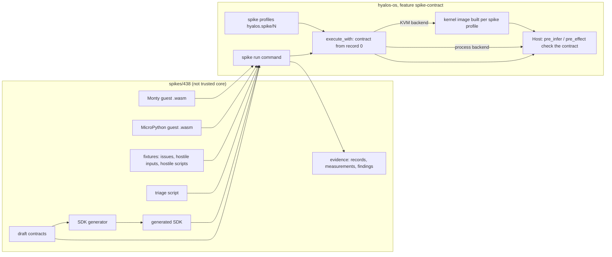
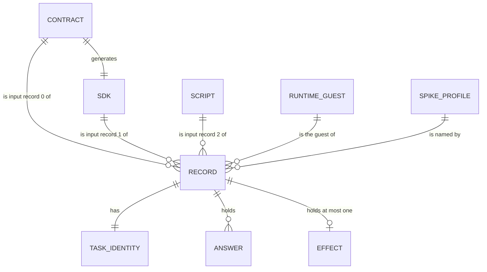
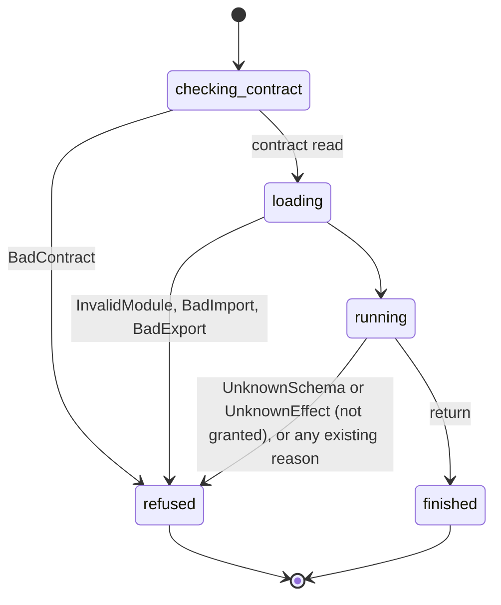
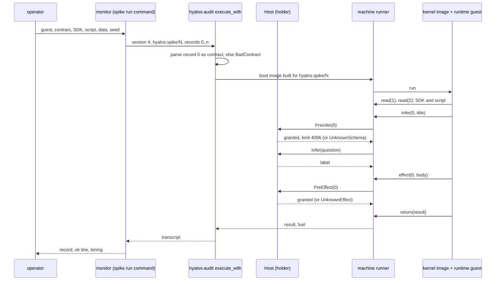

# Design

Nothing here is code. Names match the glossary in `context.md` §5; citations are to `context.md`'s
commit.

## 1. Architecture

Two halves. Inside `hyalos-os/`, behind `spike-contract` (ADR-001), the monitor learns a draft
contract and spike profiles. Under `spikes/438/`, outside the budget, live the contract files, the
SDK generator, the triage script, the two interpreter guests, the hostile fixtures, the measurements
and the evidence.

- **The boundary is `Host`.** Both backends answer every call through `hyalos_audit::Host`
  (`hyalos-os/audit/src/replay.rs:94`, `hyalos-os/monitor/src/kvm.rs:328-355`), so the contract
  check is written once there. The SDK only shapes what the script sees.
- **Nothing changes in a default build.** Every item in the `hyalos-os` box is compiled only with
  the feature; a default build's profiles, reasons, commands and kernel image are byte-for-byte what
  they are today.
- **The runtime guests are data to the monitor.** The monitor knows nothing of Python: a runtime
  guest is a `hyalos.abi/1` module like the digest guest (parent ADR-002: a language runtime is guest
  code).

## 2. Contracts

### Draft contract (input record 0)

| Field | Type | Rule |
|---|---|---|
| `asks` | list of integers | Schemas the task may ask. Each is a schema the host answers (today only `0`), distinct, ascending |
| `may_touch` | list of integers | Effect kinds the task may request. Each is a kind the host performs (today only `0`), distinct, ascending |

Canonical bytes: a JSON object with exactly these two keys in this order, no whitespace, no other
key, at most 4,096 bytes. The draft contract that grants schema `0` and effect `0` is the bytes
`{"asks":[0],"may_touch":[0]}`. An empty list is valid and grants nothing of that kind, so
`{"asks":[0],"may_touch":[]}` grants no effect. Anything else (another key, another order,
whitespace, a duplicate, a value the host does not support such as `"asks":[1]`, invalid UTF-8) is
not a contract: a spike run refuses it with `BadContract` before the guest loads, and the generator
refuses it too.

**Record form under a spike profile.** `hyalos-os/ABI.md:70-71` says each input record is one line
of UTF-8. Under a spike profile, records 0 to 2 are whole files and may hold newlines; records 3
onward keep that form. `ABI.md`'s `hyalos.abi/1` section is not edited (its digest is pinned);
ADR-0136 states this exception, and states that `BadContract` is a spike-only reason outside
`ABI.md`.

### Monitor interfaces (behind `spike-contract`)

| Name | Inputs | Outputs | Errors | Invariants |
|---|---|---|---|---|
| Spike profiles | a profile name | the profile from `lookup` | unknown name gives nothing | `hyalos.spike/1` equals profile 2's settings and `wasmi`. A later `hyalos.spike/N` is new, never an edit. A default build's `lookup` finds no `hyalos.spike/` name |
| `execute_with` under a spike profile | version 4, a spike profile name, guest, inputs, source, backend | a transcript as today | `BadContract` when input record 0 is missing or not a contract, before the guest loads; otherwise the existing reasons | Under profiles 1 and 2, behaviour and bytes unchanged. The contract is parsed from the inputs, never from anywhere else, so replay enforces exactly the record's contract |
| `Host::pre_infer` | schema | the question's byte limit | `UnknownSchema` when the run has a contract and `asks` lacks the schema; then the existing check | The contract check runs before any guest bytes are read, so `ABI.md`'s check order holds |
| `Host::pre_effect` | kind | the body's byte limit | `UnknownEffect` when the run has a contract and `may_touch` lacks the kind; then the existing checks (`EffectLimit`) | As above. One effect per run still holds |
| `Reason::BadContract` | — | — | — | The variant, its entry in the runner's `REASONS` (appended last) and that array's length are all behind the feature, so a default build's `REASONS` is the same 29 entries in the same order. Never in `RUNNER_REASONS`, since the holder decides it before the machine boots |
| Spike run command `spike-run` | `spike-run <guest.wasm> <contract> <sdk.py> <script.py> <data file> <record out> [seed]` (a contract file that cannot be read, is empty or is not a contract ends the run with `BadContract` before the guest loads, as S-01.3 and ADR-003 say: it is a refusal, so no record is written; an SDK, script or data file that cannot be read is a usage error with no record); the profile is `hyalos.spike/1` unless `HYALOS_SPIKE_PROFILE` is set | a version 4 record under that spike profile, and the `ok:` line as `run` prints it | refuses before running, with a message naming the variable and no record, when `HYALOS_SPIKE_PROFILE` is set to anything but a known `hyalos.spike/` name (an unknown name, or a non-spike profile such as `hyalos.profile/2`, would otherwise skip the contract check while records 0 to 2 are present: developer, cold-read round 4, PT2); refuses before running, with a message and no record, when the SDK, script or data file is unreadable, or the SDK or script file is empty, or the seed is not a decimal `u64` (it defaults to 0); a run refusal exits non-zero with the reason, as `run` does | Records 0, 1, 2 are the three files' whole bytes; records 3 onward are the data file's non-empty lines, as `read_inputs` reads them today. No size limit beyond the contract's 4,096 bytes and the backends' existing record limits; a file over those is refused as `run` refuses such input today. An empty data file is allowed: the run has no data records, and the triage script reports a total of 0 |
| Spike task command `spike-task` | `spike-task <guest.wasm> <contract> <sdk.py> <script.py> <data file>`, the profile chosen as for `spike-run` | prints the task identity `spike-run` would record, without running | as `spike-run`'s file checks: an unreadable, empty or invalid contract prints `BadContract` and exits non-zero; an unreadable SDK, script or data file is a usage error | Reads files only, like the existing `task` command (`hyalos-os/monitor/src/main.rs:903`) |
| Spike timing | the spike run command, with the feature | `cold_start` (from the command starting to the guest's first host call, as the holder sees it, so on KVM it includes building and booting the machine) and `run_time` (from the command starting to the transcript being complete), in milliseconds, printed on one line after the `ok:` line | none | Measured by the monitor's own clock in the holder, on both backends alike, with no `test-switches` needed. Timing is printed, never written into the record, so it cannot break replay |
| KVM under a spike profile | a record's profile | runs, or `ReplayDiverged` | as today | The KVM backend runs a profile only on a kernel image built with that profile's settings and layout. `hyalos.spike/1` has profile 2's settings, so the existing `same_settings` check (`hyalos-os/monitor/src/main.rs:165`) already runs it on the default kernel image and Slice 1 changes nothing here. The first slice that adds a spike profile with other settings adds this mechanism: (1) the kernel image gains a feature `spike-profile-N` per such profile, which sets its `PROFILE` (and layout) to `hyalos.spike/N` and forwards to `hyalos-profile/spike-contract`; (2) the image reports the profile it was built for itself: every `spike-profile-N` image carries its `PROFILE` name in its own bytes, after a fixed marker, as a constant the linker keeps; no new hypercall, and `hyalos-os/ABI.md` is unchanged (developer, cold-read round 4, PT3); (3) in a `spike-contract` build, the monitor reads that name from the image in `HYALOS_KERNEL` before boot: an image with no marker is the default image, which has `CURRENT`'s settings as today; an image whose marker names an unknown profile, or more than one marker, is refused before boot, with a message and no record; (4) `on_backend`'s check compares the record's profile with the name the image reports instead of `CURRENT`, so a run under another profile ends `ReplayDiverged`, as today; (5) a test helper builds the kernel image with a given feature list, next to `built_kernel` (`hyalos-os/monitor/tests/release_switches.rs:82`), and tests prove that a `hyalos.spike/N` run on an image built for another profile ends `ReplayDiverged`, that an image whose marker names an unknown profile is refused in a spike build, and that the default image still runs profile 2 and `hyalos.spike/1`. The operator names no profile; a default build reads no marker |
| Kernel image spike build | a feature naming the spike profile | an image whose `PROFILE` is that profile, with the matching heap and, for a profile that needs it, a spike-only machine layout | — | Needed only for a spike profile whose settings differ from profile 2's, or whose guest needs a spike-only layout (over 1 MiB, or more memory than the default heap). The default image is unchanged. A spike-only layout is selected by the same feature in the kernel image and the monitor, and the monitor's memory guards (`HEAP`, `STACK`, `GUEST_MAX`, `hyalos-os/monitor/src/kvm.rs:29-41`) are derived from the selected layout, never widened on their own |

### Python surface (`spikes/438/`, ADR-004)

| Name | Inputs | Outputs | Errors | Invariants |
|---|---|---|---|---|
| `_hyalos` (native, per runtime) | `read(index)`, `infer(schema, question bytes)`, `effect(kind, body bytes)`, `finish(result bytes)` | `read`: the record's bytes; `None` when there is no such record (`-1`); empty bytes when the record is larger than the port's buffer for that index (`-2`), which never collides with a real record since records are never empty. Data records use a 16,384-byte buffer, the digest guest's (`hyalos-os/guest/src/lib.rs:28`). `infer`: a label integer. `effect`: nothing. `finish`: never returns | a refusal ends the run in the monitor, not in Python | Exactly these four, mapping one-to-one onto the `hyalos` imports. No other native module, no `os`, `io`, `time`, `random` or `socket` |
| Generator | a contract file | one Python source file | refuses a non-canonical contract | Deterministic; uses a fixed name table (schema `0` is `classify` with labels bug, feature, security, other; effect `0` is `team`); emits members only for granted entries |
| Generated SDK module `hyalos` | — | One public name, `task`; a script begins `from hyalos import task`. `task`'s public members, for the draft contract, are exactly `read_inputs`, `ask`, `notify` and `finish`: `task.read_inputs()` reads records from index 3 until `read` gives nothing and returns them as issues with `number` and `title`; `task.ask.classify(text)` gives a label name; `task.notify.team(text)` sends the one notification; `task.finish(text)` ends the run. `ask` and `notify` each exist only when the contract grants a schema or an effect | an ungranted member does not exist, so its use is an attribute error | Holds no client, key, model setting, URL or tool list. "Public" means names not starting with `_`; the module imports only `_hyalos` |
| Runtime guest `run` | — | — | — | Makes `from hyalos import task` in record 2 resolve to the `task` that executing record 1 as a module defines, then executes record 2 as the main script, without editing either record's bytes. How is per runtime: in MicroPython, a new module object named `hyalos` in which record 1 is executed and which is placed in `sys.modules`; in Monty, whatever its embedding offers for an importable module from source. A runtime that cannot do this without editing a record is blocked, and that is recorded as a finding. Records 1 and 2 are read into fixed buffers whose sizes the port chooses and records; a `read` that returns `-2` ends the run with `finish` of `error BufferTooSmall`. An uncaught Python exception ends the run with `finish` of the bytes `error ` and the exception's type name, so a failed script still gives a deterministic, replayable record |
| Triage script | the SDK | one notification and a result | — | The same script for both runtimes. It mirrors every rule of the digest guest (`hyalos-os/guest/src/lib.rs:26-213`): at most 200 data records; a record too large for the buffer (`task.read_inputs()` gives it as an issue with no number and no title) counts as other without asking, as `-2` does in the digest (`hyalos-os/guest/src/lib.rs:128-131`); a record with no tab or a number that is not strict decimal counts as other without asking; it asks `ask.classify` with the title's bytes verbatim, cut to 4,096 bytes, and nothing else; a label outside bug, feature and security counts as other; security titles are listed under the totals with the digest's 8,000-byte truncation rule; the result is `ok ` and the total. So on the issue fixture and a given seed its notification body and result equal the digest guest's |

## 3. Domain model

## 4. State machines

### A run under a spike profile

Illegal transitions:

- `checking_contract` → `loading` without a contract: a spike run never loads a guest it has no
  contract for.
- `running` → `finished` after an ungranted call reached the source: the check precedes the source.
- `refused` → `running`: a refusal ends the run; no later call is made (`hyalos-os/ABI.md:29-30`).
- `finished` → anything: a record is written once.

## 5. Flows

### A spike run on the KVM backend

## 6. Test strategy

| Level | Proves | How | Fixtures and test data |
|---|---|---|---|
| unit | contract parsing, the `Host` checks, spike profile lookup, task identity over whole records | `cargo test` in `hyalos-audit` and `hyalos-profile` with `--features …/spike-contract` | inline contract bytes |
| integration, both backends | refusals and transcripts are the same on both backends, from WAT guests | `on_both`-style tests in `task-kernel` with the feature, KVM required in CI | WAT guests calling raw imports; `evidence/fixtures/issues.tsv` |
| release build | a default build knows no spike profile and keeps every pinned transcript | the existing pinned-transcript tests and a release-build test without the feature | committed records under `hyalos-os/evidence/` |
| structural | the generator is deterministic and emits only granted members | a test script under `spikes/438/` that generates twice and lists the SDK's public names | the draft contract and its variants |
| replay of committed evidence | runtime guests' records replay on both backends | a `task-kernel` test with the feature that replays every record under `spikes/438/evidence/` with its committed guest | committed `.wasm` guests and records |
| dry run (recorded) | builds, measurements, hostile-input reach, type checking | scripts under `spikes/438/` whose commands and output the progress file records against the ID | pinned upstream commits; `spikes/438/fixtures/hostile.tsv` |

Proven at:

- S-01.1.e1–e2, S-01.2.e1–e2, S-01.3.e1–e3, S-01.5.e1–e2: integration, both backends.
- S-01.4.e1: unit and release build; S-01.4.e2: release build with the feature.
- S-02.1.e1–e2, S-02.2.e1, S-02.3.e1–e2: structural. S-02.4.e1–e2: integration (identity) plus
  structural (bytes).
- S-03.1.e1–e2, S-03.2.e1, S-03.3.e1: unit and integration.
- S-04.1.e1–e2, S-04.2.e1, S-04.3.e1: the committed-evidence cases in
  `spikes/438/evidence/expected.tsv`, both backends: a result case is re-run and compared with its
  record, a refused case (S-04.3.e1, a refused run writes no record) is re-run and its reason checked. S-04.4.e1:
  structural (the guest's import list, by a test). S-04.4.e2: integration.
- S-05.1.e1, S-05.2.e1–e2: the committed-evidence cases, as for S-04, or S-05.1.e2: dry run.
  S-05.3.e1–e2: dry run.
- S-06.1.e1–e3, S-06.2.e1–e2: dry run, with the resulting records committed and replayed.
  S-06.3.e1–e2: the findings ADR, accepted by the developer.

## 7. Risks

| # | Risk or assumption | Mitigation |
|---|---|---|
| R1 | MicroPython cannot be ported without Emscripten in reasonable time | Timebox the port to its slice; a recorded blocker is a valid result (S-06.2.e2) |
| R2 | Monty does not build for `wasm32-unknown-unknown`, or its `getrandom` cannot be seeded | Same: recorded, not worked around in Monty's source beyond build configuration |
| R3 | An interpreter is nondeterministic (hash seeds, pointer-ordered dicts, time) | Seed hashing from a constant; the both-backends and twice-run comparisons catch the rest; a nondeterministic runtime is a finding |
| R4 | Monty does not fit the KVM machine even with a spike layout | Process-backend evidence plus a recorded KVM blocker (S-05.1.e2) |
| R5 | The spike's `wasmi` float setting changes profile 1 or 2 runs | It is build-wide (ADR-007), so safety rests on profiles 1 and 2 refusing float modules at load; the pinned-transcript tests run with it on (S-01.4.e2, Slice 4's 4.4) |
| R6 | The budget is spent | The monitor-side work is small (estimated under 500 lines); interpreter code stays in `spikes/438/` |
| R7 | Committed runtime guests are large (Monty may be several MiB) | Commit them only where a record names them; record each size; build scripts pinned to upstream commits so they can be rebuilt |
| R8 | Fuel is too low for an interpreter on 200 issues | Fuel is measured; a later spike profile may raise it, as this pack's ADR-002 allows |

## 8. Pre-mortem

| # | Failure story | Maps to |
|---|---|---|
| P1 | Capsules adopted a runtime whose records did not replay on a stranger's machine, because the spike only compared runs on one host | Replay of committed evidence in CI on KVM (Test strategy); stop condition in the MicroPython and Monty slices if the two backends differ |
| P2 | A release shipped with the contract check or a spike profile, and records named a profile verifiers did not know | Release-build test (S-01.4); stop condition in the monitor slice if any spike item compiles without the feature |
| P3 | The findings said "SDK enforces the contract" and capsules dropped the monitor check | Hostile raw-call tests (S-04.3, S-05.2.e2); the findings ADR must state the monitor is the boundary (Slice 5, 5.3) |
| P4 | The spike profile quietly changed fuel for profile 2 runs | R5; stop condition in the Monty slice if any pinned transcript changes |
| P5 | A hostile title steered a notification and nobody noticed, because only scripts were attacked | S-06.1 hostile inputs per runtime; the findings ADR carries the audit-report limit |
| P6 | The SDK's bytes differed between runs because the generator iterated an unordered map | Canonical contract bytes and a fixed name table (ADR-004); S-02.1 |
| P7 | The spike overran its scope into a real contract and blocked capsules | Non-goals; stop condition in every slice: a new guest call, a new record field or a change to a default build is a stop |

## Modifier: security

### Assets

- **The task identity a customer authorises.** It must cover everything that decides what the task
  does: guest, profile, contract, SDK, script and data.
- **The one effect.** The notification body is the task's only way to act on the world.
- **The model's questions.** Each `infer` call spends the customer's model budget and is attested
  on a live run.
- **The record's meaning.** A record must replay byte-identically, and its contract must be the one
  enforced.
- **Release builds.** No spike code, profile or raised limit may reach them.

### Entry points

| Entry point | Who controls it | Threat |
|---|---|---|
| The script (record 2) | task author, possibly hostile | calls an ungranted method; reaches `_hyalos` or the raw imports directly; exhausts fuel or memory |
| The SDK (record 1) | generated, but bytes are input | a hand-edited SDK that adds `notify` |
| The contract (record 0) | operator | malformed, over-broad or non-canonical contract |
| Data records (3 on) | outsiders (issue titles) | exploit an interpreter bug to steer labels asked, the effect body or the result |
| The runtime guest | its build | extra imports, floats or start functions; nondeterminism |
| The spike feature | the build | leaking into a release build |
| The kernel image (`HYALOS_KERNEL`) | operator | an image built for another profile than the record's (ends `ReplayDiverged`); a marker naming an unknown profile (refused). An image whose marker names a known profile it was not built with, or a spike image with its marker removed, is caught only by the both-backend comparison (pre-mortem P1); the spike accepts that, since `kernel.sh` builds every image it runs |

### Mitigations

- The monitor's `Host` refuses every ungranted schema and effect, whatever the SDK says, on both
  backends, before any guest bytes are read (S-01, S-04.3, S-05.2). A hand-edited SDK gains nothing
  the contract does not grant.
- A spike run with no readable, canonical contract never loads its guest (`BadContract`, S-01.3).
- The contract, SDK and script are in the task identity through the existing framing (S-03), so any
  change to them is a different task identity. Authorising one identity and not another is
  capsules' concern; the spike only shows that the identity changes (S-02.4).
- Replay re-reads the contract from the record (S-01.5), so a record cannot claim a narrower
  contract than the one that ran.
- The loader's existing checks refuse extra imports, floats under profiles that refuse them, and
  start functions (`hyalos-os/ABI.md:36-38`); S-04.4 checks each runtime guest's imports.
- Everything is behind `spike-contract`, and a default build is tested to know none of it (S-01.4).
- A spike build takes a kernel image's profile from the image, never from the operator, and refuses
  an image whose marker names an unknown profile (`design.md` §2, KVM under a spike profile).
- **Not mitigated, by design, and recorded:** a runtime bug that hostile data exploits can change
  the task's answer, its one effect or its result inside its grants, and replay reproduces it
  faithfully. S-06.1 measures each runtime's reach, and the findings ADR states the limit an audit
  report must carry for any Python task (parent brief).
- No `auditor` findings exist for this work yet.
