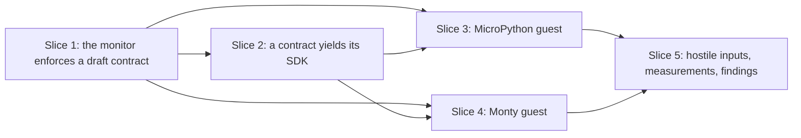

# Plan

Five slices. Slice 1 gives the monitor its contract; Slice 2 the SDK and the triage script; Slices 3
and 4 each run them under one runtime and may proceed in parallel; Slice 5 attacks, measures and
decides.

## Dependency graph



**Recorded blockers.** A stop condition below that contains the words "a recorded result" is a
result, not a block; so is a KVM `Timeout` (below). They cover a runtime that does not build, does
not fit KVM, needs an upstream edit, cannot load record 1 as module `hyalos`, runs
nondeterministically (P1), gives a non-canonical NaN (4.3), or runs out its timebox. Each is a
result: the executor
records it in `spikes/438/README.md` and the progress file, proves the criteria it can (S-05.1.e2
and S-06.2.e2 are met by such a record), and ends the slice `done`. Every other stop condition is a
hard stop under README rule 5 and ends the slice `blocked`. Slice 5 carries every recorded blocker
into the findings ADR, and runs on the runtimes that built. A run that ends `Timeout` at the KVM
backend's 30-second limit (`hyalos-os/monitor/src/main.rs:686`) is such a result: a runtime too slow
for KVM, recorded, not a hang: the case is listed `process` in `expected.tsv`, with a
`process-only: <runtime or case id> — <reason>` line in `spikes/438/README.md` (for a `Timeout`, the
reason names the host and the time; for a runtime that does not fit KVM, the sizes), and a row in
`MEASUREMENTS.md` (Slice 5 writes that row from the `process-only:` line), so CI never replays a wall-clock outcome (developer, cold-read round 4). A failed
upstream fetch, a missing tag or a SHA that differs is not a result: it is an environment fault and a
hard stop, ending the slice `blocked` (developer, cold-read round 4).

**Who records evidence.** The executor runs `run.sh`, `hostile.sh` and `measure.sh` on a host with
`/dev/kvm` and commits what they write (developer, cold-read round 4); CI only replays the committed
records. Each script builds every kernel image it needs with `spikes/438/kernel.sh <profile>` (Slice 2) and
sets `HYALOS_KERNEL` per run to the image for that run's profile; it exits non-zero before running
anything when `/dev/kvm` cannot be opened or `kernel.sh` fails, unless the runtime is recorded as
process-only (below).

Slices 3 and 4 both add rows to the committed-evidence replay test and to `spikes/438/README.md`.
Merge whichever is ready first; it creates `spike_evidence_tests.rs` and `spikes/438/evidence/expected.tsv`, and the other rebases on it and appends its rows. If both add a spike
profile, the second takes the next number and extends `KNOWN` (`hyalos-os/profile/src/lib.rs:71`)
on rebase.

## Traceability

| Criterion | Slices |
|---|---|
| S-01.1, S-01.2, S-01.3, S-01.4, S-01.5 | 1 |
| S-03.1, S-03.2, S-03.3 | 1 |
| S-02.1, S-02.2, S-02.3, S-02.4 | 2 |
| S-04.1, S-04.2, S-04.3, S-04.4 | 3 |
| S-05.1, S-05.2, S-05.3 | 4 |
| S-06.1, S-06.2, S-06.3 | 5 |

Example rows (S-NN.k.eN) follow their criterion's slices.

## Shared contract

Every slice uses the tables in `design.md` §2 as they stand: **Draft contract (input record 0)**,
**Monitor interfaces (behind `spike-contract`)** and **Python surface**. A slice that needs one of
them to change stops (README rule 6).

| Name | Inputs | Outputs | Errors | Invariants |
|---|---|---|---|---|
| `spikes/438/` layout | — | `README.md` (what is here and how to rebuild it), `contracts/`, `generate/`, `sdk/` (generated, committed), `scripts/` (triage and hostile scripts), `fixtures/`, `micropython/`, `monty/`, `guests/` (committed `.wasm` that records name), `evidence/` (records and `expected.tsv`), `kernel.sh` (builds the kernel image for a profile and prints its path), `MEASUREMENTS.md` | — | Each upstream source is fetched by a script from the repository URL the pack names, `https://github.com/micropython/micropython` for MicroPython and `https://github.com/pydantic/monty` for Monty (the executor confirms the URL publishes the tag, and records it), at a full commit SHA the script checks after the fetch (a tag is resolved to its SHA once, and both are recorded in the script and `README.md`); the first fetch is trusted and the SHA is reviewed in the PR, with no signed-tag check (developer, cold-read round 4). A failed fetch or a different SHA stops the script non-zero, a hard stop. A script may reuse a tree it fetched before when its checked-out commit equals the pinned SHA, so Verify runs offline once fetched. A Rust upstream builds with its own `Cargo.lock` and `--locked`. Nothing is vendored without its licence file. Every committed `.wasm` has its SHA-256 in `README.md`; the committed `.wasm` is what records name, and a rebuild elsewhere that differs is a reproducibility finding for the findings ADR (pre-mortem P1), not a failure. Scripts at the root: `hostile.sh`, `measure.sh` (Slice 5) |
| Committed-evidence replay test | `spikes/438/evidence/expected.tsv`, one line per case: its id; the guest; its five inputs (contract, SDK, script, data file, seed); `both` or `process` (`process` only for a runtime or case that `spikes/438/README.md` names on a line `process-only: <runtime or case id> — <reason>`, the reason being that it does not fit KVM or hit the KVM time limit); its expected outcome, either `result <bytes> effects <n>` with the record file it wrote, or `refused <Reason>` (a refused run writes no record); every `*.json` under `spikes/438/evidence/`; the guests under `spikes/438/guests/` | pass | fails, naming the case, when: `expected.tsv` lists no case; a `process` case's runtime or id has no `process-only:` line in `spikes/438/README.md`; a listed guest, input or record is missing; a `*.json` is no case's record; a case's run on a listed backend gives another outcome; or a result case's transcript differs from its committed record, or that record does not replay | The expected outcomes come from the PRD's example rows and, for seed 0 and 7 triage results, from the digest guest (3.3); hostile cases record what the run gave, so for them the test guards against change only. No script writes `expected.tsv`: the executor writes each line by hand, a PRD case's line from its example row before the run, a hostile case's line from the outcome `hostile.sh` printed, reviewed in the PR as a finding. A script re-run on the committed tree must leave `spikes/438/evidence/` unchanged (`git diff --exit-code` in Verify) | Named `python_committed_evidence_replays_on_both_backends`; runs with `spike-contract`; runs each case from its inputs; each record on the kernel image built for its profile; its KVM leg uses the existing gate that fails on a skip when `HYALOS_REQUIRE_KVM` is set (`hyalos-os/monitor/src/profile_tests.rs:114-121`), as every new KVM test in this pack does |

---

## Slice 1 — The monitor enforces a draft contract

Issue: #494 · Depends on: none · Stories: S-01, S-03 · Map: Bound the task, Describe the task

### Outcome

With `spike-contract`, the monitor runs a guest under `hyalos.spike/1` with a contract, SDK and
script as whole input records, and refuses on both backends any schema or effect the contract does
not grant; a default build is unchanged.

### Acceptance

- **S-01.1**
- **S-01.2**
- **S-01.3**
- **S-01.4**
- **S-01.5**
- **S-03.1**
- **S-03.2**
- **S-03.3**
- **1.1** Given a build with `spike-contract`, when the existing hostile-guest list
  (`hyalos-os/monitor/src/main.rs:205`) runs under `hyalos.profile/2`, then every case ends with its
  listed reason, unchanged.
- **1.2** A repository ADR (`docs/adr/0136-…`) records the feature (on `hyalos-profile`,
  `hyalos-audit` and `task-kernel`), the contract check, `BadContract` as a spike-only reason outside
  `hyalos-os/ABI.md`, the record-form exception for records 0 to 2 (`design.md` §2, Record form under
  a spike profile) and the spike profiles, and is in `docs/adr/README.md`. `ABI.md` is not edited. It is Proposed through review and set to
  Accepted in the PR's last commit, by the executor once the developer has approved the PR
  (CLAUDE.md documentation rules).
- **1.3** CI's `hyalos-os` job runs clippy and the tests with `task-kernel/spike-contract`,
  `hyalos-audit/spike-contract` and `hyalos-profile/spike-contract` as well as without them, and its
  change filter (`.github/workflows/ci.yml:68`) also matches `spikes/438/**`, so a change to the
  committed evidence alone still runs the replay test.
- **1.4** `cargo xtask lines` stays under 12,000 and `cargo xtask hyalos-unsafe` passes.
- **1.5** Given the same five files, when `spike-task` and `spike-run` are each run, then the task
  `spike-task` prints equals the `task` field of the record `spike-run` writes. The test is
  `python_1_5_spike_task_equals_record_task`.
- **1.6** Before any other change, the executor runs the digest guest under `hyalos.profile/2` on
  the issue fixture with seeds 0 and 7, on both backends, at the base commit, and pins each
  transcript's SHA-256 and fuel in `python_s_01_4_e2_profile_2_transcripts_hold`, which the feature
  run then checks (S-01.4.e2). The existing pin is for profile 1 only
  (`hyalos-os/monitor/src/ring_tests.rs:12-14`).

### Contracts

`design.md` §2: **Draft contract**, and in **Monitor interfaces** the rows Spike profiles
(`hyalos.spike/1` only), `execute_with` under a spike profile, `Host::pre_infer`,
`Host::pre_effect`, `Reason::BadContract`, Spike run command `spike-run`, Spike task command
`spike-task` and Spike timing. KVM under a spike profile holds with no change: `hyalos.spike/1` has
profile 2's settings, so the default kernel image runs it. This slice does not touch the kernel
image.

### Stop conditions

- Stop if a contract this slice depends on has drifted from `context.md` (preflight).
- Stop if any spike item (profile, reason, command, check, kernel image setting) compiles in a build
  without the feature (pre-mortem P2).
- Stop if any pinned transcript, fuel figure or committed record under `hyalos-os/evidence/` changes,
  with or without the feature (P4).
- Stop if the change needs a new guest call, a new record field or version, or a change to
  `hyalos-os/ABI.md`'s `hyalos.abi/1` section (P7).
- Stop if `unsafe` is needed in a file not on `UNSAFE_FILES`.

### Verify

```bash
set -o pipefail; log=$(mktemp)
cargo fmt --manifest-path hyalos-os/Cargo.toml --all --check
(cd hyalos-os/kernel-image && cargo fmt --check)
cargo clippy --locked --manifest-path hyalos-os/Cargo.toml --workspace --all-targets --features task-kernel/test-trust,hyalos-audit/test-trust,task-kernel/test-switches -- -D warnings
cargo clippy --locked --manifest-path hyalos-os/Cargo.toml --workspace --all-targets --features task-kernel/test-trust,hyalos-audit/test-trust,task-kernel/test-switches,task-kernel/spike-contract,hyalos-audit/spike-contract,hyalos-profile/spike-contract -- -D warnings
(cd hyalos-os/kernel-image && cargo clippy --release --locked -- -D warnings && cargo clippy --release --locked --features selftest -- -D warnings)
cargo build --release --locked --manifest-path hyalos-os/Cargo.toml -p attest --bins
cargo build --release --locked --manifest-path hyalos-os/Cargo.toml -p attest --features forge-ticket --bin forging-notary
HYALOS_REQUIRE_KVM=1 HYALOS_REQUIRE_LANDLOCK=1 cargo test --release --locked --manifest-path hyalos-os/Cargo.toml --workspace --features task-kernel/test-trust,hyalos-audit/test-trust,task-kernel/test-switches -- --nocapture 2>&1 | tee -a "$log"
HYALOS_REQUIRE_KVM=1 HYALOS_REQUIRE_LANDLOCK=1 cargo test --release --locked --manifest-path hyalos-os/Cargo.toml --workspace --features task-kernel/test-trust,hyalos-audit/test-trust,task-kernel/test-switches,task-kernel/spike-contract,hyalos-audit/spike-contract,hyalos-profile/spike-contract -- --nocapture 2>&1 | tee -a "$log"
cargo test --release --locked --manifest-path hyalos-os/Cargo.toml --workspace --features task-kernel/test-trust,hyalos-audit/test-trust,task-kernel/test-switches,task-kernel/spike-contract,hyalos-audit/spike-contract,hyalos-profile/spike-contract python_s_0 -- --list | grep -c ': test$'
cargo test --release --locked --manifest-path hyalos-os/Cargo.toml --workspace --features task-kernel/test-trust,hyalos-audit/test-trust,task-kernel/test-switches python_s_01_4_e1 -- --list | grep -c ': test$'
cargo test --release --locked --manifest-path hyalos-os/Cargo.toml --workspace --features task-kernel/test-trust,hyalos-audit/test-trust,task-kernel/test-switches,task-kernel/spike-contract,hyalos-audit/spike-contract,hyalos-profile/spike-contract python_1_5_ -- --list | grep -c ': test$'
HYALOS_REQUIRE_KVM=1 HYALOS_REQUIRE_LANDLOCK=1 cargo test --release --locked --manifest-path hyalos-os/Cargo.toml -p task-kernel --test release_switches -- --nocapture 2>&1 | tee -a "$log"
! grep -n '^skipped:' "$log"
grep -c 'spike-contract' .github/workflows/ci.yml
grep -n '^| \[0136\].*| Accepted |$' docs/adr/README.md
cargo xtask lines
cargo xtask hyalos-unsafe
cargo xtask docs
```

Expected: every command exits 0. Every `cargo test` line requires KVM and Landlock, as CI does (`.github/workflows/ci.yml:284-292`),
and runs with `--nocapture` into `$log`, so the `! grep` line fails if any test printed `skipped:`. The two `attest` builds are what CI
builds first (`.github/workflows/ci.yml:249-252`); without them the workspace tests fail on a
correct tree. Each test run ends `test result: ok`. The feature run is unfiltered, so it includes
the profile 1 pinned-transcript test (`core_s_02_1_e1_…`, `hyalos-os/monitor/src/ring_tests.rs:58`),
the profile 2 pin this slice adds (S-01.4.e2, below) and 1.1, all with the feature on. The first
`--list` count prints at least 14: one test per example row of S-01 and S-03 but S-01.4.e1, each
named `python_s_0N_k_eM_…`; the second prints at least 1, the default-build test for S-01.4.e1; the third prints 1, the test for 1.5. The
`ci.yml` count is at least 2; the index line shows ADR-0136 Accepted. `cargo xtask lines` prints
`hyalOS: N / 12000 lines` with N under 12,000. Would fail before this slice because no crate has
`spike-contract`, no `python_` test exists and ADR-0136 is not written.

Dry run: with the feature, run `spike-run` on the digest guest with the draft contract,
an empty-function SDK file and a one-line script file over `hyalos-os/evidence/fixtures/issues.tsv`,
then the existing `replay` command on the record, on both backends (KVM by setting `HYALOS_KERNEL`
to the default kernel image, built by `(cd hyalos-os/kernel-image && cargo build --release --locked
--target-dir target)` at `hyalos-os/kernel-image/target/x86_64-unknown-none/release/hyalos-kernel`,
as `hyalos-os/monitor/tests/release_switches.rs:81-99` builds it). The record names
`hyalos.spike/1`, its first three inputs are the three files' bytes, and replay prints its pass line
(S-03.1.e1, S-03.2.e1, S-01.5.e1).

### Pattern to follow

- The host checks and their order: `hyalos-os/audit/src/replay.rs:118-153`, `:236-246`.
- A feature that adds test-only behaviour, and the release-build test that proves its absence:
  `hyalos-os/monitor/Cargo.toml:26-31`, `hyalos-os/monitor/tests/release_switches.rs:63-115`.
- A new profile beside the old ones: `hyalos-os/profile/src/lib.rs:59-71`.
- Both-backend tests: `hyalos-os/monitor/src/abi_tests.rs:161-177`.
- Building the kernel image from a test: `hyalos-os/monitor/tests/release_switches.rs:82`.
- A hyalOS ADR: `docs/adr/0134-hyalos-profile-2-moves-to-wasmi-2-0-3.md`.

### Suggested path

Default route. You may deviate if every mandatory item still holds; record why.

1. Add the `spike-contract` feature to `hyalos-profile`, `hyalos-audit` and `task-kernel`, with
   `task-kernel` forwarding to `hyalos-audit` and both forwarding to `hyalos-profile` (ADR-006).
2. In `hyalos-profile`, add `hyalos.spike/1` and let `lookup` find it only with the feature.
3. In `hyalos-audit`, add the contract type and its canonical-bytes parser, `BadContract`, the
   contract on `Host`, the checks in `pre_infer` and `pre_effect`, and the contract read in
   `execute_with` for spike profiles. Unit-test S-01.3, S-03.2 and S-03.3 here.
4. In `task-kernel`, add `spike-run` with its timing and `spike-task`, and append `BadContract` to
   `REASONS` behind the feature (`design.md` §2, `Reason::BadContract`). The existing tests that
   match `Reason` exhaustively or pin the 29 entries (`hyalos-os/monitor/src/abi_tests.rs:103-146`,
   `hyalos-os/monitor/src/runner_tests.rs:464-500`, `:584`) gain the variant behind the feature;
   `every_reason()` leaves it out, since `BadContract` is not in `ABI.md` (`abi_tests.rs:626-640`).
5. Write the both-backend tests for S-01.1, S-01.2, S-01.3 and S-01.5, plus 1.1 and 1.5, on the
   default kernel image.
6. Prove S-01.4: a default-build test that `hyalos.spike/1` is unknown; in `release_switches.rs`,
   that a default build has no `spike-run` or `spike-task` command and ignores
   `HYALOS_SPIKE_PROFILE`; and the pinned-transcript tests (1.6) passing with the feature.
7. Add the feature runs to CI's `hyalos-os` job; write ADR-0136 and its README row.

### Files

- Modify: `hyalos-os/profile/Cargo.toml`, `hyalos-os/profile/src/lib.rs`
- Modify: `hyalos-os/audit/Cargo.toml`, `hyalos-os/audit/src/record.rs`, `hyalos-os/audit/src/replay.rs`
- Modify: `hyalos-os/monitor/Cargo.toml`, `hyalos-os/monitor/src/main.rs`, `hyalos-os/monitor/src/runner.rs`
- Modify: `hyalos-os/monitor/src/abi_tests.rs`, `hyalos-os/monitor/src/runner_tests.rs` (the new variant, behind the feature)
- Create: `hyalos-os/monitor/src/spike_tests.rs`
- Modify: `hyalos-os/monitor/tests/release_switches.rs`
- Modify: `.github/workflows/ci.yml`
- Create: `docs/adr/0136-hyalos-spike-contract-check.md`; Modify: `docs/adr/README.md`

---

## Slice 2 — A contract yields its SDK

Issue: #495 · Depends on: Slice 1 · Stories: S-02 · Map: Describe the task

### Outcome

`spikes/438/` holds the draft contracts, a deterministic generator, the SDKs it generates, and the
triage script written against the SDK; a different contract gives different SDK bytes and a
different task identity.

### Acceptance

- **S-02.1**
- **S-02.2**
- **S-02.3**
- **S-02.4**
- **2.1** `spikes/438/contracts/` holds three contracts in canonical bytes: `draft` (schema `0`,
  effect `0`), `no-notify` (schema `0` only) and `no-ask` (effect `0` only), and `spikes/438/sdk/`
  holds the SDK generated from each, committed.
- **2.2** `spikes/438/scripts/triage.py` is the parent brief's script shape (`read_inputs`, one
  `ask.classify` per issue, one `notify.team`, `finish`), producing the digest guest's notification
  and result format (`hyalos-os/guest/src/lib.rs:164-208`). It begins `from hyalos import task`
  and uses no name but `task`'s members and Python builtins (`len`, `str`, `int` and the like); it
  imports nothing else.
- **2.3** Given the triage script and the `draft` SDK run under the host's Python with a fake
  `_hyalos` that serves three placeholder records at indexes 0 to 2, the issue fixture's N lines
  from index 3, nothing after them, and `3` (other) for every question, when it finishes, then its
  notification is `total N bug 0 feature 0 security 0 other N` followed by a newline, and its result
  `ok N`.
- **2.4** `spikes/438/README.md` states the layout (Shared contract) and how to regenerate the SDKs.
- **2.5** `spikes/438/kernel.sh <profile>` builds the kernel image for that profile and prints its
  path: the default image for `hyalos.profile/2` and `hyalos.spike/1`; for any other known profile,
  the image built with that profile's kernel image feature, once a slice adds one; it exits non-zero
  for a profile it cannot build.

### Contracts

`design.md` §2: **Draft contract** and, in **Python surface**, the Generator, Generated SDK `task`
and Triage script rows. The Shared contract's `spikes/438/` layout. `spike-run` and `spike-task` as Slice 1 built them
(`design.md` §2).

### Stop conditions

- Stop if a contract this slice depends on has drifted from `context.md` (preflight).
- Stop if the generator's output depends on anything but the contract's bytes: the time, the
  environment, the platform or an iteration order (pre-mortem P6).
- Stop if the SDK needs a member the Python surface table does not name, or the triage script needs
  a name outside the SDK.
- Stop if a change to `hyalos-os/` is needed: Slice 1's interfaces are fixed.

### Verify

```bash
out=$(mktemp -d)
spikes/438/generate/check.sh
test -s "$(spikes/438/kernel.sh hyalos.profile/2)"
cargo run --release --locked --manifest-path hyalos-os/Cargo.toml -p task-kernel --features spike-contract -- spike-run hyalos-os/guest/digest.wasm spikes/438/contracts/draft spikes/438/sdk/draft.py spikes/438/scripts/triage.py hyalos-os/evidence/fixtures/issues.tsv "$out/draft.json"
! cargo run --release --locked --manifest-path hyalos-os/Cargo.toml -p task-kernel --features spike-contract -- spike-run hyalos-os/guest/digest.wasm spikes/438/contracts/no-notify spikes/438/sdk/no-notify.py spikes/438/scripts/triage.py hyalos-os/evidence/fixtures/issues.tsv "$out/no-notify.json" 2> "$out/err"
grep -c UnknownEffect "$out/err"
test ! -e "$out/no-notify.json"
for c in draft no-notify; do cargo run --release --locked --manifest-path hyalos-os/Cargo.toml -p task-kernel --features spike-contract -- spike-task hyalos-os/guest/digest.wasm spikes/438/contracts/$c spikes/438/sdk/$c.py spikes/438/scripts/triage.py hyalos-os/evidence/fixtures/issues.tsv; done > "$out/tasks"
for c in draft no-notify; do cargo run --release --locked --manifest-path hyalos-os/Cargo.toml -p task-kernel --features spike-contract -- spike-task hyalos-os/guest/digest.wasm spikes/438/contracts/$c spikes/438/sdk/$c.py spikes/438/scripts/triage.py hyalos-os/evidence/fixtures/issues.tsv; done > "$out/tasks2"
cmp "$out/tasks" "$out/tasks2"
sort -u "$out/tasks" | wc -l
grep -c "$(head -n 1 "$out/tasks")" "$out/draft.json"
grep -c 'regenerate' spikes/438/README.md
```

Expected: every line exits 0 (the `!` line because `spike-run` exits non-zero). `check.sh`
generates every SDK twice and compares the bytes, and compares each with the committed
`spikes/438/sdk/*.py`, failing on any difference (S-02.1.e1, 2.1); refuses a reordered and a
whitespace-padded contract (S-02.1.e2); lists each SDK's public names and compares them to
`design.md`'s table (S-02.2.e1, S-02.3.e1, S-02.3.e2); fails if `triage.py` imports anything but
`hyalos` (2.2); runs 2.3; and ends `check: ok`. `kernel.sh` prints the path of the kernel image it
built for the named profile (the default image for `hyalos.profile/2` and `hyalos.spike/1`). The
first `spike-run` prints `ok:`. The digest guest reads every record, so it counts records 0 to 2 as
unparsable titles and its notification says `total N+3`; assert nothing about that count. The
second exits non-zero with `UnknownEffect` (the `grep -c` prints at least 1) and writes no record
(`test ! -e` passes), because the digest guest calls `effect` and `no-notify` does not grant it.
`cmp` passes, since a second run of the loop gives the same identities (S-02.4.e2); `sort -u … | wc
-l` prints 2, since they differ (S-02.4.e1); the next `grep -c` prints 1, the `draft` identity being
the `task` field of `$out/draft.json`; the README count is at least 1 (2.4). `check.sh` is not in
CI: the `hyalos-os` job runs Rust tests, not the spike's scripts (`.github/workflows/ci.yml:233-325`); the
progress file records its output. Would fail before Slice 1 merges because `spike-contract` does
not exist.

### Pattern to follow

- The digest format to match: `hyalos-os/guest/src/lib.rs:164-208`.
- A spike rig's shape and README: `spikes/73/README.md`, `spikes/73/run-python.sh`.
- The task identity that binds the records: `hyalos-os/audit/src/record.rs:205`.

### Suggested path

Default route. You may deviate if every mandatory item still holds; record why.

1. Write the three contracts in canonical bytes.
2. Write the generator (Python, run on the host, standard library only) with its fixed name table,
   refusing non-canonical bytes; record the host Python version in `README.md`.
3. Generate and commit the three SDKs; write `check.sh`.
4. Write the triage script and the fake `_hyalos` used only by `check.sh`; run 2.3.
5. Write `spikes/438/README.md`.

### Files

- Create: `spikes/438/README.md`
- Create: `spikes/438/contracts/draft`, `spikes/438/contracts/no-notify`, `spikes/438/contracts/no-ask`
- Create: `spikes/438/generate/generate.py`, `spikes/438/generate/check.sh`, `spikes/438/generate/fake_hyalos.py`
- Create: `spikes/438/sdk/draft.py`, `spikes/438/sdk/no-notify.py`, `spikes/438/sdk/no-ask.py`
- Create: `spikes/438/scripts/triage.py`
- Create: `spikes/438/kernel.sh`

---

## Slice 3 — The triage task runs under MicroPython

Issue: #496 · Depends on: Slice 1, Slice 2 · Stories: S-04 · Map: Run it as Python

### Outcome

A MicroPython guest built from a custom port runs the triage script and its SDK on both backends,
every record replays byte-identically, an ungranted SDK call fails in the guest, and a raw
`_hyalos` call is refused by the monitor; or the blocker that stops it is recorded.

### Acceptance

- **S-04.1**
- **S-04.2**
- **S-04.3**
- **S-04.4**
- **3.1** `spikes/438/micropython/build.sh` fetches MicroPython at a pinned commit, builds the port
  for `wasm32-unknown-unknown` with no Emscripten, and writes `spikes/438/guests/micropython.wasm`.
  The executor chooses the commit (the newest release tag at the time is the default) and records it
  in `build.sh`, `spikes/438/README.md` and the progress file's Decisions. The default toolchain is
  the host's `clang` with its `wasm32` target and `wasm-ld`, `-nostdlib`, MicroPython's own string
  and `libm` sources and its own GC heap (no `malloc`); the `clang` version is recorded the same way;
  it builds twice, from a clean tree at the same path with `SOURCE_DATE_EPOCH=0`, and exits
  non-zero unless the two outputs are byte-identical; `spikes/438/README.md` records the SHA-256.
- **3.2** The committed-evidence replay test (Shared contract) exists in `task-kernel` and replays
  every MicroPython record on both backends.
- **3.3** Given the issue fixture and seeds 0 and 7, when the MicroPython triage run's notification
  and result are compared with those of the digest guest run under `hyalos.profile/2` on the
  fixture's lines alone with the same seed, then they are byte-identical. The test is
  `python_3_3_…`; S-04.4.e1 and S-04.4.e2's tests are `python_s_04_4_e1_…` and `python_s_04_4_e2_…`.
- **3.4** The guest runs under `hyalos.spike/1`, or, if it cannot (size over 1 MiB, memory over
  4 MiB, fuel), the progress file records the limit it hit (a guest over 1 MiB needs a spike-only
  KVM layout, since `GUEST_MAX` is a monitor constant, `hyalos-os/monitor/src/kvm.rs:33`, not a
  profile field), and the runs use a new spike profile
  added in this slice as this pack's ADR-002 allows, run with `HYALOS_SPIKE_PROFILE`. If that
  profile's settings differ from profile 2's, or its guest needs a spike-only layout, this slice also adds the KVM mechanism and kernel
  image build that `design.md` §2 assigns to the first such slice, and the repository ADR for the
  new profile that Slice 4's Files describe. `spikes/438/README.md` has a line
  `micropython profile: <name>` and, if not `hyalos.spike/1`, the limit that forced it.

### Contracts

`design.md` §2, **Python surface**: `_hyalos`, Runtime guest `run`. The Shared contract's
committed-evidence replay test. If 3.4 needs a new spike profile, the **Spike profiles**, **Kernel
image spike build** and **KVM under a spike profile** rows apply to it unchanged.

### Stop conditions

- Stop if a contract this slice depends on has drifted from `context.md` (preflight).
- Stop if the two backends' transcripts differ, or a run differs from itself on a second try, and
  the cause is not found (pre-mortem P1): record what differs, a recorded result (MicroPython is
  then "not ready").
- Stop if the port needs an import other than the four `hyalos` calls, floats under a profile that
  refuses them, or a start function: record it as the blocker, with the build command that shows it
  (MicroPython is then "not ready", as the PRD's assumption says), a recorded result.
- Stop if MicroPython's non-local return (NLR) can only be built with `setjmp` lowered to a
  WebAssembly proposal the profile refuses (exception handling): record it as the blocker, with the
  build command that shows it, a recorded result.
- Stop if making the port work needs edits to MicroPython's own source beyond a port directory and
  build configuration: record the edit needed as a finding instead, a recorded result.
- Stop if the port cannot load record 1 as module `hyalos` (`design.md` §2, Runtime guest `run`):
  record it as the blocker, a recorded result.
- Stop if a new spike profile would change an existing one (P4).
- Stop if any spike item added here (profile, kernel image feature, marker read) compiles in a build
  without the feature (P2).
- Stop at the end of the slice's timebox (two days of work) with whatever builds, and record the
  blocker (R1), a recorded result.

### Verify

```bash
set -o pipefail; log=$(mktemp)
spikes/438/micropython/build.sh
grep -q "$(sha256sum spikes/438/guests/micropython.wasm | cut -d ' ' -f 1)" spikes/438/README.md
grep -n '^micropython profile: hyalos\.' spikes/438/README.md
spikes/438/micropython/run.sh
git diff --exit-code -- spikes/438/evidence spikes/438/guests
cargo fmt --manifest-path hyalos-os/Cargo.toml --all --check
(cd hyalos-os/kernel-image && cargo fmt --check)
cargo clippy --locked --manifest-path hyalos-os/Cargo.toml --workspace --all-targets --features task-kernel/test-trust,hyalos-audit/test-trust,task-kernel/test-switches -- -D warnings
cargo clippy --locked --manifest-path hyalos-os/Cargo.toml --workspace --all-targets --features task-kernel/test-trust,hyalos-audit/test-trust,task-kernel/test-switches,task-kernel/spike-contract,hyalos-audit/spike-contract,hyalos-profile/spike-contract -- -D warnings
(cd hyalos-os/kernel-image && cargo clippy --release --locked -- -D warnings && cargo clippy --release --locked --features selftest -- -D warnings)
cargo build --release --locked --manifest-path hyalos-os/Cargo.toml -p attest --bins
cargo build --release --locked --manifest-path hyalos-os/Cargo.toml -p attest --features forge-ticket --bin forging-notary
HYALOS_REQUIRE_KVM=1 HYALOS_REQUIRE_LANDLOCK=1 cargo test --release --locked --manifest-path hyalos-os/Cargo.toml --workspace --features task-kernel/test-trust,hyalos-audit/test-trust,task-kernel/test-switches,task-kernel/spike-contract,hyalos-audit/spike-contract,hyalos-profile/spike-contract python_ -- --nocapture 2>&1 | tee -a "$log"
cargo test --release --locked --manifest-path hyalos-os/Cargo.toml --workspace --features task-kernel/test-trust,hyalos-audit/test-trust,task-kernel/test-switches,task-kernel/spike-contract,hyalos-audit/spike-contract,hyalos-profile/spike-contract python_ -- --list | grep -cE 'python_(s_04_4_e[12]_|3_3_|committed_evidence_replays_on_both_backends).*: test$'
HYALOS_REQUIRE_KVM=1 HYALOS_REQUIRE_LANDLOCK=1 cargo test --release --locked --manifest-path hyalos-os/Cargo.toml -p task-kernel --test release_switches -- --nocapture 2>&1 | tee -a "$log"
! grep -n '^skipped:' "$log"
cargo xtask lines
cargo xtask hyalos-unsafe
cargo xtask docs
```

Expected: every command exits 0. Every `cargo test` line requires KVM and Landlock, as CI does (`.github/workflows/ci.yml:284-292`),
and runs with `--nocapture` into `$log`, so the `! grep` line fails if any test printed `skipped:`. `build.sh` ends with the guest's size and fails if
its two builds differ (3.1); the hash is in `README.md`; the profile line names the profile 3.4
chose. `run.sh` builds the kernel images it needs with `kernel.sh`, runs the triage script under
`draft` on both backends with seeds 0 and 7, runs the `no-notify` SDK case and the raw
`_hyalos.effect` case under `no-notify`, writes the records to
`spikes/438/evidence/micropython-*.json` (the executor writes their cases into `expected.tsv` by
hand, Shared contract; on the committed tree the `git diff` line shows the re-run changed nothing), and ends
`micropython: ok`. The test run ends `test result: ok`; the `--list` count prints at least 4: the
tests for S-04.4.e1 (the guest's imports listed by `wasmi`'s module reader), S-04.4.e2 (a copy with
one extra import refused `BadImport`) and 3.3 (seeds 0 and 7), and the committed-evidence replay
test, which proves S-04.1.e1, S-04.1.e2, S-04.2.e1 (`result error AttributeError`, no `effect`) and
S-04.3.e1 (`refused UnknownEffect`). Would fail before Slices 1 and 2 merge because `spike-contract`
and `spikes/438/` do not exist; `build.sh` fails without host `clang` and `wasm-ld`, which is a
recorded blocker (the progress file then records the command and its output instead). When
MicroPython is recorded blocked (any stop above that contains "a recorded result"), the lines after the
step that showed it (the hash, profile, `run.sh` and `git diff` lines, and the 3.3 and S-04.4 tests)
do not apply, and the progress file says so, as in Slice 4.

### Pattern to follow

- The digest guest's imports and `run` export: `hyalos-os/guest/src/lib.rs:14-24`, `:107-108`.
- What the loader accepts: `hyalos-os/audit/src/replay.rs:300-327`, `hyalos-os/ABI.md:15-20`.
- Both-backend comparison: `hyalos-os/monitor/src/abi_tests.rs:161-177`.
- Replay from a record: `hyalos-os/audit/src/replay.rs:407-438`.

### Suggested path

Default route. You may deviate if every mandatory item still holds; record why.

1. Write the port: a minimal MicroPython port with no floats, no filesystem and no time, a fixed
   heap, string hashing seeded from a constant, and a native `_hyalos` module over the four imports.
2. Its `run` reads record 1 into module `hyalos`, record 2 as the main script, and on an uncaught
   exception calls `finish` with `error ` and the exception's type name.
3. Build, check the import list, and run the triage script on the process backend; then on KVM.
4. Write `run.sh`, commit the guest and the records, add the committed-evidence replay test.
5. Write the hostile script (raw `_hyalos.effect` under `no-notify`) and the ungranted-SDK case.

### Files

- Create: `spikes/438/micropython/` (port sources, `build.sh`, `run.sh`, upstream licence file)
- Create: `spikes/438/guests/micropython.wasm`
- Create (or use, if Slice 4 merged first and created it): `spikes/438/scripts/raw-effect.py`
- Create: `spikes/438/evidence/micropython-*.json`; Create or modify: `spikes/438/evidence/expected.tsv`
- Create (or modify, if Slice 4 merged first): `hyalos-os/monitor/src/spike_evidence_tests.rs`; Modify: `hyalos-os/monitor/src/main.rs` (its `mod` line)
- Modify: `spikes/438/README.md`
- Modify, only if 3.4 needs it: `hyalos-os/monitor/src/profile_tests.rs` (its source-text check of the kernel image's `PROFILE` line, `:152-154`, keeps passing for the default build), `hyalos-os/profile/src/lib.rs`, `hyalos-os/kernel-image/Cargo.toml`, `hyalos-os/kernel-image/src/main.rs`, `hyalos-os/monitor/src/kvm.rs`, `hyalos-os/monitor/src/main.rs`, `hyalos-os/monitor/tests/release_switches.rs`, `spikes/438/kernel.sh` (the new profile), and a repository ADR in `docs/adr/` with its `docs/adr/README.md` row

---

## Slice 4 — The triage task runs under Monty

Issue: #497 · Depends on: Slice 1, Slice 2 · Stories: S-05 · Map: Run it as Python

### Outcome

A Monty guest runs the same triage script and SDK under its own spike profile on both backends,
every record replays byte-identically, and Monty's type checking has been tried; or the blocker that
stops any of it is recorded with its command.

### Acceptance

- **S-05.1**
- **S-05.2**
- **S-05.3**
- **4.1** `spikes/438/monty/build.sh` builds Monty at `v1.6.0` if that tag exists, otherwise its
  newest release tag (the choice recorded in `build.sh`, `README.md` and the progress file),
  for `wasm32-unknown-unknown`, with its randomness supplied from a constant and no WASI imports,
  and writes `spikes/438/guests/monty.wasm`; it builds twice, from a clean tree at the same path
  with `SOURCE_DATE_EPOCH=0` and Monty's own `Cargo.lock` and `--locked`, and exits non-zero unless
  the two outputs are byte-identical; `spikes/438/README.md` records the SHA-256 and the `rustc`
  version and target.
- **4.2** `hyalos.spike/2` (or the next free number, if Slice 3 took it) is defined once with
  the limits Monty needs: floats with `wasmi`'s deterministic float results (`wasmi/deterministic`,
  turned on as ADR-007 says), `max_memory` a whole number of MiB at least the measured peak, and
  `fuel` twice the measured fixture fuel rounded up to the next ten million (peak memory is the
  smallest whole number of MiB of `max_memory` at which the seed-0 process-backend run ends with a
  result, found by trying values under a local profile, a temporary `KNOWN` entry never committed;
  fixture fuel is `fuel_used` of a seed-0 process-backend run under a local, uncommitted profile).
  `spikes/438/README.md` has a line `monty profile: <name>` with the measured peak, the fixture fuel
  and the command that gave each. The spike-only layout, if needed, is the
  smallest that holds the guest and `max_memory`; `run.sh` selects the profile with
  `HYALOS_SPIKE_PROFILE` and the image with `HYALOS_KERNEL` (the image reports its own profile,
  `design.md` §2); a kernel image is built for it with a spike-only machine layout when the
  default one cannot hold it. If Slice 3 did not add the KVM mechanism by which a spike kernel image
  reports its own profile (`design.md` §2, KVM under a spike profile), this slice adds it, with
  `kernel.sh` building the new image. A test, `python_4_2_profile_limits_cover_the_fixture`, runs
  the Monty triage guest on the fixture, seed 0, under the new profile and fails unless the run
  ends with a result (so `max_memory` holds the peak) and the profile's `fuel` equals twice its
  `fuel_used` rounded up to the next ten million.
- **4.3** Given a float guest (a WAT module in `spike_tests.rs`, test `python_4_3_…`) that divides
  `f32` zero by zero and returns the NaN's bits, when it runs under the new profile on both
  backends, then both give the same transcript and the bits are `0x7fc00000`, the canonical NaN
  (without `wasmi/deterministic`, x86 gives `0xffc00000`).
- **4.4** Given a build with `spike-contract`, when the pinned-transcript tests for profiles 1 and 2
  run, then they pass unchanged.

### Contracts

`design.md` §2: **Spike profiles** (the new profile), **Kernel image spike build** (with layout),
**KVM under a spike profile**, and in **Python surface** `_hyalos` (as Monty host functions) and
Runtime guest `run`. The Shared contract's committed-evidence replay test.

### Stop conditions

- Stop if a contract this slice depends on has drifted from `context.md` (preflight).
- Stop if any profile 1 or 2 transcript or fuel figure changes with `wasmi/deterministic` on
  (ADR-007, pre-mortem P4, R5).
- Stop if any spike item added here (`wasmi/deterministic`, a kernel image feature, the marker
  read) compiles in a default build of the monitor or the kernel image (P2).
- Stop if a spike-only layout would widen a monitor memory guard (`HEAP`, `STACK`, `GUEST_MAX`)
  other than by deriving it from that layout (`design.md` §2, Kernel image spike build).
- Stop if the two backends' transcripts differ, or a run differs from itself, and the cause is not
  found (P1): record it, a recorded result (Monty is then "not ready").
- Stop if 4.3's float guest gives bits other than `0x7fc00000`, or different transcripts on the two
  backends: record it as Monty's blocker, a recorded result; floats stay refused outside this profile.
- Stop if Monty needs edits to its own source beyond build configuration and the host-function
  binding: record the edit as a finding instead (R2), a recorded result.
- Stop if Monty's embedding cannot load record 1 as module `hyalos` (`design.md` §2, Runtime guest
  `run`): record it as Monty's blocker, a recorded result.
- Stop if the KVM machine cannot hold the guest and its memory even with a spike-only layout:
  record the sizes and run on the process backend only (S-05.1.e2, R4), a recorded result. Monty's records are then
  listed `process` in `expected.tsv`, `README.md` has the line `process-only: monty — <the sizes>`, and `run.sh`
  skips its KVM leg for that reason alone.
- Stop at the end of the slice's timebox (two days of work) with whatever builds, and record the
  blocker, a recorded result.

### Verify

```bash
set -o pipefail; log=$(mktemp)
spikes/438/monty/build.sh
grep -q "$(sha256sum spikes/438/guests/monty.wasm | cut -d ' ' -f 1)" spikes/438/README.md
grep -n '^monty profile: hyalos\.spike/' spikes/438/README.md
spikes/438/monty/run.sh
git diff --exit-code -- spikes/438/evidence spikes/438/guests
spikes/438/monty/typecheck.sh
grep -n '^typecheck: \(rejected\|accepted\|unusable: \)' spikes/438/README.md
cargo fmt --manifest-path hyalos-os/Cargo.toml --all --check
(cd hyalos-os/kernel-image && cargo fmt --check)
cargo clippy --locked --manifest-path hyalos-os/Cargo.toml --workspace --all-targets --features task-kernel/test-trust,hyalos-audit/test-trust,task-kernel/test-switches -- -D warnings
cargo clippy --locked --manifest-path hyalos-os/Cargo.toml --workspace --all-targets --features task-kernel/test-trust,hyalos-audit/test-trust,task-kernel/test-switches,task-kernel/spike-contract,hyalos-audit/spike-contract,hyalos-profile/spike-contract -- -D warnings
(cd hyalos-os/kernel-image && cargo clippy --release --locked -- -D warnings && cargo clippy --release --locked --features selftest -- -D warnings)
cargo build --release --locked --manifest-path hyalos-os/Cargo.toml -p attest --bins
cargo build --release --locked --manifest-path hyalos-os/Cargo.toml -p attest --features forge-ticket --bin forging-notary
HYALOS_REQUIRE_KVM=1 HYALOS_REQUIRE_LANDLOCK=1 cargo test --release --locked --manifest-path hyalos-os/Cargo.toml --workspace --features task-kernel/test-trust,hyalos-audit/test-trust,task-kernel/test-switches,task-kernel/spike-contract,hyalos-audit/spike-contract,hyalos-profile/spike-contract -- --nocapture 2>&1 | tee -a "$log"
cargo test --release --locked --manifest-path hyalos-os/Cargo.toml --workspace --features task-kernel/test-trust,hyalos-audit/test-trust,task-kernel/test-switches,task-kernel/spike-contract,hyalos-audit/spike-contract,hyalos-profile/spike-contract python_4_ -- --list | grep -cE 'python_4_[23]_.*: test$'
HYALOS_REQUIRE_KVM=1 HYALOS_REQUIRE_LANDLOCK=1 cargo test --release --locked --manifest-path hyalos-os/Cargo.toml -p task-kernel --test release_switches -- --nocapture 2>&1 | tee -a "$log"
! grep -n '^skipped:' "$log"
! cargo tree --locked --manifest-path hyalos-os/Cargo.toml -p task-kernel -e features | grep -q 'wasmi feature "deterministic"'
! (cd hyalos-os/kernel-image && cargo tree --locked -e features | grep -q 'wasmi feature "deterministic"')
cargo tree --locked --manifest-path hyalos-os/Cargo.toml -p task-kernel -e features --features task-kernel/test-trust,hyalos-audit/test-trust,task-kernel/test-switches,task-kernel/spike-contract,hyalos-audit/spike-contract,hyalos-profile/spike-contract | grep -c 'wasmi feature "deterministic"'
cargo xtask lines
cargo xtask hyalos-unsafe
cargo xtask docs
```

Expected: every command exits 0. Every `cargo test` line requires KVM and Landlock, as CI does (`.github/workflows/ci.yml:284-292`),
and runs with `--nocapture` into `$log`, so the `! grep` line fails if any test printed `skipped:`. `build.sh` ends with the guest's size and fails if
its two builds differ (4.1); the hash is in `README.md`; the profile line names the new profile and
the measured peak memory and fixture fuel with the command that gave each (4.2). `run.sh` builds
the kernel images it needs with `kernel.sh`, runs the triage script under `draft` on both backends
with seeds 0 and 7, runs the `no-notify` SDK case and the direct host-function case under
`no-notify`, writes `spikes/438/evidence/monty-*.json` (their cases are written into `expected.tsv` by
hand, as in Slice 3), and ends
`monty: ok` (S-05.1.e1, S-05.2.e1, S-05.2.e2), or ends `monty: blocked` with the blocker, recorded
in `spikes/438/README.md` (S-05.1.e2). `typecheck.sh` runs Monty's own type checker over a
hand-typed stub of the `no-notify` SDK, kept in `spikes/438/monty/`, and the triage script; prints
`rejected` (it reports the missing `notify`), `accepted` (it reports nothing), or `unusable: <why>`
(any other failure, with its message, including no usable checker); exits 0 in every case; and
records the result as the `typecheck:` line the `grep` prints (S-05.3.e1, S-05.3.e2). The workspace
tests end `test result: ok`, including the pinned transcripts of profiles 1 and 2 with the feature
on (4.4) and the Monty cases of the committed-evidence replay test. The `--list` count prints at
least 2: 4.2's `python_4_2_…` and 4.3's `python_4_3_…`. The two `! cargo tree` lines pass, since a
default monitor and a default kernel image have no `wasmi/deterministic`; the spike `cargo tree`
count prints at least 1, since the spike build has it. When Monty is recorded blocked before a
profile exists, the 4.2 and 4.3 checks and the spike `cargo tree` line do not apply, and the progress
file says so. Would fail before Slices 1 and 2 merge because `spike-contract` and `spikes/438/` do
not exist.

### Pattern to follow

- Interpreter settings from a profile, on both backends: `hyalos-os/audit/src/replay.rs:284-297`,
  `hyalos-os/kernel-image/src/main.rs:233-246`.
- The machine layout constants: `hyalos-os/monitor/src/kvm.rs:29-41`,
  `hyalos-os/kernel-image/src/main.rs:34-35`.
- A profile checked against its predecessor: `hyalos-os/profile/src/lib.rs:134-146`.
- Slice 3's `spikes/438/micropython/run.sh` once merged, for the run script's shape.

### Suggested path

Default route. You may deviate if every mandatory item still holds; record why.

1. Build Monty for `wasm32-unknown-unknown` with a custom `getrandom` backend that returns a
   constant, and bind its host functions to the four `hyalos` imports as `_hyalos`.
2. Measure what it needs (guest bytes, memory, fuel on the fixture) on the process backend under a
   local, uncommitted profile.
3. Define the new spike profile from those figures, turn on `wasmi/deterministic` as ADR-007 says,
   and prove 4.3 and 4.4.
4. Build the kernel image for it, with a spike-only layout if needed; run on KVM.
5. Write `run.sh` and `typecheck.sh`, commit the guest and records, add Monty's rows to the
   committed-evidence replay test.

### Files

- Create: `spikes/438/monty/` (crate and host binding, `build.sh`, `run.sh`, `typecheck.sh`)
- Create: `spikes/438/guests/monty.wasm`
- Create: `spikes/438/scripts/raw-effect-monty.py` if Monty's direct call differs from MicroPython's; otherwise use `spikes/438/scripts/raw-effect.py`, creating it if Slice 3 has not merged
- Create: `spikes/438/evidence/monty-*.json`; Create or modify: `spikes/438/evidence/expected.tsv`
- Modify: `hyalos-os/profile/src/lib.rs`, `hyalos-os/kernel-image/Cargo.toml`, `hyalos-os/kernel-image/src/main.rs`, `hyalos-os/monitor/src/kvm.rs`, `hyalos-os/monitor/src/main.rs`
- Modify: `hyalos-os/audit/Cargo.toml`, `hyalos-os/monitor/Cargo.toml` (`wasmi/deterministic` in their `spike-contract` features, ADR-007)
- Modify, if Slice 3 did not add the KVM mechanism: `hyalos-os/monitor/tests/release_switches.rs` (the kernel image helper and its tests), `hyalos-os/monitor/src/profile_tests.rs` (as in Slice 3), `spikes/438/kernel.sh` (the new profile)
- Modify: `hyalos-os/monitor/src/spike_tests.rs`, `hyalos-os/monitor/src/spike_evidence_tests.rs` (created by Slice 3, or here if this slice merges first)
- Create: a repository ADR in `docs/adr/`, numbered with the next free number there, for the new profile, its deterministic floats and its layout, with its row in `docs/adr/README.md` (ADR-0136 is accepted by then and is not edited); Proposed through review and set to Accepted in the PR's last commit by the executor once the developer has approved the PR, as 1.2
- Modify: `spikes/438/README.md`

---

## Slice 5 — Hostile inputs, measurements and the findings

Issue: #498 · Depends on: Slice 3, Slice 4 · Stories: S-06 · Map: Judge it

### Outcome

Each runtime has been run on hostile inputs and measured the same way on both backends, the results
are committed, and an accepted findings ADR names the runtime capsules should adopt, or states that
neither is ready.

### Acceptance

- **S-06.1**
- **S-06.2**
- **S-06.3**
- **5.1** `spikes/438/fixtures/hostile.tsv` holds at least the cases of S-06.1's examples (invalid
  UTF-8, a record of exactly 16,384 bytes (the guest's read buffer) and one of 16,385 bytes, 200 colliding titles),
  plus one case per runtime-specific weakness found in Slices 3 and 4. Its form: `#` lines are
  comments naming what the next case tries; every other line is `<case id>\t<runtime or all>\t<the
  data line, with \xNN escapes>`, and `hostile.sh` decodes the escapes to build each case's data
  file of one or more lines. The colliding titles are one block per runtime, generated by
  `spikes/438/fixtures/collide.py` from that runtime's string hash and its constant seed, and tagged
  with the runtime: for MicroPython, its qstr hash from the port's source; for Monty, the hash
  function its source uses at the pinned commit, reimplemented in `collide.py` with the path and line
  it follows recorded in `spikes/438/README.md`. If a runtime's hash cannot be reproduced, its block
  is 200 distinct titles of the same length, and `README.md` and the findings ADR say collisions were
  not tested for it, a recorded result. For a case that ends `OutOfFuel`, the fuel recorded is the
  profile's `fuel`, which the run used up; a KVM `Timeout` is a refusal with reason `Timeout`.
- **5.2** `spikes/438/MEASUREMENTS.md` has one row per runtime and backend with guest size, cold
  start, run time and fuel, each with its command (a process-only runtime's or case's KVM row gives
  its `process-only:` reason in place of figures) (times are the median of three runs, so they are
  recorded, not reproduced); and one row per hostile case and runtime with its
  outcome and reach.
- **5.3** The findings ADR is the next free number in `docs/plans/hyalos-kernel-python/decisions/`
  (`ADR-008-findings-…` unless a later ADR took 008; its file name always has `-findings-`). It states that
  the monitor, not the SDK, is the boundary (pre-mortem P3), names the runtime or states neither is
  ready with what each still needs, states the hostile-input limit an audit report must carry for a
  Python task (P5), and lists what capsules must decide (floats, memory limit, the script field). It
  is accepted by the developer: the executor writes `accepted (developer, <date>)` in the PR's last
  commit once the developer has approved the PR. It says that signing the task identity was out of
  scope and is capsules' concern. `docs/plans/hyalos-kernel/pack-briefs.md`'s capsules section cites
  it (M4).
- **5.4** The hostile-input records for each runtime that built are committed under
  `spikes/438/evidence/` and replay in the committed-evidence replay test.

### Contracts

None new. The Shared contract's committed-evidence replay test gains the hostile records.

### Stop conditions

- Stop if a contract this slice depends on has drifted from `context.md` (preflight).
- Stop if a hostile input escapes the guest (reaches a host call the contract does not grant, or
  changes anything outside the record): that is a monitor bug, to report, not a finding to record.
- Stop if a hostile input makes either backend crash, or run on past its limit with no reason at all
  (a `Timeout` at the limit is a reason, as Recorded blockers says).
- Stop if the findings would recommend changing a default build, the guest interface or the record
  format: that belongs to capsules, so record it as a decision for capsules instead.

### Verify

```bash
set -o pipefail; log=$(mktemp)
spikes/438/hostile.sh
git diff --exit-code -- spikes/438/evidence
spikes/438/measure.sh
spikes/438/measure.sh --check
cargo fmt --manifest-path hyalos-os/Cargo.toml --all --check
(cd hyalos-os/kernel-image && cargo fmt --check)
cargo clippy --locked --manifest-path hyalos-os/Cargo.toml --workspace --all-targets --features task-kernel/test-trust,hyalos-audit/test-trust,task-kernel/test-switches -- -D warnings
cargo clippy --locked --manifest-path hyalos-os/Cargo.toml --workspace --all-targets --features task-kernel/test-trust,hyalos-audit/test-trust,task-kernel/test-switches,task-kernel/spike-contract,hyalos-audit/spike-contract,hyalos-profile/spike-contract -- -D warnings
(cd hyalos-os/kernel-image && cargo clippy --release --locked -- -D warnings && cargo clippy --release --locked --features selftest -- -D warnings)
cargo build --release --locked --manifest-path hyalos-os/Cargo.toml -p attest --bins
cargo build --release --locked --manifest-path hyalos-os/Cargo.toml -p attest --features forge-ticket --bin forging-notary
HYALOS_REQUIRE_KVM=1 HYALOS_REQUIRE_LANDLOCK=1 cargo test --release --locked --manifest-path hyalos-os/Cargo.toml --workspace --features task-kernel/test-trust,hyalos-audit/test-trust,task-kernel/test-switches,task-kernel/spike-contract,hyalos-audit/spike-contract,hyalos-profile/spike-contract python_ -- --nocapture 2>&1 | tee -a "$log"
! grep -n '^skipped:' "$log"
grep -c -e '-hostile-' spikes/438/evidence/expected.tsv
grep -n '^\*\*Status:\*\* accepted' docs/plans/hyalos-kernel-python/decisions/ADR-*-findings-*.md
grep -n 'hyalos-kernel-python/decisions/ADR-[0-9]*-findings-' docs/plans/hyalos-kernel/pack-briefs.md
cargo xtask lines
cargo xtask hyalos-unsafe
cargo xtask docs
```

Expected: every command exits 0. Every `cargo test` line requires KVM and Landlock, as CI does (`.github/workflows/ci.yml:284-292`),
and runs with `--nocapture` into `$log`, so the `! grep` line fails if any test printed `skipped:`. `hostile.sh` builds the kernel images it needs with
`kernel.sh`, runs every case in `hostile.tsv` under each runtime that built, on both backends (the process backend alone for a runtime or case with a
`process-only:` line), writes each record it gives and prints the outcome line per case and runtime
that the executor copies into `expected.tsv` once reviewed (a result, or `refused` with the reason,
`OutOfFuel` included; a KVM `Timeout` makes the case process-only, as Recorded blockers says), and prints one line per case
and runtime with its outcome and its reach (labels asked, effect body hash, result, fuel), ending
`hostile: ok` (S-06.1.e1, S-06.1.e2, S-06.1.e3). `measure.sh` prints the measurements table in
`MEASUREMENTS.md`'s form, a runtime that did not build with its recorded reason and no figures
(S-06.2.e2); `measure.sh --check` exits non-zero unless its guest size and fuel figures equal
`MEASUREMENTS.md`'s, figure for figure, and every time figure there has its command; times are not
compared, since they vary (S-06.2.e1). The tests end `test result: ok`, and the committed-evidence
replay test passes every hostile case (5.4). The `-hostile-` count is at least one line per case and
runtime it applies to (a case tagged `all` counts once per runtime that built, one tagged with a
runtime once); the ADR line shows it accepted (S-06.3); the brief cites it (M4).
Would fail before Slices 3 and 4 merge because the guests do not exist.

Dry run (S-06.3.e1, S-06.3.e2): read the findings ADR against `MEASUREMENTS.md` and the Slice 3 and 4
progress files; every claim in it cites a row or a record.

### Pattern to follow

- The hostile-guest list and its verdicts: `hyalos-os/monitor/src/main.rs:205-229`, `:459-473`.
- The phase timings a KVM run already measures, printed by the trace printer in a `test-switches`
  build: `hyalos-os/monitor/src/runner.rs:633`. `spike-run`'s own timing (Slice 1) is what
  `measure.sh` records.
- The issue fixture's form: `hyalos-os/ABI.md:70-71`.
- A per-pack ADR: `docs/plans/hyalos-kernel-python/decisions/ADR-002-a-spike-profile-per-runtime-on-both-backends.md`.

### Suggested path

Default route. You may deviate if every mandatory item still holds; record why.

1. Write `hostile.tsv` from S-06.1's examples and the weaknesses the progress files of Slices 3
   and 4 name.
2. Write `hostile.sh`; run, commit the records, extend the committed-evidence replay test.
3. Write `measure.sh`; run it three times per row and record the median for times.
4. Write `MEASUREMENTS.md` and the findings ADR, and add it to nothing else: the pack's Read order
   already lists `decisions/`.
5. Add a line to `docs/plans/hyalos-kernel/pack-briefs.md`'s capsules section citing the findings ADR.

### Files

- Create: `spikes/438/fixtures/hostile.tsv`, `spikes/438/fixtures/collide.py`, `spikes/438/hostile.sh`, `spikes/438/measure.sh`, `spikes/438/MEASUREMENTS.md`
- Create: `spikes/438/evidence/*-hostile-*.json`; Modify: `spikes/438/evidence/expected.tsv`
- Create: `docs/plans/hyalos-kernel-python/decisions/ADR-008-findings-<slug>.md` (or the next free number, keeping `-findings-`)
- Modify: `hyalos-os/monitor/src/spike_evidence_tests.rs`
- Modify: `docs/plans/hyalos-kernel/pack-briefs.md`
- Modify: `spikes/438/README.md` (a `process-only:` line for each hostile case that ends `Timeout` on KVM)
