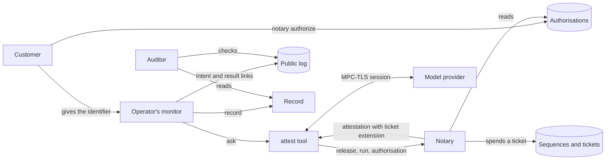
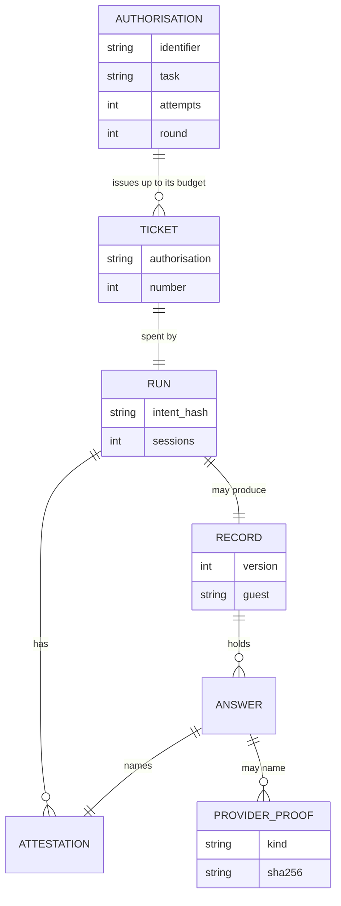
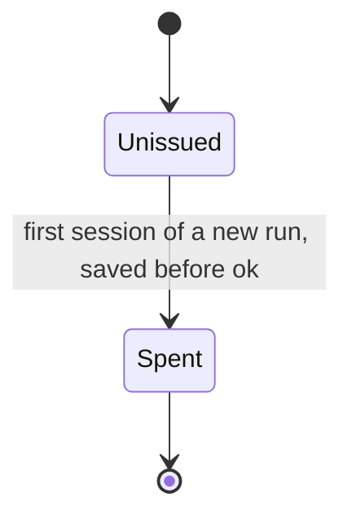
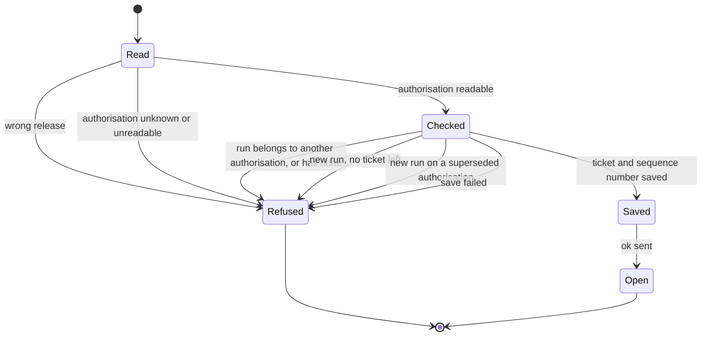
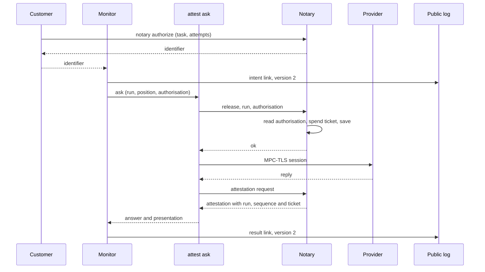
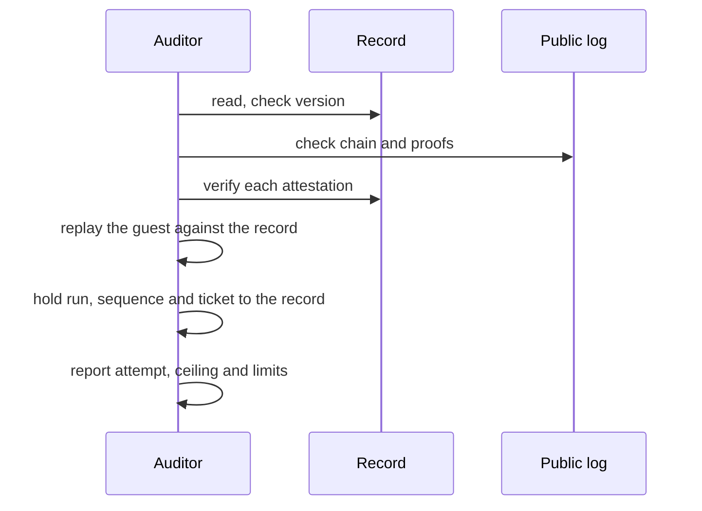

# Design

## 1. Architecture

The work adds one idea to the notary: **an attempt is a numbered ticket the customer's notary hands out, and the notary signs that number and its ceiling into every attestation.** It also gives the record an enforced version, a framed task identity and a slot for a provider proof.

| Component | Responsibility in this pack |
|---|---|
| `notary authorize` | The customer's command. Keeps one authorisation per file |
| Notary, serving | Reads the named authorisation, spends a ticket for a new run, signs the ticket extension |
| `attest ask` | Names the authorisation when it opens a session, and maps a refusal to one word |
| `attest verify` | Reports the ticket extension it verified |
| Monitor | Writes version 2 records and links, passes the authorisation to the tool, and maps refusals to reasons |
| `task` command | Prints a task's version 2 identity for the customer |
| Audit | Enforces the version, replays the guest, holds the ticket to the record, and reports the attempt, the ceiling and the limits |

## 2. Contracts

### Record and identity

| Name | Inputs | Outputs | Errors | Invariants |
|---|---|---|---|---|
| Record version | The transcript's `version` | 1 or 2 | Any other value is refused and named | New runs write 2. Replay rebuilds the version it was given |
| Link version | The `v` of every link in the chain | 1 or 2 | Any other value; a result whose `v` differs from its intent's; a run's links differing from its record's version | Both links of a version 2 run say 2 |
| Version 2 intent link | Adds `operator`, the SHA-256 of the operator public key's DER bytes in lowercase hex. Its `task` is the version 2 identity | The run hash now depends on the key | A value that is not the audited key's | ADR-010 |
| Task identity, version 1 | Guest hash, inputs | Today's `task_of` | none | Used only for version 1 records |
| Task identity, version 2 | Guest hash, inputs | 64 lowercase hex characters of the SHA-256 over the domain tag `hyalos.task/2`, the guest hash as 32 raw bytes, the input count, then each input's length and bytes, with counts and lengths as 8 big-endian bytes | none | Injective over input lists. Never equals the version 1 form for the same task |
| Transcript `task` | Required in version 2, absent in version 1 | The version 2 identity | Missing, or not the value recomputed from the record | A version 1 record relabelled as 2 cannot replay (ADR-011) |
| `task-kernel task <guest> <inputs>` | A guest file and an inputs file | One line: the version 2 identity | A missing or unreadable file | Reads no key and uses no network |
| Provider-proof entry | Optional list `provider_proofs` on a version 2 answer | Each entry has `kind` and `sha256` | Empty `kind`, a `kind` over 64 bytes or outside lowercase letters, digits, `.`, `-`, `/`; a `sha256` not 64 lowercase hex; any unknown field; any entry on a version 1 record | Left out of the bytes when empty. Replay carries it unchanged, copied from the recorded answer. `sha256` covers the proof bytes as the provider supplied them. No known kinds exist |

### Authorisation

| Name | Inputs | Outputs | Errors | Invariants |
|---|---|---|---|---|
| `notary authorize --dir <d> --task <hash> --attempts <n> [--again]` | Notary directory, task identity, 1 to 100 | Prints the identifier: 32 bytes from the operating system's random source, as 64 lowercase hex characters | No `signing.key` in the directory; a sequences file that is not version 2; malformed task; attempts out of range; task already authorised without `--again`; any unreadable authorisation | Takes `<dir>/authorisations.lock`, not the serving lock. Round is one more than the task's highest, or 0. Prior total is the sum of earlier budgets |
| Authorisation file | `<dir>/authorisations/<identifier>`, mode 600, directory 700 | Lines: `hyalos.authorisation/1`, `task <hash>`, `attempts <n>`, `round <r>`, `prior 
`, `end` | Anything else is unreadable and refuses a session | Written whole with `keep_private`, never over an existing file, never edited. Only names of exactly 64 lowercase hex characters are authorisations, so a leftover temporary file is ignored. `authorize` creates the directory, mode 700, and takes the identifier's 32 bytes from `getrandom`, refusing on a short read. It refuses if the round or prior total would not fit in 4 bytes. A file whose attempts are outside 1 to 100 is unreadable. Because files are written whole, a test plants a truncated file by hand to prove S-03.5.e2 |
| `notary tickets --dir <d>` | Notary directory | One line per authorisation: identifier, task, round, budget, prior total, spent | Any unreadable authorisation or state prints no partial total | Reads no key and takes no lock |

### Link and refusals

| Name | Inputs | Outputs | Errors | Invariants |
|---|---|---|---|---|
| The operator's first message | `<release> <run> <authorisation>` | One word: `ok`, `release`, `sequence`, `authorisation` or `spent` | A line over the limit, or with a malformed run, drops the link. With a valid run, a missing or malformed authorisation answers `authorisation` | The line limit becomes `RELEASE.len() + 130`. The release is compared first, before the line's other fields are required, so an older tool's two-field line hears `release`. The `attest` crate's version is bumped so the release changes |
| `HYALOS_NOTARY_AUTHORISATION` | The identifier | Passed to the tool as a notary setting | A missing value refuses the run, as for the other settings | Joins `NOTARY_SETTINGS` |
| `Word` | Adds `authorisation`, `spent` | Printed by `ask` | Unknown words map to `ModelUnavailable` | Closed set |
| `Reason` | Adds `NoAuthorisation`, `AttemptsSpent` | Written in the result link's outcome | none | Never free text |

### Ticket spending

| Name | Inputs | Outputs | Errors | Invariants |
|---|---|---|---|---|
| Spend | Run, authorisation | Sequence number, ticket, and the authorisation's fields | `authorisation` (unknown, another run's, or not the task's newest round for a new run), `spent`, or `sequence` when the save fails | One save holds the ticket and sequence number. A new run's ticket is the number of runs already on that authorisation. Saved before `ok`. Checks run in this order and the first failure answers: the run's own authorisation, the newest round, then the budget. A failed save restores the run's whole entry |
| Sequences file, version 2 | `hyalos.sequences/2`, then `<run> <count> <authorisation> <ticket>` per run, with `- -` for a run from before this pack, then `end <n>` | The loaded state | Refuse to start on anything else, on a duplicate run, or when an authorisation's tickets are not exactly 0 to k | A version 1 file is rewritten as version 2 before serving. A version 1 file while any authorisation exists refuses to start (ADR-009) |

### Ticket extension

| Name | Inputs | Outputs | Errors | Invariants |
|---|---|---|---|---|
| `hyalos.ticket/1` | 64 hex authorisation and 64 hex task, each as ASCII text, then 4-byte budget, round, prior total and ticket, big-endian | 144 bytes, under the notary's one signature | A second extension of this name, another length, bad hex | Sits beside `hyalos.run-sequence/1`, which is unchanged |
| `verify`'s report | A presentation | Adds a `ticket` object with `authorisation`, `task`, `budget`, `round`, `prior` and `ticket` when the extension is present | Two extensions or a malformed one fail verification | An absent extension is `null`, so version 1 presentations still verify |

### Audit

| Check, for a version 2 record | Refused when |
|---|---|
| Version | The record, its intent link or its result link is not version 2, or any chain link's `v` is unknown |
| Operator | The intent's `operator` is not the SHA-256 of the audited key |
| Replay | `--guest` is missing, its hash differs, or replay on the in-process backend diverges |
| Operator key given | A version 2 audit has no `--operator-public` |
| Ticket present | Any answer's attestation has no single, well-formed ticket extension |
| Ticket agrees | Answers differ in authorisation, task, budget, round, prior total or ticket |
| Ticket is this task's | The extension's task is not the version 2 task recomputed from the record |
| Ticket in range | Budget outside 1 to 100, or ticket not below budget |

The audit replays on `Backend::Process` whatever `HYALOS_KERNEL` says, so it opens no kernel file. On 2026-11-22 at `72136c1`, all 13 committed transcripts in `spikes/task-kernel/out` that parse replayed identically on both the in-process and the KVM backend.

A version 1 audit, only with `--legacy-v1`, refuses any attestation carrying a ticket extension and opens its report with `legacy audit passed: no attempt budget`.

The report states `attempt {ticket + 1} of at most {budget} under this authorisation, {prior} authorised earlier, for this exact task on this notary`, the line `unchecked provider proofs: {n}, which prove nothing` with the total across all answers, zero included and no kind printed, both run counts marked `under this log key only`, and seven limits: the five of the notary pack, then `not proven: the operator may have asked the provider directly, away from the notary` and `not proven: the customer did not authorise this task again after this attestation`.

## 3. Domain model

## 4. State machines

### Ticket

Illegal transitions:

- Spent → Unissued: a ticket is never returned, by failure, restart or any command (ADR-004).
- Unissued → Spent for a run that already holds a ticket: a run has exactly one ticket.
- Spent → Spent for a second run: one ticket never serves two runs.

### Session open

Illegal transitions:

- Checked → Open without Saved: the operator could read a reply on an unspent ticket.
- Refused → Open: every refusal closes the link.

## 5. Flows

### One attempt

### An audit

## 6. Test strategy

| Level | Proves | How | Fixtures and test data |
|---|---|---|---|
| Unit | Task identity, parsers for each file and extension, the provider-proof entry | `cargo test` in the crate that owns the code | Inline byte strings |
| Integration, notary | Authorising, spending, restarts, refusals, old state | `cargo test --manifest-path attest/Cargo.toml`, against the built `notary` | Temporary directories, the stand-in provider |
| Integration, audit | Every audit check and forgery, against a real test notary | `cargo test`, with `Rig` and `World` | Test keys and a stand-in log |
| Replay | Version 1 records are unchanged | `task-kernel replay` on `out/live3.json` | The committed record |
| Structural | The format document holds what S-06.5 requires | `grep` in Verify | `RECORD.md` |

| Examples | Level |
|---|---|
| S-01.1 to S-01.4 | Integration, audit |
| S-01.5 | Replay |
| S-02.1, S-02.2 | Unit |
| S-02.3 | Integration, audit |
| S-03, S-04.1 to S-04.7 | Integration, notary |
| S-04.8 | Unit for the mapping, integration for the logged outcome |
| S-05 | Integration, audit |
| S-06.1 to S-06.4 | Unit for the entry, integration for the report |
| S-06.5 | Structural |

**Forged tickets in tests.** A real notary never signs a bad ticket, so the audit's shape and range checks are reached through a test-only program, `forging-notary`. It is a separate binary with `required-features = ["forge-ticket"]`, a Cargo feature that is off by default. It runs the notary's real session and signs the ticket extension bytes named by `HYALOS_FORGE_TICKET`: missing, doubled, short or out of range. The default `notary` build holds no path to it, and Slice 5's Verify proves that on the release binary. S-05.7.e5 edits a stored attestation, updates the record's hash and re-signs the chain under the forger's keys, so the check reached is that the attestation does not verify.

No test contacts the real provider or the public log.

## 7. Risks

| # | Risk or assumption | Mitigation |
|---|---|---|
| R1 | The pinned TLSNotary mishandles a second extension | Proven in the ticket slice by a real MPC-TLS session between the built `notary` and `attest` against the stand-in provider, with a stop condition. The real provider is never contacted |
| R2 | A ceiling above 1 still lets an operator choose among attempts | The report states the ceiling, so the reader can judge it, and a customer wanting one try sets 1 |
| R3 | Sharing the sequences file with tickets breaks old notary state | Version 1 loads, tested, and a cut-short file still refuses |
| R4 | Changing record bytes breaks replay of real evidence | Replay rebuilds the given version, and `out/live3.json` is in every slice's Verify |
| R5 | A provider outage uses up a budget | The customer authorises again, and the prior total shows it |
| R6 | An earlier record cannot show a later authorisation | A stated limit in every report (ADR-008) |
| R7 | A customer restores a whole notary directory and returns spent tickets | Undetectable by the notary. Stated in `RECORD.md` as the customer's responsibility (ADR-009) |

## 8. Pre-mortem

| # | Failure story | Maps to |
|---|---|---|
| P1 | An operator presented new work as version 1 and the audit passed it as if budgeted | ADR-005, S-05.7.e3, stop conditions in the slice that adds the version check and the slice that starts issuing tickets |
| P2 | A crash between saving the ticket and the sequence number let a run try again for free | One save for both (ADR-004), stop condition in the slice that spends tickets |
| P3 | The notary signed a ticket before saving it | Stop condition in the slice that spends tickets, and the Session open state machine |
| P4 | A later edit made an unknown proof count as evidence | ADR-006, S-06.2 and S-06.4 |
| P5 | Real v1 evidence stopped replaying | R4, and a stop condition in the format slice |
| P6 | A second extension failed only against the real library version | R1 |
| P7 | The audit stopped replaying and one ticket bought many tries again | ADR-007, S-05.7.e6, stop condition in the slice that adds replay to the audit |
| P8 | A notary accepted requester-supplied extensions, so an operator forged a ticket | Keep the library's default of refusing them, with a test, in the slice that adds the extension |

## Modifier: security

**Assets.** The integrity of the attempt count, the notary's signing key, the customer's authorisations, and an auditor's belief about what a record proves.

**Attacker.** An operator who holds every operator key, the provider credential and the monitor's source, and can change or replace their own programs. They cannot reach the notary's machine.

**Entry points.** The notary's link, the record and its attestations as read by the audit, and the public chain.

| Threat | Mitigation |
|---|---|
| Run a task many times and keep the best | Each new run spends a ticket, and the notary refuses past the budget |
| Open extra sessions inside one run, or reword a question | The audit replays the guest, so only the questions it asks, once each, can pass (ADR-007) |
| Get a new round, then report from an old one | Only the newest round takes new runs, each signs the budget before it, and the report states what it cannot show (ADR-008) |
| Restore old notary state to reuse tickets | Migration is one-way, and old state with authorisations refuses to start (ADR-009) |
| Vary an input to get a fresh count | The authorisation names one exact task, and the audit holds the signed task to the record |
| Use a second operator log key | The notary counts per authorisation, and a run hash names its key (ADR-010) |
| Read a reply, leave, and try again | The ticket is spent before `ok`, and is never refunded |
| Reuse a ticket for another run | A ticket is bound to its first run, durably |
| Move an attestation between runs | The existing run and sequence checks, and the ticket must agree across answers |
| Edit the budget or ticket | It sits under the notary's signature |
| Present work as version 1 | Refused unless the auditor names `--legacy-v1`, ticketed attestations are refused even then, and a legacy pass reads differently (ADR-011) |
| Claim a provider proof | An unknown kind is counted as not checked, and its label is never printed |
| Ask the provider away from the notary | Cannot be stopped. It is a stated limit |

Refusals are closed words. No task data, credential or key reaches a log line or a message.

**Adversarial read, 2026-11-22.** A fresh reviewer attacked the draft design and found 3 blocking, 5 major and 4 minor issues. The author checked them against the code. All are closed above or by ADR-007 to ADR-011, except one proposed fix that was not taken: refusing custom sections in a guest (F4). The shipped guest has three, and any harmless code change would have the same effect, so the report instead says the identity is this exact task.

## Modifier: data

**Schema changes**, as expand and contract:

1. **Expand.** Readers accept record versions 1 and 2, link versions 1 and 2, and sequences files 1 and 2.
2. **Write.** New runs write version 2. The notary rewrites a version 1 sequences file as version 2 at start, before serving.
3. **Contract.** None. Version 1 stays readable, because real evidence depends on it.

**Backfill.** None. Committed records are never rewritten, because their commitments cover their exact bytes (ADR-005). Runs in an old sequences file are kept with no ticket and can take no further sessions.

**Deploy order.** The customer upgrades the notary and starts it once, which migrates its state, then authorises the task. The operator then upgrades `attest` and the monitor. A mismatched pair gets no session: an older tool hears `release`, and a newer tool's longer line makes an older notary drop the link.

**Rollback.** Older notary code refuses a version 2 sequences file and will not start. The sequences file is never restored in place, because that would return spent tickets (ADR-009). To roll back, the customer moves to a new notary directory and key, which retires every authorisation.

## Modifier: public-api

**Consumers.** Auditors running the audit, customers running `notary authorize` and `task`, and operators' tools speaking the link.

**Versioning.** The record, the links, the sequences file, the authorisation file and the ticket extension each carry their own version. A change to any one's bytes bumps it. The link is versioned by the release string.

**Deprecation.** Version 1 records have no removal date. They stay readable by name.

**Compatibility tests.** `out/live3.json` replays byte-identically, a version 1 record audits with `--legacy-v1`, and a `hyalos.sequences/1` file with no authorisation migrates.

**The format document.** `spikes/task-kernel/RECORD.md` defines both record versions, the link, the authorisation and sequences files, the ticket extension, the provider-proof slot, and the dated assumption that no provider signs its responses, with what would reopen it.
