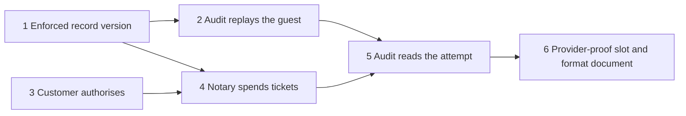

# Plan

## Dependency graph



Slices 1 and 3 are independent and may run in parallel. Slice 4 needs both, because it must refuse a ticketed attestation under `--legacy-v1` from the moment tickets exist. Slice 5 merges after Slices 2 and 4.

## Traceability

| Criterion | Slices |
|---|---|
| S-01.1, S-01.2, S-01.3, S-01.4, S-01.5, S-01.8, S-01.9, S-02.1, S-02.2, S-02.3, S-05.9, S-05.10 | 1 |
| S-01.7 | 1, 5 |
| S-05.8 | 2 |
| S-05.7 | 2, 5 |
| S-03.1, S-03.2, S-03.3, S-03.4, S-03.6, S-03.7, S-04.10 | 3 |
| S-04.7 | 3, 4 |
| S-01.6, S-03.5, S-04.1, S-04.2, S-04.3, S-04.4, S-04.5, S-04.6, S-04.8, S-04.9 | 4 |
| S-05.1, S-05.2, S-05.3, S-05.4, S-05.5, S-05.6 | 5 |
| S-06.1, S-06.2, S-06.3, S-06.4, S-06.5 | 6 |

Example rows (S-NN.k.eN) follow their criterion's slices. Where a criterion is split, its slice's Acceptance names which rows it proves.

## Shared contract

Every contract is in `design.md` §2, and slices refer to its tables.

**Test names.** The notary pack's tests already use names such as `s_01_1_e1`. This pack's tests are named `record_s_NN_k_eN_<what>`, for example `record_s_04_3_e1_a_spent_budget_is_refused`, so each example row has exactly one findable test. Every Verify below checks that the slice's rows have one. A local criterion's test is named `record_N_k_<what>`, for example `record_4_1_both_extensions_are_read`, and its slice's dry run names it.

**Run every Verify from `spikes/task-kernel`.**

---

## Slice 1 — A record has one enforced version and an unambiguous task

Issue: #413 · Depends on: none · Stories: S-01, S-02, S-05 · Map: Define the record, Audit

### Outcome

New runs write version 2 records and links with a framed task identity and the operator's key fingerprint. The audit refuses unknown versions and reads version 1 only with `--legacy-v1`, under a distinct first line.

### Acceptance

- **S-01.1**
- **S-01.2**
- **S-01.3**
- **S-01.4**
- **S-01.5**
- **S-01.7** (legacy side): row S-01.7.e1.
- **S-01.8**
- **S-01.9**
- **S-02.1**
- **S-02.2**
- **S-02.3**
- **S-05.9**
- **S-05.10**
- **1.1** Given a version 2 record at this slice, when it passes the audit, then its first line is `interim audit passed: attempt budget not yet checked`, which does not begin with `audit passed`, and it states no attempt or ceiling. Slice 5 replaces that line with `audit passed`.

### Contracts

`design.md` §2, **Record and identity**, except the provider-proof entry (Slice 6), and the Version and Operator rows of **Audit**.

### Stop conditions

- Stop if a contract this slice depends on has drifted from `context.md` (preflight).
- Stop if `out/live3.json` no longer replays identically, or if making it do so would need a committed record or ledger file changed.
- Stop if any path lets a version 1 record pass the audit without `--legacy-v1`.
- Stop if the committed chain's links would need rewriting.

### Verify

```bash
cargo build --release --manifest-path attest/Cargo.toml
cargo build --release
cargo test
target/release/task-kernel replay guest/digest.wasm out/live3.json
comm -23 <(grep -oE '^\| S-(01\.(1|2|3|4|5|7|8|9)|02\.[1-3]|05\.(9|10))\.e[0-9]+' ../../docs/plans/hyalos-kernel-record/prd.md | grep -v 'S-01\.7\.e2' | sed 's/^| S-/record_s_/; s/\./_/g' | sort -u) <(grep -rhoE 'fn record_s_[0-9]+_[0-9]+_e[0-9]+' kernel/src attest/src attest/tests | sed 's/^fn //' | sort -u)
git status --short ledger out
```

Expected: the build ends with `Finished`. `cargo test` ends with `test result: ok` and no test failed. Replay prints `replay identical`. `comm` and `git status` print nothing.

Dry run for **1.1**: a test named `record_1_1_a_version_2_pass_says_the_budget_is_not_checked` reads that first line, and that the report has no attempt or ceiling.

### Pattern to follow

- Strict reading and refusal by name: `spikes/task-kernel/kernel/src/main.rs:714`
- Each refusal named by the check that failed: `spikes/task-kernel/kernel/src/ledger.rs:371`
- Test rig for chains: `spikes/task-kernel/kernel/src/audit_tests.rs:12`

### Suggested path

Default route. You may deviate if every mandatory item still holds; record why.

1. Add the version 2 task identity beside `task_of`, and the `task` command.
2. Add the optional `task` field to `Transcript`, left out of version 1 bytes.
3. Pass the record version through `execute`, so replay rebuilds the version it was given.
4. Write version 2 links, with `operator` in the intent, from `declared_run`.
5. Add `--legacy-v1`, the version checks in `audit_record` and `Auditor::audit`, and the legacy first line.
6. Mark both run-count lines `under this log key only`.

### Files

- Modify: `spikes/task-kernel/kernel/src/main.rs`
- Modify: `spikes/task-kernel/kernel/src/ledger.rs`
- Modify: `spikes/task-kernel/kernel/src/audit_tests.rs`
- Modify: `spikes/task-kernel/kernel/src/forgery_tests.rs`
- Modify: `spikes/task-kernel/kernel/src/live_tests.rs`

---

## Slice 2 — The audit replays the guest

Issue: #414 · Depends on: Slice 1 · Stories: S-05 · Map: Audit

### Outcome

A version 2 audit requires the guest, checks its hash and replays the record before it reports, so extra sessions in a run and reworded questions fail.

### Acceptance

- **S-05.8**
- **S-05.7** (replay side): rows S-05.7.e6 and S-05.7.e7.
- **2.1** Given a version 1 record and `--legacy-v1`, when it is audited, then no guest is required.

### Contracts

`design.md` §2, the Replay and Operator key given rows of **Audit**, and the backend paragraph beneath them. `audit` gains `--guest <file>`.

### Stop conditions

- Stop if a contract this slice depends on has drifted from `context.md` (preflight).
- Stop if any version 2 path reaches the report without replay having passed (pre-mortem P7).
- Stop if replay on the in-process backend does not give the bytes the KVM backend recorded for a real record.
- Stop if the audit would need to open a kernel file or a private key.

### Verify

```bash
cargo build --release --manifest-path attest/Cargo.toml
cargo build --release
cargo test
target/release/task-kernel replay guest/digest.wasm out/live3.json
comm -23 <(grep -oE '^\| S-05\.(8\.e[0-9]+|7\.e[67])' ../../docs/plans/hyalos-kernel-record/prd.md | sed 's/^| S-/record_s_/; s/\./_/g' | sort -u) <(grep -rhoE 'fn record_s_[0-9]+_[0-9]+_e[0-9]+' kernel/src attest/src attest/tests | sed 's/^fn //' | sort -u)
```

Expected: the build ends with `Finished`. `cargo test` ends with `test result: ok`. Replay prints `replay identical`. `comm` prints nothing.

Dry run for **2.1**: audit a version 1 fixture with `--legacy-v1` and no `--guest`. Its first line is `legacy audit passed: no attempt budget`.

### Pattern to follow

- Replay: `spikes/task-kernel/kernel/src/main.rs:361`
- An audit given a program by path, resolved once: `spikes/task-kernel/kernel/src/main.rs:687`
- A forger against a real test notary: `spikes/task-kernel/kernel/src/forgery_tests.rs:24`

### Suggested path

Default route. You may deviate if every mandatory item still holds; record why.

1. Add `--guest` to `audit_inputs`.
2. In `audit_record`, for a version 2 record, read the guest and call `replay` on `Backend::Process` before the report.
3. Add the forgeries that open extra sessions and reword a question.

### Files

- Modify: `spikes/task-kernel/kernel/src/main.rs`
- Modify: `spikes/task-kernel/kernel/src/forgery_tests.rs`
- Modify: `spikes/task-kernel/kernel/src/audit_tests.rs`

---

## Slice 3 — The customer authorises a task

Issue: #415 · Depends on: none · Stories: S-03, S-04 · Map: Authorise

### Outcome

The customer can authorise an exact task for a number of attempts and see what has been spent, on a notary whose state has moved to version 2.

### Acceptance

- **S-03.1**
- **S-03.2**
- **S-03.3**
- **S-03.4**
- **S-03.6**
- **S-03.7**
- **S-04.10**
- **S-04.7** (migration side): rows S-04.7.e1 and S-04.7.e3.
- **3.1** Given two `notary authorize` commands for one task at once, when both finish, then their rounds differ.

### Contracts

`design.md` §2, **Authorisation**, and the Sequences file row of **Ticket spending**. This slice writes version 2 state with `- -` for every existing run. No run holds a ticket until Slice 4.

### Stop conditions

- Stop if a contract this slice depends on has drifted from `context.md` (preflight).
- Stop if any path could lower a run's sequence number during migration.
- Stop if `notary authorize` or `notary tickets` would need to read `signing.key`'s contents. They check only that it exists.
- Stop if a notary could start on a version 1 file while an authorisation exists.

### Verify

```bash
cargo build --release --manifest-path attest/Cargo.toml
cargo test --manifest-path attest/Cargo.toml
comm -23 <(grep -oE '^\| S-(03\.[12346]|03\.7|04\.10|04\.7)\.e[0-9]+' ../../docs/plans/hyalos-kernel-record/prd.md | grep -v 'S-04\.7\.e2' | sed 's/^| S-/record_s_/; s/\./_/g' | sort -u) <(grep -rhoE 'fn record_s_[0-9]+_[0-9]+_e[0-9]+' attest/src attest/tests | sed 's/^fn //' | sort -u)
```

Expected: the build ends with `Finished`. `cargo test` ends with `test result: ok`. `comm` prints nothing.

Dry run for **3.1**: a test starts both commands together and reads two different rounds from their files.

### Pattern to follow

- Durable save: `spikes/task-kernel/attest/src/bin/notary.rs:111`
- A strict state file: `spikes/task-kernel/attest/src/bin/notary.rs:83`
- Private files: `spikes/task-kernel/attest/src/lib.rs:261`
- A second notary subcommand: `spikes/task-kernel/attest/src/bin/notary.rs:640`

### Suggested path

Default route. You may deviate if every mandatory item still holds; record why.

1. Extend `Sequences` to load both file versions and write version 2, migrating before the listener binds.
2. Add the authorisation file's strict reader and writer.
3. Add `notary authorize` under its own lock file.
4. Add `notary tickets`.

### Files

- Modify: `spikes/task-kernel/attest/src/bin/notary.rs`
- Modify: `spikes/task-kernel/attest/src/lib.rs`
- Create: `spikes/task-kernel/attest/tests/authorise.rs`

---

## Slice 4 — The notary spends one ticket per run and signs it

Issue: #416 · Depends on: Slice 1, Slice 3 · Stories: S-01, S-03, S-04 · Map: Authorise, Run, Audit

### Outcome

Every attested session names an authorisation. A new run spends a ticket before any reply, past the budget it is refused, and each attestation carries the signed ticket extension.

### Acceptance

- **S-01.6**
- **S-03.5**
- **S-04.1**
- **S-04.2**
- **S-04.3**
- **S-04.4**
- **S-04.5**
- **S-04.6**
- **S-04.7** (session side): row S-04.7.e2.
- **S-04.8**
- **S-04.9**
- **4.1** Given a real MPC-TLS session between the built `notary` and `attest` against the stand-in provider, when its presentation is verified, then both the run-sequence and the ticket extension are read from it.
- **4.2** Given an attestation request carrying an extension of the operator's own, when the notary builds the attestation, then it is refused.

### Contracts

`design.md` §2, **Link and refusals**, **Ticket spending** and **Ticket extension**. The `attest` crate's version is bumped to `0.1.0`, so the release changes.

### Stop conditions

- Stop if a contract this slice depends on has drifted from `context.md` (preflight).
- Stop if the pinned TLSNotary cannot carry both extensions in that session (R1, pre-mortem P6). A merged extension needs a new ADR.
- Stop if the ticket and the sequence number cannot be saved in one write (pre-mortem P2).
- Stop if any path answers `ok` or signs before the ticket is durably saved (pre-mortem P3).
- Stop if the notary's request-extension validator would need loosening (pre-mortem P8).
- Stop if a legacy audit can pass an attestation carrying a ticket (pre-mortem P1).

### Verify

```bash
cargo build --release --manifest-path attest/Cargo.toml
cargo build --release
cargo test --manifest-path attest/Cargo.toml
cargo test
comm -23 <(grep -oE '^\| S-(01\.6|03\.5|04\.[1234569]|04\.7|04\.8)\.e[0-9]+' ../../docs/plans/hyalos-kernel-record/prd.md | grep -Ev 'S-04\.7\.e[13]' | sed 's/^| S-/record_s_/; s/\./_/g' | sort -u) <(grep -rhoE 'fn record_s_[0-9]+_[0-9]+_e[0-9]+' kernel/src attest/src attest/tests | sed 's/^fn //' | sort -u)
```

Expected: each build ends with `Finished`. Both test runs end with `test result: ok`. `comm` prints nothing.

Dry run for **4.1** and **4.2**: tests named `record_4_1_both_extensions_are_read` and `record_4_2_a_requester_extension_is_refused` pass.

### Pattern to follow

- Spend before answering: `spikes/task-kernel/attest/src/bin/notary.rs:304`
- Adding an extension: `spikes/task-kernel/attest/src/bin/notary.rs:414`
- Reading an extension strictly: `spikes/task-kernel/attest/src/lib.rs:205`
- A closed word mapped to a reason: `spikes/task-kernel/kernel/src/live.rs:77`

### Suggested path

Default route. You may deviate if every mandatory item still holds; record why.

1. Add the extension's writer and strict reader to `attest`'s library.
2. Change `link::open` and the notary's first-line limit.
3. Spend under the sequences lock: check the authorisation, the newest round and the budget, then save.
4. Sign the extension and report it from `verify`.
5. Pass `HYALOS_NOTARY_AUTHORISATION` through the monitor, and map the two new words to reasons.
6. Refuse a ticket extension in a version 1 audit, reading `verify`'s `ticket` object.
7. Update the existing test rigs to authorise a task first.

### Files

- Modify: `spikes/task-kernel/attest/Cargo.toml`
- Modify: `spikes/task-kernel/attest/src/lib.rs`
- Modify: `spikes/task-kernel/attest/src/main.rs`
- Modify: `spikes/task-kernel/attest/src/bin/notary.rs`
- Modify: `spikes/task-kernel/attest/tests/common/mod.rs`
- Modify: `spikes/task-kernel/attest/tests/authorise.rs`
- Modify: `spikes/task-kernel/kernel/src/live.rs`
- Modify: `spikes/task-kernel/kernel/src/main.rs`
- Modify: `spikes/task-kernel/kernel/src/live_tests.rs`
- Modify: `spikes/task-kernel/kernel/src/forgery_tests.rs`

---

## Slice 5 — The audit reads the attempt from the attestation

Issue: #417 · Depends on: Slice 2, Slice 4 · Stories: S-01, S-05 · Map: Audit

### Outcome

A version 2 audit holds each answer's signed ticket to the record, and reports the attempt, the ceiling, the budget authorised earlier and all seven limits. Each forgery in the threat model is refused by its own check.

### Acceptance

- **S-01.7** (version 2 side): row S-01.7.e2.
- **S-05.1**
- **S-05.2**
- **S-05.3**
- **S-05.4**
- **S-05.5**
- **S-05.6**
- **S-05.7** (ticket side): rows S-05.7.e1 to S-05.7.e5, and S-05.7.e8.
- **5.1** Given the default release build of `notary`, when its bytes are searched, then `HYALOS_FORGE_TICKET` does not appear.

### Contracts

`design.md` §2, the Ticket rows of **Audit** and the report wording beneath them. A passing version 2 audit's first line becomes `audit passed`. The unchecked-proof line arrives in Slice 6. `design.md` §6, **Forged tickets in tests**, defines the test-only signer.

### Stop conditions

- Stop if a contract this slice depends on has drifted from `context.md` (preflight).
- Stop if any version 2 record can pass with a missing, duplicated or malformed ticket extension.
- Stop if the default `notary` build can reach the forging path, or if the forging path would need a runtime switch in it.
- Stop if a forgery in the threat model passes and no named check can refuse it. That is a design gap, not a test to adjust.

### Verify

```bash
cargo build --release --manifest-path attest/Cargo.toml
grep -c HYALOS_FORGE_TICKET attest/target/release/notary
cargo build --release --manifest-path attest/Cargo.toml --features forge-ticket --bin forging-notary
cargo build --release
cargo test --manifest-path attest/Cargo.toml
cargo test
target/release/task-kernel replay guest/digest.wasm out/live3.json
comm -23 <(grep -oE '^\| S-(01\.7|05\.[1-6]|05\.7)\.e[0-9]+' ../../docs/plans/hyalos-kernel-record/prd.md | grep -Ev 'S-01\.7\.e1|S-05\.7\.e[67]' | sed 's/^| S-/record_s_/; s/\./_/g' | sort -u) <(grep -rhoE 'fn record_s_[0-9]+_[0-9]+_e[0-9]+' kernel/src attest/src attest/tests | sed 's/^fn //' | sort -u)
```

Expected: each build ends with `Finished`. The first `grep -c` prints `0`, which proves **5.1**. Both test runs end with `test result: ok`. Replay prints `replay identical`. `comm` prints nothing.

### Pattern to follow

- One answer against its attestation: `spikes/task-kernel/kernel/src/main.rs:535`
- What a report proves, then what it does not: `spikes/task-kernel/kernel/src/main.rs:726`
- Forgeries with every operator key: `spikes/task-kernel/kernel/src/forgery_tests.rs:24`

### Suggested path

Default route. You may deviate if every mandatory item still holds; record why.

1. Add the `forge-ticket` feature and the `forging-notary` binary. It includes `notary.rs`'s source, so the session is not moved, and the hook that replaces the ticket bytes is compiled only under the feature. Tests set `HYALOS_FORGE_TICKET` on that child only, never in the monitor.
2. Read the `ticket` object from `verify`'s report in `witnessed`, which the `attested` command also calls. Presence, range and agreement run there. The task binding runs only in `audit_record`, against `claim_of`'s task.
3. Add the ticket checks to `check_answer`, and agreement across answers.
4. Extend `audit_report`, and change the first line to `audit passed`.
5. Add each remaining forgery.

### Files

- Modify: `spikes/task-kernel/attest/Cargo.toml`
- Modify: `spikes/task-kernel/attest/src/bin/notary.rs`
- Create: `spikes/task-kernel/attest/src/bin/forging-notary.rs`
- Modify: `spikes/task-kernel/kernel/src/main.rs`
- Modify: `spikes/task-kernel/kernel/src/forgery_tests.rs`
- Modify: `spikes/task-kernel/kernel/src/audit_tests.rs`

---

## Slice 6 — A slot for a provider proof, and the format written down

Issue: #418 · Depends on: Slice 5 · Stories: S-06 · Map: Define the record, Audit

### Outcome

A version 2 answer can name a provider proof that never counts as evidence, and `RECORD.md` defines the whole format with the dated assumption that no provider signs its responses.

### Acceptance

- **S-06.1**
- **S-06.2**
- **S-06.3**
- **S-06.4**
- **S-06.5**
- **6.1** `RECORD.md` states that restoring a whole notary directory can return spent tickets and is the customer's responsibility (ADR-009).

### Contracts

`design.md` §2, the Provider-proof entry row. `design.md`, **Modifier: public-api**, for what `RECORD.md` holds.

### Stop conditions

- Stop if a contract this slice depends on has drifted from `context.md` (preflight).
- Stop if any code path lets a proof entry change the verdict or remove the model-name limit (pre-mortem P4).
- Stop if a proof's `kind` would reach the report's text.
- Stop if adding the field changes the bytes of a record with no proof.

### Verify

```bash
cargo build --release --manifest-path attest/Cargo.toml
cargo build --release
cargo test
target/release/task-kernel replay guest/digest.wasm out/live3.json
comm -23 <(grep -oE '^\| S-06\.[1-4]\.e[0-9]+' ../../docs/plans/hyalos-kernel-record/prd.md | sed 's/^| S-/record_s_/; s/\./_/g' | sort -u) <(grep -rhoE 'fn record_s_[0-9]+_[0-9]+_e[0-9]+' kernel/src | sed 's/^fn //' | sort -u)
grep -c '2026-11-22' RECORD.md
grep -c 'FlashProve' RECORD.md
grep -ci 'verifiable proof through its API' RECORD.md
grep -ci 'restor' RECORD.md
```

Expected: the build ends with `Finished`. `cargo test` ends with `test result: ok`. Replay prints `replay identical`. `comm` prints nothing. Each `grep -c` prints 1 or more, which proves S-06.5.e1, S-06.5.e2 and **6.1**.

### Pattern to follow

- An optional field left out when empty: `spikes/task-kernel/kernel/src/main.rs:74`
- A guest-interface document: `spikes/task-kernel/ABI.md`

### Suggested path

Default route. You may deviate if every mandatory item still holds; record why.

1. Add the entry type and strict validation, in one parse used by the audit, `replay` and `attested`.
2. Add `provider_proofs` to `Answer`, left out when empty, copied from the recorded answer in the replay branch, and refused in `audit_record` on a version 1 record.
3. Count unchecked proofs in the report, without their kinds.
4. Write `RECORD.md`.

### Files

- Modify: `spikes/task-kernel/kernel/src/main.rs`
- Modify: `spikes/task-kernel/kernel/src/audit_tests.rs`
- Create: `spikes/task-kernel/RECORD.md`
