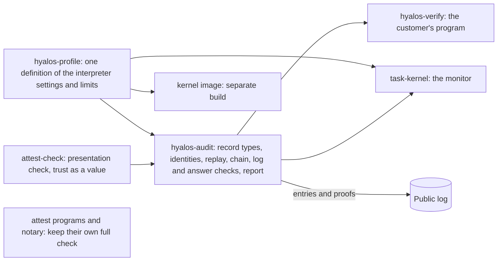
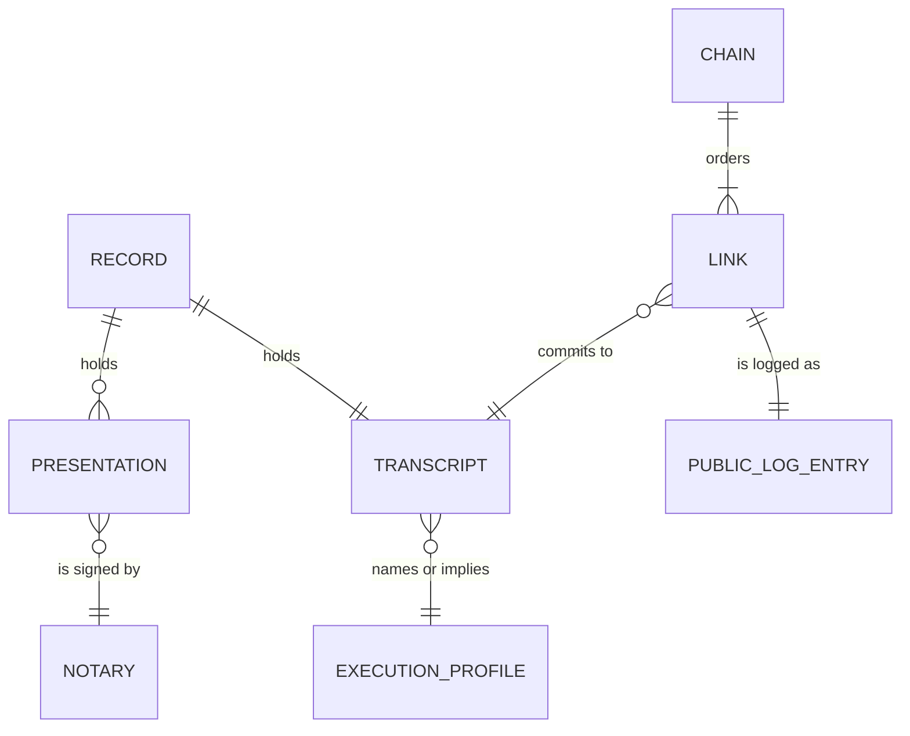
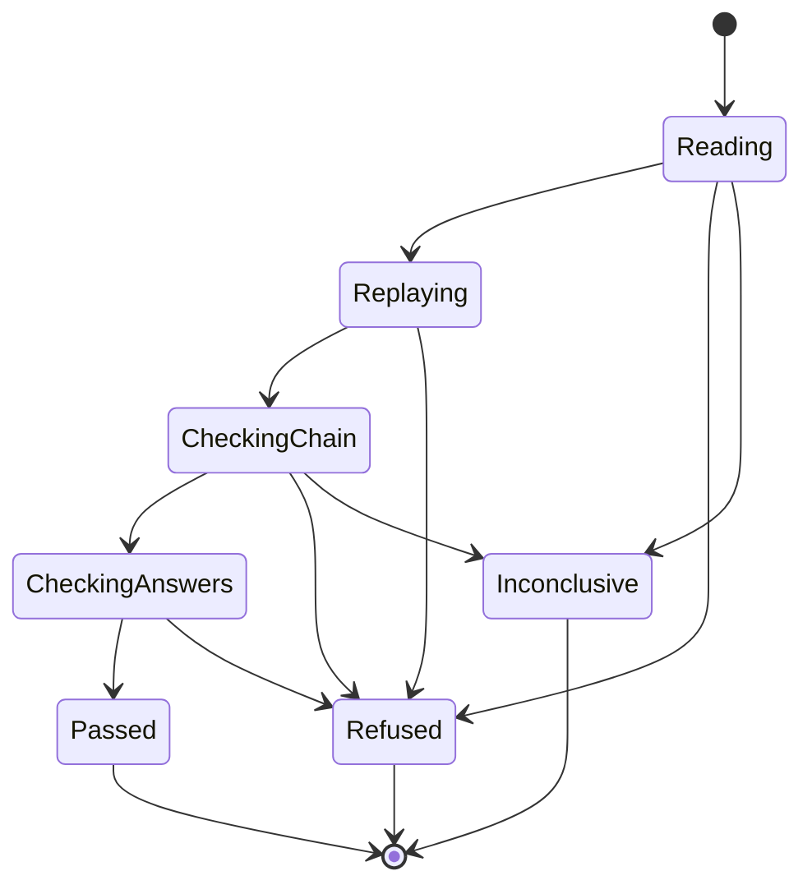
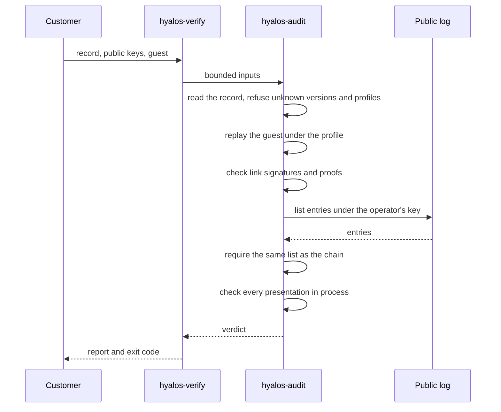

# Design

## 1. Architecture

`hyalos-os/` is one Cargo workspace for the host programs, with the kernel image and guest as separate builds beside it (ADR-001). The audit moves out of the monitor into a library, and the customer's program is a thin caller of that library (ADR-003).

| Component | Directory | Holds | Must not hold |
|---|---|---|---|
| `hyalos-profile` | `hyalos-os/profile` | Profile names and contents. `no_std`, so the kernel image can use it | Any I/O |
| `attest-check` | `hyalos-os/attest-check` | The presentation check and the shapes it reads, depending only on `tlsn-attestation` and `tlsn-core` | The `tlsn` crate, environment reads, keys, networking |
| `hyalos-audit` | `hyalos-os/audit` | Everything in the audit | KVM, the live model call, the notary service, link signing |
| `hyalos-verify` | `hyalos-os/verify` | Argument parsing, bounded file reading, the exit code | Any check of its own |
| `task-kernel` | `hyalos-os/monitor` | Running tasks, and an `audit` command that calls the library | A second copy of a check |
| `attest` | `hyalos-os/attest` | The notary and client programs, and `attest verify`, kept with its full-`tlsn` check as the independent judge for S-04.2 | Any call from the audit after Slice 5 |
| Kernel image | `hyalos-os/kernel-image` | The bare-metal program | Host dependencies |
| Guest | `hyalos-os/guest` | The example task | Host dependencies |

Each spike directory moves as follows. Evidence means every tracked file in the four evidence directories.

| From `spikes/task-kernel/` | To `hyalos-os/` |
|---|---|
| `kernel/` | `monitor/` |
| `hyalos/` | `kernel-image/` |
| `attest/` | `attest/` |
| `guest/` | `guest/` |
| `out/`, `ledger/`, `ledger-forged-test/`, `fixtures/` | `evidence/out/`, `evidence/ledger/`, `evidence/ledger-forged-test/`, `evidence/fixtures/` |
| `RECORD.md`, `ABI.md` | `RECORD.md`, `ABI.md` |

## 2. Contracts

### `hyalos-verify` command

| Form | Inputs | Output | Exit |
|---|---|---|---|
| Check | `hyalos-verify <record-file> <links-dir> --operator-public <file> --notary-public <file> [--guest <file>] [--legacy-v1]` | The report on standard output | 0 pass, 1 refused, 2 inconclusive |
| Check, Slices 3 and 4 only | The form above plus a required `--verify <program>`, as the audit has today. Slice 5 removes it, and it is then an unknown option (S-04.4) | The report | As above |
| Version | `hyalos-verify --version` | `hyalos-verify <version>`, `commit <40-hex or unknown>`, `records 1-4`, `profiles hyalos.profile/1`, one per line | 0 |

| Rule | Behaviour |
|---|---|
| Inputs | `<record-file>` is the transcript, with `<record-file>.salt` and `<record-file>.attest/` beside it. `<links-dir>` holds the operator's whole chain, `NNNNN.json` from 00000, and has no default. `--guest` is required for every record but version 1, so it is checked after the record's version is read: a version 2 or later record without it exits 2, and a version 1 record needs none. `--legacy-v1` is an optional flag, and a version 1 record without it is a record refusal, exit 1. `--notary-public` is one compressed secp256k1 key in lowercase hex, as the audit reads it today |
| Unknown option, or a missing required argument | Exit 2, `inconclusive: <what>` on standard error |
| Refusal | Exit 1, `refused: <the first check that failed>` on standard error, and no report |
| Inconclusive | Exit 2, `inconclusive: <what could not be checked>` on standard error, and no report |
| Pass | Exit 0, with the report unchanged from the audit's wording |
| Secrets and task data | Never printed in an error |

**What is inconclusive:** a file named on the command line (the record, a key or the guest) cannot be read, the public log cannot be reached, gives an unreadable or over-limit reply, or lists more entries than the limit, or the 30-second limit on a request is hit. None of these shows a forgery. **What is refused:** every failed check on readable evidence, including a local input file over its size limit, and any gap in the evidence the operator supplies: a missing `<record-file>.salt`, a missing presentation for an answer, or a link missing from the chain. An existing salt that cannot be read is inconclusive.

### Size limits

The verifier checks a file's size before reading it. The largest committed evidence is a 21,661-byte record, and every presentation is smaller than that.

| Input | Limit |
|---|---|
| Transcript | 16 MiB |
| One presentation | 1 MiB |
| One link file | 64 KiB |
| Guest | 16 MiB |
| Key file | 4 KiB |
| Salt | 4 KiB |
| Number of presentations | One per answer in the record |
| One public log reply | 1 MiB, from Slice 5 |
| Entries listed under one key | 10,000 |

### `hyalos-audit`

| Name | Inputs | Outputs | Errors | Invariants |
|---|---|---|---|---|
| Audit a record | Record file, links directory, operator key, trusted notary key, guest (except version 1), legacy flag, a log source, provider trust | A verdict: passed with its report, refused with a reason, or inconclusive with a reason | None outside the verdict | Everything is checked before a report exists. Only a completed check gives `passed` |
| Log source | Public, always with the pinned URL and key. Stand-in only with the `test-trust` feature | Entries and proofs | Unreachable or unreadable is inconclusive | Redirects are not followed. A reply over 1 MiB is inconclusive. Slice 5 adds both |
| Replay host | The record's answers and effects, through a host-call trait in `hyalos-audit` | The guest's calls answered from the record | A divergence is a refusal | The monitor implements the same trait for live runs, outside the library |
| Provider trust | The default real settings, or a stand-in with `test-trust` | Passed by value | None | Never read from the environment by this library without `test-trust` |

### `hyalos-profile`

| Name | Contents | Invariants |
|---|---|---|
| `hyalos.profile/1` | `wasmi` `=2.0.2`, fuel metering on, floats off, start function refused, custom sections ignored, memory64, multi-memory, tail call, wide arithmetic and custom page sizes off, fuel 200,000,000, memory 4 MiB, one memory, one table, 4,096 table elements, one instance, trap on failed growth | Contents never change. A change is a new name |
| Lookup by name | A name gives a profile or nothing | An unknown name is a refusal, worded `unknown profile <name>`. A version 4 record with none is refused as `version 4 record names no profile` |
| Shape | Plain `no_std` values and the name, with no `wasmi` dependency | Each backend has one function mapping these values to its `wasmi` configuration |

### Record version 4

| Field | Rule |
|---|---|
| `version` | `4` |
| `profile` | Required, and must be a known profile |
| Every other field | As version 3, including one signed canary per answer |
| Link `v` | `4` |
| Task identity | SHA-256 of the tag `hyalos.task/4`, the profile name's byte length (8 bytes, big-endian), the profile name, the guest's 32 raw hash bytes, the input count (8 bytes, big-endian), then each input's length (8 bytes, big-endian) and bytes |

### Release assets

| Asset | Contents |
|---|---|
| `hyalos-verify-x86_64-linux` | The static binary |
| `SHA256SUMS` | The binary's SHA-256 |
| GitHub attestation | Build provenance for the binary, for this repository and workflow |

| Release rule | Requirement |
|---|---|
| Tag | Equals `verifier-v` plus the `version` in `hyalos-os/verify/Cargo.toml`, and is an ancestor of `origin/main` |
| Manual mode | `workflow_dispatch`, with no inputs. Evidence, build and provenance run, and no release is ever created. Only the operator starts it |
| Commit in `--version` | The build script passes the host's `git rev-parse HEAD` as `HYALOS_BUILD_COMMIT` to `build.rs`. Without it the value is `unknown`. The release workflow fails on `unknown`, and the documented rebuild uses a git clone of the tag |
| Builder | The digest in `.github/scripts/build-release-binary.sh`, with the `musl-tools` package version pinned |

## 3. Domain model

## 4. State machines

### One verification

Illegal transitions:

- Refused → Passed: a failed check is final.
- Inconclusive → Passed: a check that did not finish cannot count as passing.
- Reading → Passed, Replaying → Passed, CheckingChain → Passed: no check may be skipped.
- Passed → any state: the report is written only once every check is complete.

## 5. Flows

## 6. Test strategy

| Level | Proves | How | Fixtures and test data |
|---|---|---|---|
| Unit | Profiles, identities, limits, parsing | `cargo test` in the crate | Small inline values |
| Differential | The new checks agree with `openssl` and `attest verify` | Test runs both over every stored item and altered copies | The 171 committed presentations, `ledger/`, and signatures in the evidence |
| Golden | The report is unchanged | Compares output with files captured before extraction | The committed records |
| Integration | The verifier as a program: exit codes, environment, files | Runs the built binary | Evidence, stand-in log under `test-trust`, the forgery corpus |
| Structural | Dependency and source exclusions, workflow rules | `cargo tree`, source checks, `release_gate` | The lockfile and workflows |
| End to end | A real record, alone | The clean container, with network to the public log | `hyalos-os/evidence/out/two-machines-canary/`, the only committed version 3 record. A later version 4 real run is outside this pack |

| Example rows | Level |
|---|---|
| S-01.1.e1–e2, S-01.2.e1–e2, S-01.4.e1, S-01.5.e1 | Structural |
| S-01.3.e1–e2, S-05.5.e1–e2 | Structural, on the workflow's change rules |
| S-01.4.e2 | Unit, in `crates/xtask` |
| S-01.5.e2 | Integration |
| S-02.1.e1, S-02.2.e2, S-02.3.e2, S-02.4.e1–e2 | Unit |
| S-02.1.e2, S-02.2.e1, S-02.3.e1, S-02.5.e1–e2, S-02.6.e1–e2 | Integration |
| S-03.1.e1 | Golden |
| S-03.1.e2, S-03.2.e1–e2, S-03.3.e1–e2, S-03.5.e1–e2, S-03.6.e1–e2, S-03.7.e1–e2 | Integration |
| S-03.4.e1–e2 | Structural |
| S-04.1.e1–e2, S-04.4.e1–e2 | Integration |
| S-04.2.e1–e2, S-04.3.e1–e2 | Differential |
| S-05.1.e1–e2, S-05.2.e1–e2, S-05.3.e1–e2 | Structural on the workflow in Slice 6. Real run in Slice 7, from the operator's run of the workflow's manual, non-publishing mode on `main`. No agent creates a tag |
| S-05.4.e1–e2 | Integration, in CI's two directories |
| S-05.6.e1–e2 | Integration |
| S-06.1.e1–e2, S-06.2.e1–e2, S-06.3.e1 | End to end |
| S-06.3.e2, S-06.4.e1–e2 | Structural |

Tests that need KVM or the network skip without them unless a `HYALOS_REQUIRE_*` variable is set, and CI sets it for the job that owns them. A skip is reported as a skip.

## 7. Risks

| # | Risk or assumption | Mitigation |
|---|---|---|
| R1 | Moving to one lockfile changes a resolved version | Compare before and after. Stop on `tlsn`, `wasmi` or any cryptographic crate |
| R2 | `attest/build.rs` finds the TLSNotary tag by reading a `tlsn = ` line, so moving the dependency to the workspace table breaks the release identifier | S-01.5 pins the identifier, and the move keeps the tag readable |
| R3 | Two copies of `wasmi` built with different features count fuel differently | S-02.5 compares records across backends, in the `hyalos-os` CI job on the runner's KVM |
| R4 | `p256` accepts or rejects a signature differently from `openssl` | The differential test. Any disagreement is a stop (ADR-005) |
| R5 | `tlsn-core` alone rejects or reads a presentation differently from the full `tlsn` build | The differential test over all 171 presentations |
| R6 | The static build is not reproducible because of paths or the C compiler | Remapped paths, a digest-pinned build image, and CI's double build. Failure is a stop (ADR-006) |
| R7 | Reclassifying errors marks a real forgery as inconclusive, or a transient failure as a refusal | Each audit error is mapped by a table test. Neither outcome can exit 0 |
| R8 | Rekor's index returns a partial list | The chain comparison refuses a differing list, so this fails closed |
| R9 | The public log's API changes after release | The verifier reports inconclusive, and a fix ships as a new verifier release |
| R10 | The golden reports hold anything run-specific | They are captured with a stored stand-in log, so they do not depend on time or the network |

## 8. Pre-mortem

| # | Failure story | Maps to |
|---|---|---|
| P1 | The move quietly changed a fixture, and old evidence no longer means what it did | Stop condition in the slice that moves the code (S-01.2) |
| P2 | An interpreter bump changed fuel, and customers' old records began to fail | R3, plus a stop condition in the slice that defines the profile |
| P3 | A wrapper set the stand-in variables and a forged record passed | ADR-004, S-03.7 |
| P4 | Replacing `openssl` accepted a signature it used to refuse | R4, stop condition in the slice that removes external programs |
| P5 | Customers trusted a binary the operator handed them, because the check was too hard | ADR-006's quick check, S-06.3 |
| P6 | An outage was reported as a forged record, and a customer accused an honest operator | R7, the separate exit code 2 |
| P7 | A pass was read as proving more than it does | The report's limits are kept word for word, and S-06.3.e2 |
| P8 | An agent pushed a `verifier-v*` tag | ADR-006, the repo's rules, and the ADR the release slice adds to `docs/adr/` |

## Modifier: security

**Assets:** the truth of a pass, the customer's trust in the binary, and the record's task data.

**Attacker:** the operator, who controls the record, its presentations and links, may supply a tool or a wrapper, and may try to influence the environment.

| Entry point | Threat | Mitigation |
|---|---|---|
| Transcript and links | Forged or relabelled content | Unknown fields refused, version and profile bound into the identity, full replay |
| Presentations | Forged or altered attestations | Trusted notary key, in-process check |
| Log replies | Hostile or oversized replies | Pinned URL and key, redirects off, bounded replies, proofs checked |
| `PATH` and tools | A decoy `openssl` or `attest` | No external program is run (S-04.1) |
| Environment | Stand-in trust variables | Compiled out of release builds (ADR-004) |
| Large files | Exhausting memory | Size checked before reading (S-03.6) |
| Guest | Hostile WebAssembly | The interpreter with the profile's fuel, memory and table limits, and no host call beyond replay |
| Binary | A substituted verifier | Provenance and a reproducible rebuild (ADR-006) |

The verifier forbids `unsafe` in its own crates. Its signature libraries are `p256`, `k256` and `ring` (ADR-008), and #412 must cover or exclude them. There are no `auditor` findings for this code yet.

## Modifier: data

**Expand.** Slice 2 adds version 4. Readers accept versions 1 to 4, and new runs write 4.

**Contract.** None. Versions 1 to 3 are never dropped, and committed evidence is never rewritten.

**Backfill.** None. Older records imply `hyalos.profile/1`.

**Deploy order.** The notary needs no change, because it treats the task as an opaque hash. Readers and writers ship in one change, because there is no deployed fleet.

**Rollback.** Revert the slice. A version 4 record made in the meantime cannot be read by the reverted build, which refuses it. That is safe, and the record stays valid for a later build.

## Modifier: public-api

**Consumers:** customers and third-party auditors, who depend on the command line, exit codes, report wording and record format.

**Versioning.** `hyalos-verify` uses semantic versioning. Removing an option, changing an exit code or changing a report line is a major version. Reading a new record version or profile is a minor version.

**Deprecation.** Before 1.0 a change may be made with a release note. From 1.0, an option stays for at least one major version after its deprecation is announced. Support for reading a record version is never removed.

**Compatibility tests.** The golden reports, the exit-code tests, and reading every committed record version.

## Modifier: integration

| External system | Contract used | Failure | Timeout and retries | How tests fake it |
|---|---|---|---|---|
| Rekor public log | `POST /api/v1/index/retrieve`, `GET /api/v1/log/entries/{id}`, pinned key | Inconclusive for no answer, refused for a bad proof | 30 seconds per request, as today. No retries, so a transient failure is reported and the customer reruns | The stored replies in `ledger/`, under `test-trust` |
| TLSNotary presentations | Format at tag `v0.1.0-beta.1` | Refused | None, local | The committed presentations and the forging notary |

## Modifier: infra

**Environments.** A developer's machine, CI, and GitHub Releases. There is no service to deploy.

**Flags.** The `test-trust` Cargo feature and the existing `forge-ticket` feature. `test-trust` gates all five stand-in variables (`HYALOS_TRUST_LOG_DIR`, `HYALOS_TRUST_LOG_KEY`, `HYALOS_TRUST_ROOT`, `HYALOS_TRUST_SERVER_NAME`, `HYALOS_TRUST_PROVIDER_ADDRESS`) in `hyalos-audit`, the only library on the audit path that reads them. It passes trust to `attest-check` as a value, so `attest-check` has no environment read, and no release build of `hyalos-verify` reads them. Until Slice 5 removes the child `attest verify`, a build without `test-trust` launches it with the three provider variables it reads removed from its environment. The monitor's audit goes through the same gate, by a `test-trust` feature that forwards to `hyalos-audit`. `attest`'s own programs are not on the audit path after Slice 5 and keep reading the three provider variables, because their tests run release builds against stand-ins.

**CI.** A `hyalos_os` output in the `changes` job turns on one job when `hyalos-os/`, `rust-toolchain.toml` or `ci.yml` changes. A push to `main` leaves the output unset, and the job runs unless it is `false`, as the other specialised jobs do. It builds in the required order, runs all tests and a `cargo deny` policy of its own that names the TLSNotary git source, and runs fmt and clippy on the four new crates (`hyalos-profile`, `attest-check`, `hyalos-audit`, `hyalos-verify`). The developer chose this scope on 2026-11-23: the moved monitor and `attest` code fails both today, and fixing it inside the move would hide changes to security code in a rename, so that cleanup goes to `hyalos-kernel-core`. The job feeds the required check. The main workspace's `deny.toml` does not change.

**Repository rules.** `/hyalos-os/` is added to `.github/CODEOWNERS`. `hyalos-os/` needs its own ADR under `docs/adr/`, because ADR-0017 owns the code layout. The release slice adds or extends an ADR for `verifier-v*` tags, because ADR-0111 owns tag rules, and updates `CLAUDE.md`'s tag rule to name them.

**Rollout order.** Workspace and CI, then the profile, then the library and verifier, then in-process checks, then the release workflow, then the real run and docs.

**Rollback.** Each slice reverts alone. Slice 1 is a large rename, so later slices build on it, and reverting it means reverting them first. A bad published release is marked as such and replaced by a new tag. A tag is never moved.
